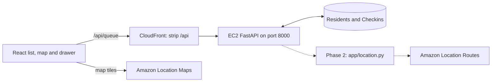

# CareLine map and Location plan

Updated Oct 24, 2026. This is the workshop plan for the existing map and planned
supplier drive times. The [original hospital-map specification](../docs/reference/amazon-location-map-spec.original.md)
is preserved for future design work; its Lambda, EventBridge, shared-layer,
five-table and hospital-priority contracts are superseded.

## Current behavior to preserve

- React + MapLibre in `web/src/map/` draws Amazon Location's Monochrome Light map
  of San Jose. The priority list is primary and remains usable if the map fails.
- Resident pins use the same `/queue` rows as the list, with level colors and
  priority numbers. List and map selections open the same resident drawer.
- Polls update data every three seconds without moving the camera. The camera
  fits the zone initially and moves for selection.
- The browser uses the existing map-only configuration from `web/.env.local`:
  VITE_AWS_REGION, VITE_LOCATION_API_KEY and VITE_MAP_STYLE. Backend traffic uses
  VITE_API_URL, default http://localhost:8000, or https://<cloudfront>/api.
- Call answers and resulting pin changes arrive after disconnect. There are no
  per-turn updates from Lex to the API. Mock animations are rehearsal behavior.

## Architecture and ownership

Routing code belongs in a normal backend module, planned `backend/app/location.py`.
It uses the server's existing AWS access, with no new IAM role, function, shared
layer or EventBridge rule. Himanshu owns hosting; dashboard work stays in
`web/src/map/`, `priority/` and `drawer/`; backend round 1 stays in `app/ranking.py` and round 2 in `app/rules.py`.
No deployed hospital-route API is claimed by this plan.

## Phase 2: supplier drive times and time to spare

Follow [RANKING.md](../docs/RANKING.md) and
[NEXT_STEPS.md tasks 10–12](../docs/NEXT_STEPS.md):

1. Add three made-up oxygen suppliers and calculate the shortest drive time from
   a supplier to each resident. Cache drive_minutes on the resident.
2. Keep coordinates in Location requests and the registry, outside Bedrock inputs.
   Verify Location request details against AWS documentation when implementing.
3. Pass the cached drive time to round 2 ranking after
   `call_results.extract_facts(transcript)` supplies Bedrock facts.
4. Compute time_to_spare = hours_left - drive_minutes / 60. Unknown drive time
   stays unknown and is labeled; do not invent a speed or a drive estimate.
5. Order by level, least time to spare (unknown counts as zero), device group,
   then ID. Supplier drive time participates in R2 per RANKING.md; it is not
   the old hospital-only tie-breaker.
6. Add facts and time-to-spare fields to the backend models and web API type
   together, then show the same values in list, map selection and drawer.

Keep Region us-east-1 and use env configuration. Changes to routing permissions,
request parameters or infrastructure belong to the implementation task, not this
document update. Preserve the current two-table storage contract.

## Deferred hospital features

Hospital CSV import, hospital pins, nearest-hospital routing and route-on-click
remain separate future work in the archived specification. Their data has not
been conformed or imported by this architecture change. Do not replace supplier
travel times with hospital travel times or change ranking to the historical
30-minute deadline buckets. Any hospital route is operator logistics, not a
medical destination recommendation to callers.

## Acceptance

- Map/list selection stays synchronized; poll updates do not reset the camera.
- A map failure leaves the priority list usable.
- Unit tests for future Location integration cover correct supplier-to-resident
  direction, response failures and missing drive time. Keep tests under
  `backend/tests/` with the existing unittest style.
- Round 2 evaluation must retain the RANKING.md example: Ruth's 70-minute supplier
  drive gives less time to spare than Maria's 15-minute drive for the same supply.
- Verify UI changes with the current EC2 API contract. No Lambda handler, shared
  layer, /outages/{id}/priority endpoint or copilot is a prerequisite for the map.
