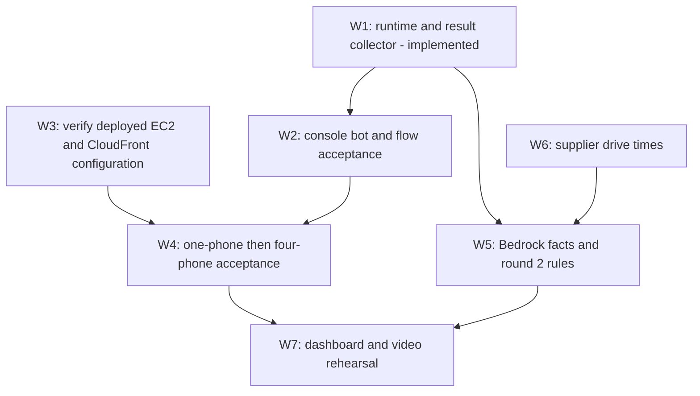

# CareCall workshop task graph

Updated Oct 24, 2026. This graph follows the current
[implementation plan](../docs/careline-plan.md) and
[next steps](../docs/NEXT_STEPS.md). The
[original task graph](../docs/reference/careline-task-graph.original.md) is
historical: its C1–C10 contracts and S/F/B/V/A/D tasks must not drive workshop work.

## Current contracts

| Concern | Contract |
| --- | --- |
| Runtime | backend/app on EC2; one uvicorn process, port 8000; requirements.txt is sufficient |
| Hosting | CloudFront dashboard and /api proxy; strip /api before the app |
| Configuration | backend/.env.example → /etc/careline/backend.env; table names from env; comma-separated ALLOWED_ORIGINS |
| Tables | Residents PK id; Checkins PK resident_id, SK at; no Outages, Calls, Tasks or Audit tables required |
| Script | backend/app/script.py: QUESTIONS, CLOSING, EMERGENCY_REPLY, NOT_HEARD and emergency phrases |
| Bot | CareCallCheckIn, en_US, published live alias; CheckIn required FreeFormInput A1–A5; Emergency intent; no code hooks |
| First reply | Selects CheckIn; repeat the safety question to elicit A1, then QUESTIONS[2..5] |
| Flow outputs | answered=yes; intent from $.Lex.IntentName; a1–a5 from $.Lex.Slots.A1..A5; fallback/error outcome=no_input |
| Call identity | residentId is passed into Connect and Lex; backend retrieves results by resident.contact_id |
| Completion | DescribeContact DisconnectTimestamp, or 300 seconds from call_started_at; retrieve GetContactAttributes |
| Scheduling | Five-second FastAPI lifespan checker and poll-triggered checking; lock against overlap |
| Saving | store.transition from CALLING with contact_id guard, then add_checkin and dial_next |
| Transcript | Ordered list of {q, question, answer} for each nonempty persisted a1–a5 |
| Phase 1 results | Emergency → HELP_NOW/R0; complete or partial → PERSON_CHECK; two misses → HELP_SOON/NA |
| Phase 2 | call_results.extract_facts(transcript) is the Bedrock hook, currently returning None; ranking stays plain Python |
| Dashboard | GET /queue?zone=A every three seconds; VITE_API_URL defaults to localhost:8000, hosted value https://<cloudfront>/api |
| Tests | unittest in backend/tests/ using the existing Connect and store fakes |

Use `backend/app/main.py` and `models.py` for exact current API payloads and
[docs/RANKING.md](../docs/RANKING.md) for ranking. Do not replace these contracts
with API-key headers, workflow events or model shapes from the historical graph.

## Dependencies

## Tasks

| ID | Work and files | Depends on | Done when / status |
| --- | --- | --- | --- |
| W1 | Script, calling, call_results, main lifespan, store guard and unittest fakes | Existing dialer | Implemented and tested offline: collector tests and four-contact DRY_RUN completion. Do not recreate removed handlers |
| W2 | Console bot and flow in connect/SETUP.md: repeated A1 prompt, remaining slots, Emergency, live alias, persistent attributes | Working Connect instance | Console matrix and actual attributes checked; pending. No invocation or recording blocks |
| W3 | EC2/CloudFront configuration owned by Himanshu; infra handoff and backend/.env.example | Recorded hosting | Verify current deployed code has lifespan checking, two table names, prefix stripping and both CORS origins; local validation is not deployment proof |
| W4 | One-phone then four-phone run, including emergencies, no input, hang-up and two misses | W1, W2, W3 | /queue and check-in history show expected results with dashboard closed; pending |
| W5 | Wire app/call_results.py:extract_facts to existing app/understand.py and app/rules.py; models.py and eval scenarios | W1; W6 for drive-aware cases | Facts validate against RANKING.md's shape; deterministic rules give expected R0–R6/NA; zero missed Help now cases in the stated eval; helpers tested offline, integration and eval harness pending |
| W6 | app/location.py and supplier data, with focused tests | Existing resident coordinates | Shortest supplier-to-resident drive_minutes stored, failure remains unknown; no new execution role or routing function; pending |
| W7 | web/src/ detail, list and map; remaining alerts/acknowledgment tracked in NEXT_STEPS.md | W4, W5 | Real transcripts, facts, reasons and time to spare shown; mocks/DRY_RUN explicitly distinguished |

W2–W4 require account console and consenting phones. Mark a task complete only
with its own evidence. Keep the five-second checker running without a dashboard;
do not infer phone success from fakes.

## Known acceptance limits

- FreeFormInput cannot fill A1 from the intent-triggering reply; the chosen design
  repeats the safety question. No intent switching occurs during slot elicitation.
- Emergency phrases in slots escalate after disconnect; immediate interruption is
  not available with this design.
- A hang-up before the attribute-copy stage may leave no saved slots. Preserve
  every attribute received, and document actual phone-test results.
- DRY_RUN creates full five-answer results without Connect but still needs
  allow_call=true. Real calls also require Parameter Store or DIALER_ALLOW_LIST.
- No per-turn backend progress, simulator function, task token callback, automatic
  EventBridge completion event or automatic transcript expiry is implemented.

## Working checks

From backend/: `python -m unittest discover -s tests -t . -v`.
From web/: `npm run build` and `npm run lint`.
For console and full DRY_RUN reproduction, follow
[connect/SETUP.md](../connect/SETUP.md). Update NEXT_STEPS.md and the relevant
contract when implementation changes; keep historical references out of execution.
