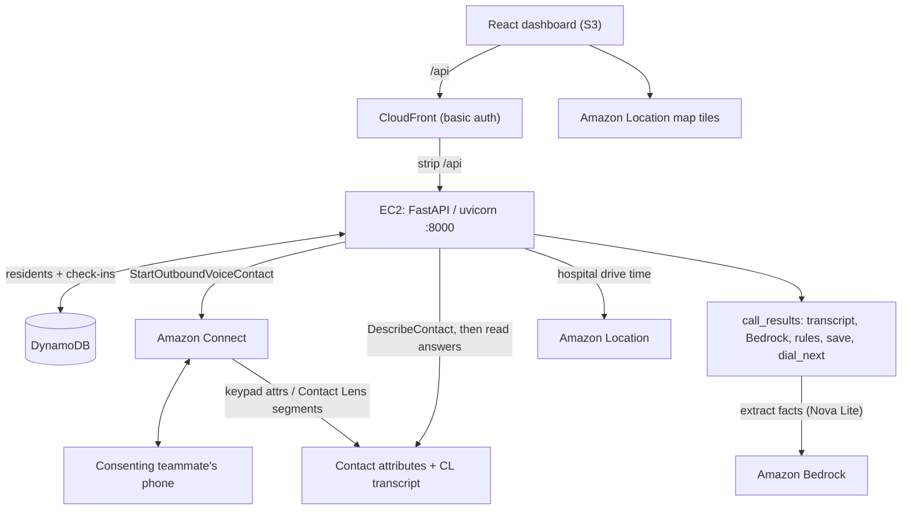

# CareLine

**When the power goes out, CareLine phones the people who can't wait.**

CareLine is an AWS voice agent that calls residents who depend on powered medical
equipment during an outage, turns what they say into facts with **Amazon Bedrock**, and
ranks them with plain written rules so a duty officer sees **who runs out first**. Four
phones ring at once; the answers land on one screen, highest risk on top, each with the
rule and the facts behind it.

Built for the **AI-Driven Automation & Critical Service Continuity** track at the
Sparthill hackathon, October 2026. English only.

---

## What it does (for judges)

1. **Jane, the duty officer, starts an outage** for a zone (one button).
2. **CareLine phones up to 4 residents at once** through Amazon Connect, highest medical
   risk first.
3. **Residents answer 5 short questions** — are you safe, is the device working, how many
   backups, how many hours left, what else do you need. Answers come in by **keypad**
   today (natural-speech via Amazon Contact Lens is built and is the next step — see
   [Call paths](#call-paths)).
4. **Amazon Bedrock (Nova Lite) extracts facts** from the answers — one Converse call with
   a forced `record_checkin` tool at temperature 0, validated against
   [`schemas/checkin.json`](schemas/checkin.json). Bedrock only extracts; it never decides
   the level.
5. **Plain Python rules (R0–R6, NA) decide the triage level.** The first rule that matches
   wins and its ID is saved.
6. **Amazon Location** gives each resident the drive time from the nearest hospital
   (`data/Hospital_clean.csv`), which feeds **time to spare** = hours left − drive time.
7. **One dashboard** shows the ranked list (least time to spare first inside each level),
   a map of residents and hospitals, and a drawer with the resident's answers, **Bedrock's
   facts**, the deciding rule, and the countdown.

The pipeline is live, not a mock: a real call → Bedrock facts → rules → DynamoDB → the
dashboard. The eval runs 24 English cases through the same extraction and rule code; the
last live run scored **24/24, 0 missed urgent**.

## Triage rules

The first matching rule wins; its ID is saved with the result (`docs/RANKING.md` is the
spec, `backend/app/rules.py` the code).

| Rule | Condition | Level |
| --- | --- | --- |
| R0 | Said it's an emergency, or said they're not safe | **Help now** |
| R1 | Device off and no backups left | **Help now** |
| R2 | Time to spare under 1 hour (hours left − hospital drive) | **Help now** |
| R3 | One backup left, or under 4 hours left | **Help soon** |
| R4 | Answers unclear (`confidence < 0.7`, or hours unknown for an oxygen/ventilator user) | **A person must check** |
| R5 | Needs supplies (medicine, food, a ride, charging, oxygen) | **Needs supplies** |
| R6 | Enough supply for now | **OK for now** (recheck scheduled) |
| NA | No answer after 2 calls | **Help soon** + welfare check |

Inside a level, the person with the **least time to spare** is first (unknown counts as 0,
so it rises to the top), then device group, then id.

## What Bedrock extracts

One forced-tool Converse call returns exactly this (see `schemas/checkin.json` and
`backend/app/understand.py`):

```json
{"safe":"yes|no|unsure","device_working":"yes|no|unsure","backup_left":"int|null",
 "hours_left":"number|null","needs":["medicine","food","transport","charging","oxygen_delivery"],
 "emergency":true,"confidence":0.0}
```

If Bedrock fails or returns an odd field, that field becomes `unsure`/`null` with low
confidence, so rule **R4** sends the resident to a person. The model never picks a level.

## Call paths

The workshop account cannot build a **Lex** bot: `CreateBot` needs `iam:PassRole` on the
Lex service-linked role, and the role policy denies it (proven on the API; see
`connect/SETUP.md`). It also cannot create **Lambda** execution roles, so the whole system
runs as one FastAPI process on EC2, not Lambdas.

Two Lex-free call paths write the same contact data that `app/call_results.py` reads:

- **Keypad (live demo path).** A DTMF contact flow (`connect/build_keypad_flow.py`) maps
  each key to readable text in contact attributes `a1..a5` (e.g. `a4 = "2 hours"`), plus
  `answered` and `intent`.
- **Natural speech via Amazon Contact Lens (built, next step).** A flow
  (`connect/build_speech_flow.py`) turns on Contact Lens real-time analytics, which records
  and transcribes the caller; `call_results.contact_lens_segments()` reads the CUSTOMER
  turns. Built and unit-tested; not yet verified end to end on a live call, so keypad is
  the path used for the demo.

Either way: **Connect → (keypad attributes | Contact Lens segments) → `app/call_results.py`
→ Bedrock extract → rules → DynamoDB → dashboard.**

## Architecture



| Service | Job |
| --- | --- |
| Amazon Connect | Real outbound calls and the fixed call script; keypad or Contact Lens answers |
| Amazon Contact Lens | Records and transcribes the caller for the natural-speech path |
| Amazon Bedrock (Nova Lite) | Converse + forced `record_checkin` tool turns answers into facts |
| Amazon Location | Geocoding + hospital-to-resident drive time (`geo-places`, `geo-routes`), map tiles |
| Amazon EC2 | The long-lived FastAPI API, dialer and background call checker (one uvicorn worker) |
| Amazon CloudFront | Dashboard hosting, basic auth, and `/api` proxy to port 8000 |
| Amazon S3 | Dashboard static files; Bedrock model-invocation logs |
| Amazon DynamoDB | Residents and check-ins (`careline-residents`, `careline-checkins`) |

**No Lex, no Lambda, no Step Functions, no Knowledge Bases, no copilot** — the workshop
account blocks the IAM roles those need. Rules, not a model, decide every level.

## Responsible AI and privacy

- **The model extracts, rules decide.** Bedrock never marks anyone safe; `app/rules.py`
  does, and the rule ID is saved with every result.
- **Unclear goes to a person.** Low confidence or missing facts for an oxygen/ventilator
  user → rule R4, a human review.
- **PII removed before Bedrock.** `app/understand.py` redacts phone numbers and emails from
  the transcript before it is sent to Bedrock or stored.
- **Consenting teammates only.** The dialer refuses any number not on the allow-list
  (`PHONES_SSM_PATH` in Parameter Store or `DIALER_ALLOW_LIST`); an empty list means no
  real calls. All resident data is synthetic.
- **The call script only asks questions**; it never gives medical advice. A Bedrock
  guardrail is configured to block medical-advice content.
- **Contact Lens records audio** on the speech path, to transcribe it. Recording is off on
  the keypad path.

## Evaluation

```bash
cd backend && BEDROCK_MODEL_ID=us.amazon.nova-lite-v1:0 .venv/bin/python ../eval/run.py
python ../eval/run.py --offline     # rules only, no AWS
```

24 English cases run through the real `extract_facts` + `rank_after_call`. Headline metric:
**missed "Help now" cases, target 0.** Last live run: 24/24 exact, 0 missed. Writes
`eval/report.json`.

---

## Run it yourself

The backend (`backend/`, FastAPI) places the calls and ranks the answers; the dashboard
(`web/`, React + Vite) shows the ranked list and map. Both run locally; the live demo is
hosted on EC2 behind CloudFront.

### Clone

```bash
git clone https://github.com/kallmekabir/AWS-Track.git
cd AWS-Track
```

You need Git, Node.js 22+, Python 3.11+ and the AWS CLI, plus a sign-in to the team's
AWS account (us-east-1) with the Connect instance from `connect/SETUP.md`.

### Setup

```bash
aws login --region us-east-1 --profile carecall   # lasts ~12 h; rerun on ExpiredToken
cd backend && ./setup.sh                            # venv, deps, backend/.env + web/.env.local from your sign-in
```

`setup.sh` picks the keypad call script (`CareCall check-in keypad`), turns on Bedrock
(`BEDROCK_MODEL_ID`) and hospital routes (`LOCATION_ENABLED=1`), and saves the map key in
`web/.env.local`. Rerun it after pulling if calls ring twice or the map is missing.

Add your phone to Parameter Store (never paste numbers into chat or files): create a
**SecureString** `/carecall/phones/<persona>` (e.g. `ruth-okafor`) with your number as
`+1XXXXXXXXXX`. Only numbers stored here are ever called. Personas: `daniel-kim`,
`ruth-okafor`, `maria-lopez`, `linh-tran`.

### Run

```bash
# Terminal 1 — backend
cd backend && source .venv/bin/activate && uvicorn app.main:app --reload --env-file .env
# Terminal 2 — dashboard
cd web && npm install && npm run dev        # http://localhost:5173
```

The map only loads at `http://localhost:5173`. If Vite picks another port, close what is
using 5173 and restart it.

### Test a call (your phone only)

1. Backend and dashboard running, dashboard open.
2. Ring only your persona (`r-001` Daniel, `r-002` Ruth, `r-003` Maria, `r-004` Linh), or
   press **Call again** on your row after the first call:
   ```bash
   curl -X POST localhost:8000/residents/r-001/call
   ```
3. Answer with the keypad. Wait for each question to finish before pressing.
   Q1 safe? 1 yes, 2 no · Q2 device working? 1 yes, 2 no, 3 not sure · Q3 full backups 0-5 ·
   Q4 hours until you run out 0-9 · Q5 need: 1 nothing, 2 ride, 3 oxygen, 4 charging,
   5 food, 6 medicine.
4. A few seconds after you hang up, your row shows a level and reason; **What they said**
   shows the answers.
