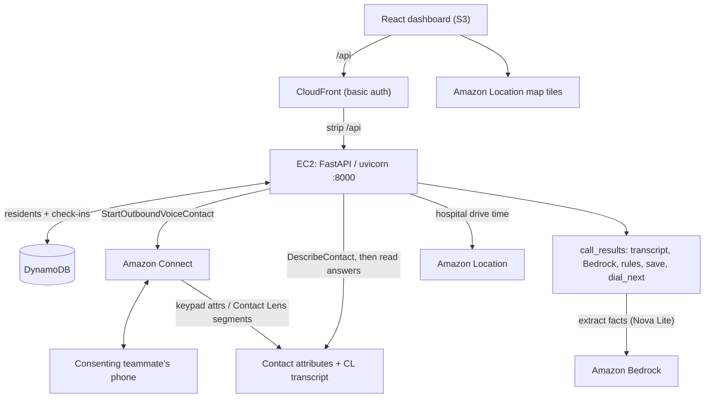

# CareLine

**When the power goes out, CareLine phones the people who can't wait.**

CareLine is an AWS voice agent that calls residents who depend on powered medical
equipment during an outage, turns what they say into facts with **Amazon Bedrock**, and
ranks them with plain written rules so a duty officer sees **who runs out first**. Four
phones ring at once; the answers land on one screen, highest risk on top, each with the
rule and the facts behind it.

Built for the **AI-Driven Automation & Critical Service Continuity** track at the
Sparthill hackathon, October 2026. English only.

---

## What it does (for judges)

1. **Jane, the duty officer, starts an outage** for a zone (one button).
2. **CareLine phones up to 4 residents at once** through Amazon Connect, highest medical
   risk first.
3. **Residents answer 5 short questions** — are you safe, is the device working, how many
   backups, how many hours left, what else do you need. Answers come in by **keypad**
   today (natural-speech via Amazon Contact Lens is built and is the next step — see
   [Call paths](#call-paths)).
4. **Amazon Bedrock (Nova Lite) extracts facts** from the answers — one Converse call with
   a forced `record_checkin` tool at temperature 0, validated against
   [`schemas/checkin.json`](schemas/checkin.json). Bedrock only extracts; it never decides
   the level.
5. **Plain Python rules (R0–R6, NA) decide the triage level.** The first rule that matches
   wins and its ID is saved.
6. **Amazon Location** gives each resident the drive time from the nearest hospital
   (`data/Hospital_clean.csv`), which feeds **time to spare** = hours left − drive time.
7. **One dashboard** shows the ranked list (least time to spare first inside each level),
   a map of residents and hospitals, and a drawer with the resident's answers, **Bedrock's
   facts**, the deciding rule, and the countdown.

The pipeline is live, not a mock: a real call → Bedrock facts → rules → DynamoDB → the
dashboard. The eval runs 24 English cases through the same extraction and rule code; the
last live run scored **24/24, 0 missed urgent**.

## Triage rules

The first matching rule wins; its ID is saved with the result (`docs/RANKING.md` is the
spec, `backend/app/rules.py` the code).

| Rule | Condition | Level |
| --- | --- | --- |
| R0 | Said it's an emergency, or said they're not safe | **Help now** |
| R1 | Device off and no backups left | **Help now** |
| R2 | Time to spare under 1 hour (hours left − hospital drive) | **Help now** |
| R3 | One backup left, or under 4 hours left | **Help soon** |
| R4 | Answers unclear (`confidence < 0.7`, or hours unknown for an oxygen/ventilator user) | **A person must check** |
| R5 | Needs supplies (medicine, food, a ride, charging, oxygen) | **Needs supplies** |
| R6 | Enough supply for now | **OK for now** (recheck scheduled) |
| NA | No answer after 2 calls | **Help soon** + welfare check |

Inside a level, the person with the **least time to spare** is first (unknown counts as 0,
so it rises to the top), then device group, then id.

## What Bedrock extracts

One forced-tool Converse call returns exactly this (see `schemas/checkin.json` and
`backend/app/understand.py`):

```json
{"safe":"yes|no|unsure","device_working":"yes|no|unsure","backup_left":"int|null",
 "hours_left":"number|null","needs":["medicine","food","transport","charging","oxygen_delivery"],
 "emergency":true,"confidence":0.0}
```

If Bedrock fails or returns an odd field, that field becomes `unsure`/`null` with low
confidence, so rule **R4** sends the resident to a person. The model never picks a level.

## Call paths

The workshop account cannot build a **Lex** bot: `CreateBot` needs `iam:PassRole` on the
Lex service-linked role, and the role policy denies it (proven on the API; see
`connect/SETUP.md`). It also cannot create **Lambda** execution roles, so the whole system
runs as one FastAPI process on EC2, not Lambdas.

Two Lex-free call paths write the same contact data that `app/call_results.py` reads:

- **Keypad (live demo path).** A DTMF contact flow (`connect/build_keypad_flow.py`) maps
  each key to readable text in contact attributes `a1..a5` (e.g. `a4 = "2 hours"`), plus
  `answered` and `intent`.
- **Natural speech via Amazon Contact Lens (built, next step).** A flow
  (`connect/build_speech_flow.py`) turns on Contact Lens real-time analytics, which records
  and transcribes the caller; `call_results.contact_lens_segments()` reads the CUSTOMER
  turns. Built and unit-tested; not yet verified end to end on a live call, so keypad is
  the path used for the demo.

Either way: **Connect → (keypad attributes | Contact Lens segments) → `app/call_results.py`
→ Bedrock extract → rules → DynamoDB → dashboard.**

## Architecture



| Service | Job |
| --- | --- |
| Amazon Connect | Real outbound calls and the fixed call script; keypad or Contact Lens answers |
| Amazon Contact Lens | Records and transcribes the caller for the natural-speech path |
| Amazon Bedrock (Nova Lite) | Converse + forced `record_checkin` tool turns answers into facts |
| Amazon Location | Geocoding + hospital-to-resident drive time (`geo-places`, `geo-routes`), map tiles |
| Amazon EC2 | The long-lived FastAPI API, dialer and background call checker (one uvicorn worker) |
| Amazon CloudFront | Dashboard hosting, basic auth, and `/api` proxy to port 8000 |
| Amazon S3 | Dashboard static files; Bedrock model-invocation logs |
| Amazon DynamoDB | Residents and check-ins (`careline-residents`, `careline-checkins`) |

**No Lex, no Lambda, no Step Functions, no Knowledge Bases, no copilot** — the workshop
account blocks the IAM roles those need. Rules, not a model, decide every level.

## Responsible AI and privacy

- **The model extracts, rules decide.** Bedrock never marks anyone safe; `app/rules.py`
  does, and the rule ID is saved with every result.
- **Unclear goes to a person.** Low confidence or missing facts for an oxygen/ventilator
  user → rule R4, a human review.
- **PII removed before Bedrock.** `app/understand.py` redacts phone numbers and emails from
  the transcript before it is sent to Bedrock or stored.
- **Consenting teammates only.** The dialer refuses any number not on the allow-list
  (`PHONES_SSM_PATH` in Parameter Store or `DIALER_ALLOW_LIST`); an empty list means no
  real calls. All resident data is synthetic.
- **The call script only asks questions**; it never gives medical advice. A Bedrock
  guardrail is configured to block medical-advice content.
- **Contact Lens records audio** on the speech path, to transcribe it. Recording is off on
  the keypad path.

## Evaluation

```bash
cd backend && BEDROCK_MODEL_ID=us.amazon.nova-lite-v1:0 .venv/bin/python ../eval/run.py
python ../eval/run.py --offline     # rules only, no AWS
```

24 English cases run through the real `extract_facts` + `rank_after_call`. Headline metric:
**missed "Help now" cases, target 0.** Last live run: 24/24 exact, 0 missed. Writes
`eval/report.json`.

---

## Run it yourself

The backend (`backend/`, FastAPI) places the calls and ranks the answers; the dashboard
(`web/`, React + Vite) shows the ranked list and map. Both run locally; the live demo is
hosted on EC2 behind CloudFront.

### Setup

```bash
aws login --region us-east-1 --profile carecall   # lasts ~12 h; rerun on ExpiredToken
cd backend && ./setup.sh                            # venv, deps, backend/.env from your sign-in
```

Add your phone to Parameter Store (never paste numbers into chat or files): create a
**SecureString** `/carecall/phones/<persona>` (e.g. `ruth-okafor`) with your number as
`+1XXXXXXXXXX`. Only numbers stored here are ever called. Personas: `daniel-kim`,
`ruth-okafor`, `maria-lopez`, `linh-tran`.

### Run

```bash
# Terminal 1 — backend
cd backend && source .venv/bin/activate && uvicorn app.main:app --reload --env-file .env
# Terminal 2 — dashboard
cd web && npm install && npm run dev        # http://localhost:5173
```

### Seed residents

```bash
python -m app.seed --demo        # 8-person teammate roster (matches docs/RANKING.md); phones can ring
python -m app.seed               # synthetic CSV residents (data/Residents_simple.csv); nobody callable
# flags: --dry-run (validate only), --with-location (compute hospital drives; needs LOCATION_ENABLED=1)
```

### Hospital drive times (Amazon Location)

Set `LOCATION_ENABLED=1` and restart. `data/Hospital_clean.csv` holds the hospitals;
`calculate_route_matrix` finds each resident's shortest hospital drive. `POST
/locations/refresh?zone=A` backfills an existing registry. With Location off, the `--demo`
roster still has fixed demo drive times so the worked example is reproducible. Location
calls are billable; see [pricing](https://aws.amazon.com/location/pricing/).

### Offline check (no AWS)

```bash
cd backend && python -m unittest discover -s tests -t .
```

### Hosting

One uvicorn worker on EC2 reads `/etc/careline/backend.env` (keys from
`backend/.env.example`). CloudFront serves `https://<cloudfront>/api/...`, strips `/api`,
and forwards to port 8000. Build the dashboard with
`VITE_API_URL=https://<cloudfront>/api`. Never commit `.env` or `web/.env.local`.

### If something goes wrong

| You see | Fix |
| --- | --- |
| "Can't reach the CareCall API" | Backend (terminal 1) isn't running |
| `ExpiredToken` | `aws login --region us-east-1 --profile carecall`, restart the backend |
| `403 … not in Parameter Store` | That persona has no stored number, or the backend started before it was added |
| `503 Calling is not set up` | A Connect value is missing in `backend/.env`; rerun `./setup.sh` |

## Repository layout

```
backend/app/        FastAPI API, dialer, store, Bedrock extraction (understand.py),
                    rules.py, ranking.py, location.py, script.py, call_results.py
backend/tests/      unittest tests with fake Connect / Bedrock / Contact Lens clients
connect/            build_keypad_flow.py, build_speech_flow.py, SETUP.md
eval/               run.py, cases.yaml, report.json (24 English cases)
web/                React + Vite dashboard: priority list, map, resident drawer
data/               Hospital_clean.csv, Residents_simple.csv
schemas/checkin.json  The exact JSON Bedrock must return
docs/RANKING.md     Ranking spec (code must match it)
docs/NEXT_STEPS.md  What's proven and what's left
docs/reference/     Historical broader designs; not the current build
lambdas/, kb/       Historical placeholders; no runtime (the build uses no Lambda or KB)
```

## Team

| Role | Name |
| --- | --- |
| Voice + Connect flows | _TODO: fill in_ |
| Orchestration + Bedrock + rules | _TODO: fill in_ |
| Dashboard | _TODO: fill in_ |
| Data, evaluation, location | _TODO: fill in_ |

Questions from judges: reach us through the event's channel _(TODO: handle)_.

## Teardown

After judging: release the phone number, delete the Connect instance (and its flows and
the Bedrock guardrail), stop the EC2 service, remove the CloudFront distribution and S3
buckets, and delete the DynamoDB tables. `scripts/teardown.sh` does the infra-owned part
(it leaves the Connect instance to a human). See `docs/infra/HANDOFF.md`.
