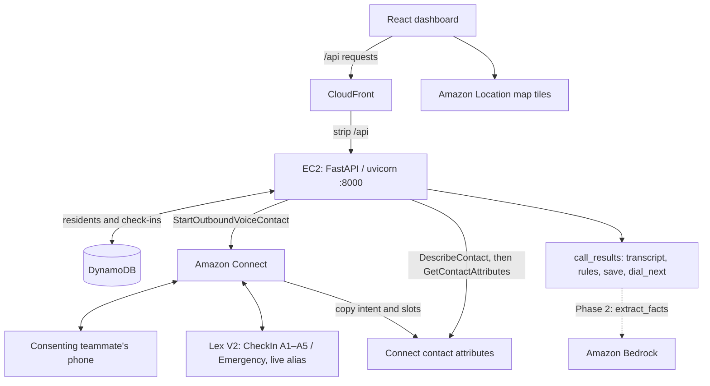

# CareLine

**When the power goes out, CareLine calls the people who can't wait.**

CareLine is an AI voice agent on AWS that phones every resident who depends on powered
medical equipment during an outage, in their language. It works out who needs help
before their backup battery runs out, and gives the duty officer a live, auditable plan
of action. Amazon Bedrock is at its core.

Built for the **AI-Driven Automation & Critical Service Continuity** track (AWS) at the
Sparthill hackathon, October 2026.

> **Status:** in active development during the hackathon. Sections marked *planned*
> describe the design in [`docs/careline-plan.md`](docs/careline-plan.md) and will be
> filled in as the build lands. **What works today:** the backend phones teammates
> through Amazon Connect when you click **Start outage**. See
> [Run the backend](#run-the-backend-works-today).

---

## Run the backend (works today)

The backend (`backend/`, Python) places the phone calls; the dashboard (`web/`) has the
**Start outage** button. Both run locally, and Himanshu hosts the long-lived backend
on EC2 behind CloudFront.

**Why no Lambda:** the workshop account blocks IAM role creation. The only passable
role, `WSParticipantRole`, trusts no AWS service. Connect and Lex still work through
service-linked roles. Do not deploy `docs/reference/template.lambda.yaml`; it is an
archived production reference, with historical handlers and packaging.

### One-time setup

**1. Sign in to AWS** (the hackathon account, region us-east-1):

```bash
aws login --region us-east-1 --profile carecall
```

This lasts 12 hours. Run it again whenever you see `ExpiredToken`.

**2. Run the setup script:**

```bash
cd backend
./setup.sh
```

It installs the Python packages, creates `backend/.env` (git-ignored), and fills in the
Amazon Connect IDs by looking them up with *your* AWS sign-in, so no IDs are stored in
this public repo. At the end it says `Settings OK` and lists which personas already have
a phone number.

<details>
<summary>Doing it by hand instead</summary>

```bash
cd backend
python3 -m venv .venv
source .venv/bin/activate
pip install -r requirements.txt
cp .env.example .env
```

Then fill in `CONNECT_INSTANCE_ID`, `CONNECT_CONTACT_FLOW_ID` and `CONNECT_SOURCE_NUMBER`
in `backend/.env`. Ask in the team chat, or find them in the Amazon Connect console.
</details>

**3. Add your phone number to AWS Parameter Store.** Never paste phone numbers into chat,
files, Slack or an AI assistant. In the AWS console (region **N. Virginia**), search
**Parameter Store** → **Create parameter**:

| Field | Value |
| --- | --- |
| Name | `/carecall/phones/` + the persona you play (below) |
| Tier | Standard |
| Type | **SecureString** (keep the default key `alias/aws/ssm`) |
| Value | your number as `+1XXXXXXXXXX` (no spaces or dashes) |

Each teammate plays one made-up resident, so no real names are stored anywhere:

| Persona | Parameter name |
| --- | --- |
| Daniel Kim | `/carecall/phones/daniel-kim` |
| Ruth Okafor | `/carecall/phones/ruth-okafor` |
| Maria Lopez | `/carecall/phones/maria-lopez` |
| Linh Tran | `/carecall/phones/linh-tran` |

Only numbers stored here are ever called.

### Every time

**Terminal 1, the backend:**

```bash
cd backend
source .venv/bin/activate
uvicorn app.main:app --reload --env-file .env
```

Wait for `Application startup complete`. Check http://localhost:8000/health: it should
show `"calls_dry_run":false`. Keep this terminal open.

**Terminal 2, the dashboard:**

```bash
cd web
npm install        # first time only
npm run dev
```

Open http://localhost:5173 and click **Start outage**. Every teammate with a number in
Parameter Store gets a call, all at the same time.

**Useful commands** (in a third terminal):

```bash
curl -X POST localhost:8000/residents/r-001/call       # call just Daniel Kim's phone
curl -X POST "localhost:8000/demo/reset?zone=A"        # everyone back to "Not called yet"
```

Stop with `Ctrl+C` in each terminal. After anyone adds or changes a number in Parameter
Store, restart terminal 1.

### Seed residents

From `backend/`, with the virtual environment active. The seed has two data sources:
pick one.

| Command | Writes | Phones ring? | Use it for |
| --- | --- | --- | --- |
| `python -m app.seed --demo` | The 8-person teammate roster in `app/seed.py` (matches the worked example in `docs/RANKING.md`) | Yes: Daniel, Ruth, Maria and Linh get their teammate's number from Parameter Store with `allow_call=true` | **The calling demo** |
| `python -m app.seed` | The 10 synthetic residents in `data/Residents_simple.csv` (or `RESIDENTS_CSV`) | No: every row has `allow_call=false` and a made-up number | Showing a realistic registry on the map and list |
| `python -m app.seed --csv <file>` | Your own CSV | Only rows with `allow_call=true` whose number is in Parameter Store or `DIALER_ALLOW_LIST` | Loading another roster |

Add either flag to any command above:

- `--dry-run` validates and counts residents, then stops. Nothing is written and no
  Location requests are made.
- `--with-location` calculates hospital drive times before writing (needs
  `LOCATION_ENABLED=1`). Without it, seeded residents have no drive time until you run
  `POST /locations/refresh`.

For the live demo, run:

```bash
python -m app.seed --demo --with-location
```

The CSV path never reads Parameter Store, so it cannot make anyone callable. Both
sources use IDs starting at `r-001`: seeding `--demo` after the CSV overwrites
`r-001`–`r-008` and leaves CSV rows `r-009` and `r-010` in the table.

The default CSV contains 10 synthetic residents with calls disabled. Set
`RESIDENTS_CSV` in `backend/.env` to choose another default file. All rows are
validated before any writes. The header uses the `ResidentIn` fields plus `id`;
required columns are `id,name,phone,address,lat,lng,device`. IDs must have the form
`r-001`. Blank device groups are inferred, and blank backup counts/hours stay unknown.

Set both `RESIDENTS_TABLE` and `CHECKINS_TABLE` in `backend/.env` to use the existing
DynamoDB store: Residents has partition key `id` (String), and Checkins has partition
key `resident_id` (String) and sort key `at` (String). Without `RESIDENTS_TABLE`, the
seed command writes only to process memory, which disappears when it exits. The API
continues to load its demo roster in memory mode.

Re-running the seed replaces records with matching IDs, including their live outage
state; it leaves other residents and check-in history in place. Writes are individual
operations, so a database failure can leave a partially seeded table. Use this command
to initialize demo data before an outage.

### Hospital locations and drive times

The six hospitals in `data/Hospital_clean.csv` are the starting points for delivery
drive estimates. The dataset supplies names, addresses and coordinates; it does not
confirm oxygen availability. Include `data/` alongside `backend/` on EC2, or set
`HOSPITALS_CSV` to an absolute path there. The dashboard reads `GET /hospitals` to
show hospital pins and name/address popups. Mock mode uses the same checked-in CSV.

Set `LOCATION_ENABLED=1` in the backend environment and restart the API to enable
Amazon Location calculations. The default is `0`, preserving the offline demo.
Use the existing backend AWS access with `geo-places:Geocode` and
`geo-routes:CalculateRouteMatrix` and `geo-routes:CalculateRoutes` permissions; the browser map configuration stays
the same. These are the current `geo-places` and `geo-routes` APIs, so no place index
or route calculator resource is needed. Install the current runtime requirements
if the local boto3 installation does not recognize those service names.

Backfill the existing registry from `/docs` using **POST /locations/refresh**, or:

```bash
curl -X POST 'http://localhost:8000/locations/refresh?zone=A'
curl 'http://localhost:8000/queue?zone=A'
# Explicitly update the cached traffic snapshot:
curl -X POST 'http://localhost:8000/locations/refresh?zone=A&force=true'
```

Each resident gets `drive_minutes`, `nearest_hospital_id` and
`location_updated_at`. The response lists residents with no reachable hospital in
`unavailable`; their drive stays unknown. `conflicts` lists residents whose address
changed while calculating; retry the refresh for them. Successful results are
cached by address, coordinates, region and hospital dataset. Polling the dashboard
never calls the routing API. `DepartNow=true` calculates a traffic snapshot; it is
not a continuously updated arrival estimate. Refresh before a new outage or when
traffic changes materially.

Selecting a resident in the list or on the map calls
`GET /residents/{id}/hospital-route`. The backend uses the existing nearest-hospital
selection (calculating it on demand if missing), then requests a resident-to-hospital
driving route from Amazon Location with traffic and simple line geometry. The map
draws the road route and shows the hospital, drive time, distance and calculation
time. Successful routes are cached in API process memory for 15 minutes; address,
coordinate, hospital dataset or selected hospital changes invalidate the cache.
These trips do not overwrite the hospital-to-resident delivery estimates used for
ranking. Queue polling does not fetch routes. Mock mode reports that routes require
the live backend.

`POST /residents` accepts an address without `lat` and `lng`; the backend geocodes
it and saves the resulting position. Supplied coordinate pairs bypass geocoding.
With Location enabled, new residents and address/coordinate edits calculate drive
times automatically. Send both coordinates when changing a position; changing
only an address geocodes it again. If Location is disabled, supplied coordinates
still work and changed locations lose their old cached drive. An address requiring
geocoding returns 503 until Location is enabled. AWS failures return 502 without
saving a partially updated resident.

To calculate CSV residents' drives before seeding, run from `backend/`:

```bash
python -m app.seed --with-location
```

`--dry-run` validates only and never makes Location requests, including when
combined with `--with-location`. Seeding still replaces matching residents' outage
state, so use refresh for an existing live registry. Location requests are billable;
stored geocodes use `IntendedUse=Storage`, which has a higher rate than single-use
results. See AWS's [Geocode documentation](https://docs.aws.amazon.com/boto3/latest/reference/services/geo-places/client/geocode.html),
[route matrix documentation](https://docs.aws.amazon.com/boto3/latest/reference/services/geo-routes/client/calculate_route_matrix.html)
and [pricing](https://aws.amazon.com/location/pricing/).

### If something goes wrong

| You see | Fix |
| --- | --- |
| Dashboard: "Can't reach the CareCall API" | Terminal 1 isn't running. Start it |
| `ExpiredToken` or a credentials error | Run `aws login --region us-east-1 --profile carecall`, then restart terminal 1 |
| `403 … not in Parameter Store` | That persona has no number yet, or terminal 1 started before it was added. Add it, restart terminal 1 |
| `503 Calling is not set up` | A Connect value is missing in `backend/.env`. Run `./setup.sh` again |
| `./setup.sh` says "STOP: …" | Do what the message says (usually `aws login`), then run it again |
| `uvicorn: command not found` | Run `source .venv/bin/activate` first |
| You get a second call after hanging up | If no answers were saved, the backend retries once after everyone else's first call. Check the Lex slot-to-contact-attribute copies in SETUP.md |

### Answers and hosting

`app/script.py` holds the five fixed questions. Lex `CareCallCheckIn` (en_US,
**live** alias) collects A1–A5, and the Connect flow copies intent and slots into
contact attributes. After disconnect, `app/call_results.py` reads them using
GetContactAttributes and saves a transcript and status. Emergency intent or an
emergency phrase in any answer → **HELP_NOW / R0**; complete or partial answers →
**PERSON_CHECK**; no answers → a retry, then **HELP_SOON / NA** after two misses.
Phase 2 Bedrock will replace the `extract_facts(transcript)` placeholder.

The FastAPI lifespan checker runs every five seconds even with no dashboard open.
Dashboard polls also check calls; overlapping checks are skipped and a guarded
store transition prevents duplicate results. DescribeContact's disconnect timestamp
ends the call, with a 300-second backstop measured from call start. Answers appear
after disconnect; no per-question updates arrive.

**Console acceptance remains open:** AWS FreeFormInput slots cannot fill A1 from
the intent-triggering first reply or switch to Emergency during slot elicitation.
The guide documents a repeated safety-question fallback and the tests needed;
a caller who hangs up before the flow copies slots may leave no saved answers.
See [the setup guide's Lex constraints](connect/SETUP.md#2-lex-bot-without-code-hooks).

On EC2, install `backend/requirements.txt` and load the environment from
`/etc/careline/backend.env` (same keys as `backend/.env.example`). With the service
manager loading that file, run from `backend/`:

```bash
uvicorn app.main:app --host 0.0.0.0 --port 8000
```

Use one worker. Himanshu creates **Residents** (PK `id`) and **Checkins**
(PK `resident_id`, SK `at`); set their names in `RESIDENTS_TABLE` and
`CHECKINS_TABLE`. CloudFront serves `https://<cloudfront>/api/...` and strips
`/api` before forwarding to port 8000. Set
`ALLOWED_ORIGINS=https://<cloudfront>,http://localhost:5173` and build the dashboard
with `VITE_API_URL=https://<cloudfront>/api` in `web/.env.local`. Its default is
`http://localhost:8000`; rebuild Vite when changing the URL. Disable caching for
CloudFront's API behavior and forward query strings and write methods.

### Offline check

```bash
cd backend
source .venv/bin/activate
python -m unittest discover -s tests -t . -v
CONNECT_DRY_RUN=1 RESIDENTS_TABLE= CHECKINS_TABLE= PHONES_SSM_PATH= uvicorn app.main:app --host 0.0.0.0 --port 8000
```

DRY_RUN still requires `allow_call=true`. In another terminal, opt a synthetic
resident into the rehearsal, then start an outage:

```bash
curl -X PATCH localhost:8000/residents/r-001 -H 'Content-Type: application/json' -d '{"allow_call":true}'
curl -X POST localhost:8000/outages -H 'Content-Type: application/json' -d '{"zone":"A"}'
# After about 5–10 seconds, with no intervening dashboard polls:
curl "localhost:8000/queue?zone=A"
```

The resident has **PERSON_CHECK**, `All 5 answers in. Waiting for ranking`, and
five transcript entries. No real phone rings.

More detail: [`connect/SETUP.md`](connect/SETUP.md) (full AWS setup) and
[`docs/NEXT_STEPS.md`](docs/NEXT_STEPS.md) (what's done and next).

---

## The persona: Jane Doe

Jane is the duty officer for the Santa Clara County public-health department (San Jose,
CA) during a planned utility power shutoff. She has **3 staff**, about **400 residents** on oxygen concentrators,
ventilators or home dialysis, and only hours before their backup batteries run out.
Today she works from a spreadsheet and a phone.

More than 3 million Medicare beneficiaries rely on electricity-dependent medical equipment
([HHS emPOWER](https://empowerprogram.hhs.gov/faqs.html)). In a long outage that equipment
can fail immediately, or within hours once the batteries run down. Every hour Jane's team
spends dialing is an hour in which someone's battery runs down without anyone knowing.

## What CareLine does

1. **Jane triggers an outage** for a zone, or a simulated outage event fires.
2. **CareLine calls residents** in that zone, highest medical risk first, in English or
   Spanish (Hindi if time allows), through Amazon Connect.
3. **A voice bot asks five short questions:** are you safe, is your device working,
   how many backups do you have, how many hours are left, and what else do you need.
4. **Bedrock understands the answers**, including messy or mixed-language speech, and
   turns them into validated JSON.
5. **Deterministic rules decide triage** (R0–R7), not the model. Urgent cases go to a
   human right away; unclear cases go to human review.
6. **Battery runway:** each resident's next check-in is scheduled before their battery
   runs out, and escalates as the deadline gets close.
7. **No answer twice → welfare check.** An in-person task is created automatically.
8. **Live priority map:** Jane works from a priority list, highest priority on top, next
   to an Amazon Location Service map of San Jose showing each resident by triage and
   every hospital. Clicking a patient draws the route and live-traffic drive time to
   their nearest hospital.
9. **Bedrock briefs Jane:** an operator copilot reads the live data and writes a zone
   brief and a draft dispatch plan. Tasks are only created when Jane approves.

## Amazon Bedrock's three jobs

| Job | What Bedrock does | What keeps it safe |
| --- | --- | --- |
| **Understand answers** | Converse API (Claude Haiku, temperature 0) turns each spoken reply into JSON matching [`schemas/checkin.json`](schemas/checkin.json) | Rules decide triage; low confidence goes to a human |
| **Operator copilot** | Converse API tool use (Claude Sonnet) with read-only tools over live call data writes zone briefs and dispatch drafts | Read-only tools; every priority must cite resident IDs the tools returned; Jane approves every plan |
| **Grounded resident answers** | Knowledge Bases `RetrieveAndGenerate` answers questions like "where can I charge my machine?" from verified resource sites | Bedrock Guardrails block medical advice and ungrounded answers; blocked questions go to a person |

## Workshop architecture



| Service | Workshop job |
| --- | --- |
| Amazon Connect | Real outbound calls, fixed prompts and persistent contact attributes |
| Amazon Lex V2 | Five answer slots and Emergency intent, with no code hooks |
| Amazon Polly | Joanna neural voice for fixed scripts |
| Amazon EC2 | Long-lived API, dialer and background call checker |
| Amazon CloudFront | Dashboard hosting and `/api` proxy to port 8000 |
| Amazon DynamoDB | Persistent residents and check-ins; table names from env |
| Amazon Bedrock | Phase 2 fact extraction through `app/call_results.py:extract_facts` |
| Amazon Location Service | Map tiles today; supplier drive times in Phase 2 |
| Amazon SNS | Planned emergency alert email |

The current workshop plan is [`docs/careline-plan.md`](docs/careline-plan.md).
The broader CareLine design (copilot, multilingual calls and workflows) is preserved
as [historical reference](docs/reference/careline-plan.original.md). The workshop runs no
execution functions and creates no IAM roles.

## Triage rules

The first matching rule wins, and its ID is written to the audit log.

| Rule | Condition | Triage |
| --- | --- | --- |
| R0 | Emergency intent or any distress signal | URGENT (live transfer, 911 instruction) |
| R1 | Device has no power and resident is risk tier 1 | URGENT |
| R2 | On battery with under 4 hours left, or battery unknown at tier 1 | URGENT |
| R3 | Resident says they are not safe | URGENT |
| R4 | Key field unsure or confidence < 0.7 at tier 1–2 | HUMAN_REVIEW |
| R5 | Needs medicine, transport or charging | NEEDS_HELP |
| R6 | Needs food only | NEEDS_HELP |
| R7 | None of the above | SAFE (recheck scheduled) |

## Responsible AI and privacy

- **The model extracts, rules decide.** Bedrock never marks anyone "safe" on its own.
- **No medical advice.** Residents hear fixed, reviewed scripts; the one generated-answer
  path is grounded and filtered by Guardrails.
- **Humans stay in charge.** Urgent and unclear cases go to a person; the copilot is
  read-only; overrides require a reason and are audited.
- **Minimal data.** PII is redacted before any model call; no diagnoses or medication
  names are stored; transcripts expire after 24 hours; call recording is off.
- **Consent.** Opt-in registry only; "stop" on any call opts the resident out.
- **All demo data is synthetic.** The dialer only calls numbers on an allow-list of
  consenting teammates.
- **Code orders, the model explains.** The priority list and the copilot brief share one
  sort function (`priority_key()`). Drive time only breaks ties, and it is shown as
  logistics, never as a recommendation for where to receive care. Coordinates never
  reach Bedrock, and the browser map key allows map tiles only.

## Evaluation

The eval runs 30 scenarios in each language through the same extraction and rule code the
live system uses. The headline metric is **missed urgent cases** (target: 0 in every
language). The harness also reports over-escalation, per-field accuracy, extraction
latency and wave time-to-contact.

```bash
python eval/run.py            # planned: writes eval/report.json
```

A Kiro hook re-runs the eval whenever `lambdas/triage/rules.py` or anything in `schemas/`
changes.

## Repository layout

```
.kiro/steering/        Kiro steering: product, tech, structure, plan (manual)
.kiro/specs/           Kiro specs per workstream (generated in Kiro)
.plans/                Feature specs (amazon-location-map-spec.md)
docs/careline-plan.md  Current workshop implementation plan
schemas/               JSON schemas for extraction and the eval
data/                  hospitals.csv, residents.sample.csv; private/ is gitignored (planned)
scripts/               seed.py, build_geo_data.py (planned)
infra/                 CDK stacks (planned)
lambdas/               Historical scaffold placeholders; no workshop runtime
eval/                  scenarios and harness (planned)
backend/               EC2 FastAPI API, dialer, script and Connect attribute collector
connect/SETUP.md       Connect, Lex slots, contact attributes, EC2 and acceptance steps
docs/reference/template.lambda.yaml  Historical production template; never workshop-deploy
kb/                    Knowledge Base source documents (planned)
web/                   React + Vite operator dashboard (Start outage + live list today)
```

## Future deployment automation

Use [Run the backend](#run-the-backend-works-today) for the working workshop path.
Future infrastructure automation belongs in an account that permits role creation;
the archived template is a historical reference and requires handler/packaging
updates before reuse. The original scripts and CDK design are preserved in
`docs/reference/careline-plan.original.md`; current work follows `docs/NEXT_STEPS.md`.
Never commit `.env` or `web/.env.local`.

## Building with Kiro

Steering files in `.kiro/steering/` give Kiro the project rules on every request. The
full plan is available on demand: type `#plan` (or `/plan`) in Kiro chat. Each
workstream has its own spec: `call-orchestration`, `voice-agent`, `operator-dashboard`,
`copilot` and `evaluation`.

## Team

| Role | Name |
| --- | --- |
| A — Voice + grounded answers | _TBD_ |
| B — Orchestration | _TBD_ |
| C — Dashboard + copilot | _TBD_ |
| D — Data, evaluation and video | _TBD_ |

Questions from judges: reach us through the event's communication channel at
_TBD (handle to be confirmed by organizers)_.

## Teardown

After judging: release the phone number, delete the Connect instance and the Knowledge
Base if one was created. Have Himanshu stop the EC2 service, remove CloudFront hosting
and delete the demo tables after their data is no longer needed. Follow
`connect/SETUP.md` for the workshop cleanup order.
