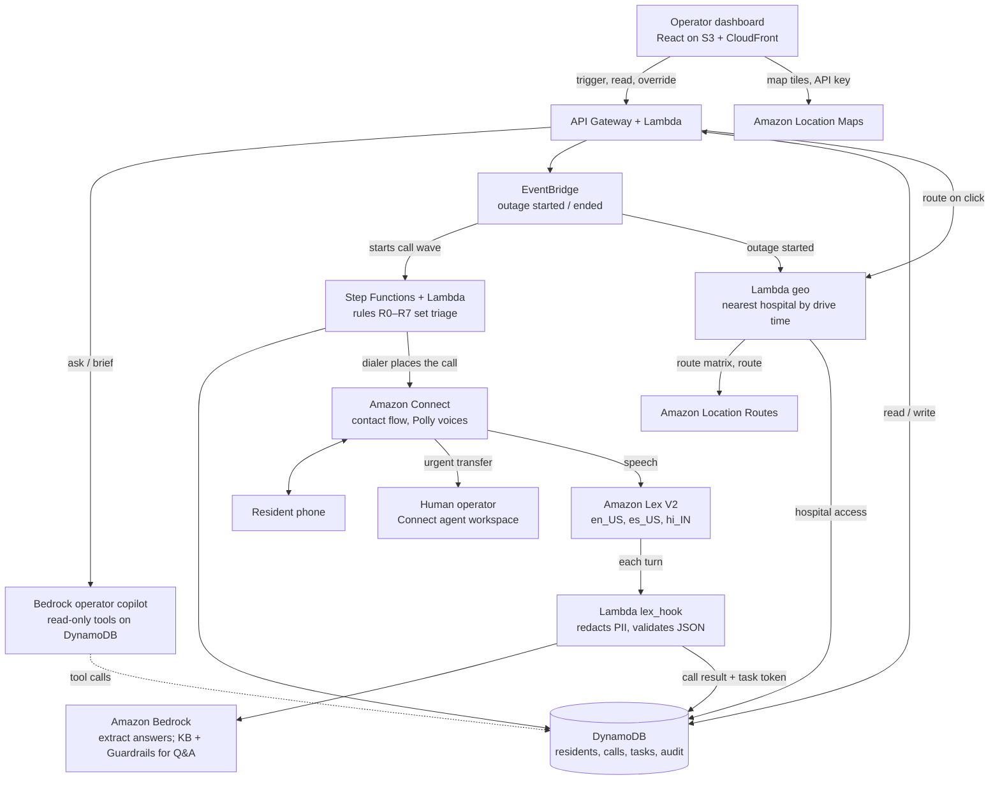

# CareLine

**When the power goes out, CareLine calls the people who can't wait.**

CareLine is an AI voice agent on AWS that phones every resident who depends on powered
medical equipment during an outage, in their language. It works out who needs help
before their backup battery runs out, and gives the duty officer a live, auditable plan
of action. Amazon Bedrock is at its core.

Built for the **AI-Driven Automation & Critical Service Continuity** track (AWS) at the
Sparthill hackathon, October 2026.

> **Status:** in active development during the hackathon. Sections marked *planned*
> describe the design in [`docs/careline-plan.md`](docs/careline-plan.md) and will be
> filled in as the build lands.

---

## The persona: Jane Doe

Jane is the duty officer for the Santa Clara County public-health department (San Jose,
CA) during a planned utility power shutoff. She has **3 staff**, about **400 residents** on oxygen concentrators,
ventilators or home dialysis, and only hours before their backup batteries run out.
Today she works from a spreadsheet and a phone.

More than 3 million Medicare beneficiaries rely on electricity-dependent medical equipment
([HHS emPOWER](https://empowerprogram.hhs.gov/faqs.html)). In a long outage that equipment
can fail immediately, or within hours once the batteries run down. Every hour Jane's team
spends dialing is an hour in which someone's battery runs down without anyone knowing.

## What CareLine does

1. **Jane triggers an outage** for a zone, or a simulated outage event fires.
2. **CareLine calls residents** in that zone, highest medical risk first, in English or
   Spanish (Hindi if time allows), through Amazon Connect.
3. **A voice bot asks four short questions:** are you safe, does your device have power,
   how many hours of battery are left, and do you need medicine, food, transport or a
   place to charge.
4. **Bedrock understands the answers**, including messy or mixed-language speech, and
   turns them into validated JSON.
5. **Deterministic rules decide triage** (R0–R7), not the model. Urgent cases go to a
   human right away; unclear cases go to human review.
6. **Battery runway:** each resident's next check-in is scheduled before their battery
   runs out, and escalates as the deadline gets close.
7. **No answer twice → welfare check.** An in-person task is created automatically.
8. **Live priority map:** Jane works from a priority list, highest priority on top, next
   to an Amazon Location Service map of San Jose showing each resident by triage and
   every hospital. Clicking a patient draws the route and live-traffic drive time to
   their nearest hospital.
9. **Bedrock briefs Jane:** an operator copilot reads the live data and writes a zone
   brief and a draft dispatch plan. Tasks are only created when Jane approves.

## Amazon Bedrock's three jobs

| Job | What Bedrock does | What keeps it safe |
| --- | --- | --- |
| **Understand answers** | Converse API (Claude Haiku, temperature 0) turns each spoken reply into JSON matching [`schemas/checkin.json`](schemas/checkin.json) | Rules decide triage; low confidence goes to a human |
| **Operator copilot** | Converse API tool use (Claude Sonnet) with read-only tools over live call data writes zone briefs and dispatch drafts | Read-only tools; every priority must cite resident IDs the tools returned; Jane approves every plan |
| **Grounded resident answers** | Knowledge Bases `RetrieveAndGenerate` answers questions like "where can I charge my machine?" from verified resource sites | Bedrock Guardrails block medical advice and ungrounded answers; blocked questions go to a person |

## Architecture



### AWS services and why

| Service | Why |
| --- | --- |
| Amazon Bedrock (Converse API) | The AI core: understands answers, runs the copilot, answers resident questions |
| Bedrock Knowledge Bases | Grounds resident answers in the verified list of resource sites |
| Bedrock Guardrails | Blocks medical advice and ungrounded answers |
| Amazon Connect | Real calls to landlines and basic phones, live transfer to a human; web calling as fallback |
| Amazon Lex V2 | Structured voice dialog in English, Spanish and Hindi |
| Amazon Polly | Neural voices for the fixed scripts |
| AWS Step Functions | Durable waits for retries and battery-runway callbacks |
| Amazon EventBridge | Outage and check-in events that drive the workflows |
| AWS Lambda | Dialer, Lex hook, triage rules, copilot tools, API |
| Amazon DynamoDB | State, with TTL for automatic transcript deletion |
| Amazon Location Service | Maps for the live San Jose map; Routes for each resident's drive time to the nearest hospital and the route shown on click |
| API Gateway, S3, CloudFront | Operator API and dashboard hosting |
| Kiro | Spec-driven development, steering files and eval hooks |

## Triage rules

The first matching rule wins, and its ID is written to the audit log.

| Rule | Condition | Triage |
| --- | --- | --- |
| R0 | Emergency intent or any distress signal | URGENT (live transfer, 911 instruction) |
| R1 | Device has no power and resident is risk tier 1 | URGENT |
| R2 | On battery with under 4 hours left, or battery unknown at tier 1 | URGENT |
| R3 | Resident says they are not safe | URGENT |
| R4 | Key field unsure or confidence < 0.7 at tier 1–2 | HUMAN_REVIEW |
| R5 | Needs medicine, transport or charging | NEEDS_HELP |
| R6 | Needs food only | NEEDS_HELP |
| R7 | None of the above | SAFE (recheck scheduled) |

## Responsible AI and privacy

- **The model extracts, rules decide.** Bedrock never marks anyone "safe" on its own.
- **No medical advice.** Residents hear fixed, reviewed scripts; the one generated-answer
  path is grounded and filtered by Guardrails.
- **Humans stay in charge.** Urgent and unclear cases go to a person; the copilot is
  read-only; overrides require a reason and are audited.
- **Minimal data.** PII is redacted before any model call; no diagnoses or medication
  names are stored; transcripts expire after 24 hours; call recording is off.
- **Consent.** Opt-in registry only; "stop" on any call opts the resident out.
- **All demo data is synthetic.** The dialer only calls numbers on an allow-list of
  consenting teammates.
- **Code orders, the model explains.** The priority list and the copilot brief share one
  sort function (`priority_key()`). Drive time only breaks ties, and it is shown as
  logistics, never as a recommendation for where to receive care. Coordinates never
  reach Bedrock, and the browser map key allows map tiles only.

## Evaluation

The eval runs 30 scenarios in each language through the same extraction and rule code the
live system uses. The headline metric is **missed urgent cases** (target: 0 in every
language). The harness also reports over-escalation, per-field accuracy, extraction
latency and wave time-to-contact.

```bash
python eval/run.py            # planned: writes eval/report.json
```

A Kiro hook re-runs the eval whenever `lambdas/triage/rules.py` or anything in `schemas/`
changes.

## Repository layout

```
.kiro/steering/        Kiro steering: product, tech, structure, plan (manual)
.kiro/specs/           Kiro specs per workstream (generated in Kiro)
.plans/                Feature specs (amazon-location-map-spec.md)
docs/careline-plan.md  Full implementation plan
schemas/               JSON schemas shared by Lambdas and the eval
data/                  hospitals.csv, residents.sample.csv; private/ is gitignored (planned)
scripts/               seed.py, build_geo_data.py (planned)
infra/                 CDK stacks (planned)
lambdas/               dialer, lex_hook, triage, copilot, api, geo, shared layer (planned)
eval/                  scenarios and harness (planned)
connect/               exported Connect contact flow (planned)
kb/                    Knowledge Base source documents (planned)
web/                   React + Vite operator dashboard (planned)
```

## Getting started (planned)

Prerequisites: an AWS account in **us-east-1** with Amazon Connect and Bedrock model
access, Python 3.12, Node 20, AWS CDK v2, and Kiro.

```bash
git clone <this repo> && cd careline
cp .env.example .env               # fill in IDs after deploying
python -m venv .venv && source .venv/bin/activate
pip install -r requirements.txt
python scripts/build_geo_data.py   # validates data/*.csv, writes hospitals GeoJSON/JSON
cd infra && cdk deploy --all       # tables, workflows, Lambdas, API, dashboard, map key
python scripts/seed.py             # 40 synthetic residents from RESIDENTS_CSV, 5 resource sites
```

`scripts/seed.py` reads `data/private/residents.csv` (gitignored, shared out of band) and
falls back to `data/residents.sample.csv`. After deploying, read the map key with
`aws location describe-key --key-name careline-map-key`, put it in `web/.env.local` as
`VITE_LOCATION_API_KEY`, then build and deploy the web app. Never commit the key.

Then, in the Amazon Connect console: claim a number (or enable web calling), import
`connect/CareLine-Outbound.json`, and attach the `CareLineCheckIn` Lex bot and the
`lex_hook` Lambda.

## Building with Kiro

Steering files in `.kiro/steering/` give Kiro the project rules on every request. The
full plan is available on demand: type `#plan` (or `/plan`) in Kiro chat. Each
workstream has its own spec: `call-orchestration`, `voice-agent`, `operator-dashboard`,
`copilot` and `evaluation`.

## Team

| Role | Name |
| --- | --- |
| A — Voice + grounded answers | _TBD_ |
| B — Orchestration | _TBD_ |
| C — Dashboard + copilot | _TBD_ |
| D — Data, evaluation and video | _TBD_ |

Questions from judges: reach us through the event's communication channel at
_TBD (handle to be confirmed by organizers)_.

## Teardown

After judging: release the phone number, delete the Connect instance and the Knowledge
Base, and run `cdk destroy --all` (this also deletes the map API key, which expires
Oct 31 regardless).
