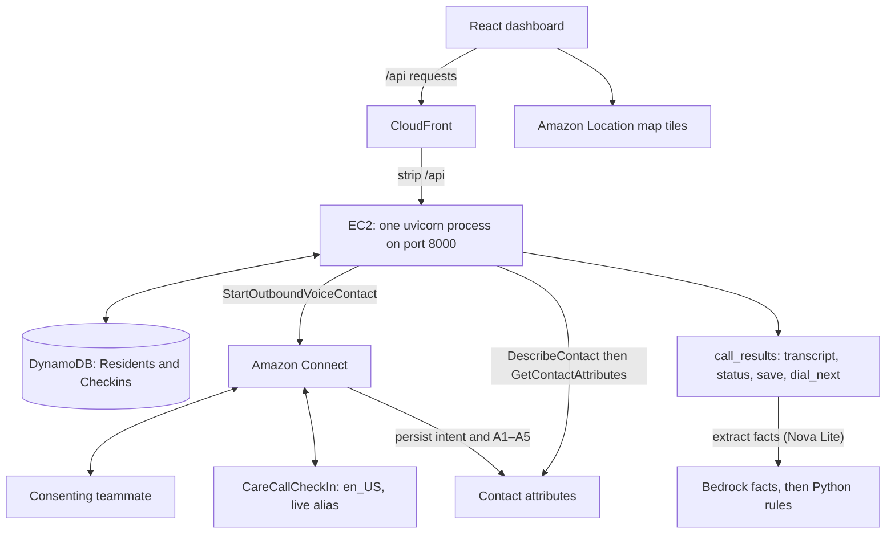

# CareLine workshop implementation plan

Updated Oct 24, 2026 for the EC2 and Lex slot architecture. This is the active
implementation plan. The [original CareLine design](reference/careline-plan.original.md)
is historical; its execution roles, workflows, table schemas and APIs are superseded.

## Scope and sources of truth

CareLine helps Jane, a county public-health duty officer, check on residents whose
medical devices need electricity. The workshop demo calls four consenting teammates
at once, collects five fixed answers, and shows transcripts and statuses on one
priority list and San Jose map. English only.

- [Ranking and script](RANKING.md): round 1, planned round 2, and fixed wording.
- [Next steps](NEXT_STEPS.md): implementation and real-phone acceptance status.
- [Task graph](../.plans/careline-task-graph.md): dependencies and current contracts.
- [Connect setup](../connect/SETUP.md): console steps, Lex limitations and acceptance.
- [Infrastructure handoff](infra/HANDOFF.md): recorded hosting and operations.
- Runtime request/response shapes are in `backend/app/models.py` and
  `backend/app/main.py`. Do not restore the historical five-table contracts.

## Architecture

**Why no Lambda:** the workshop account denies IAM role creation. PassRole is
limited to WSParticipantRole, which trusts no AWS service. Connect and Lex use
service-linked roles; the backend runs as a long-lived EC2 process.

No code hooks, invocation blocks, call recording, Step Functions task tokens or
EventBridge completion events. `docs/reference/template.lambda.yaml` is historical
production reference only and must not be deployed in this account.

## Calling and answer collection

1. `POST /outages` resets the zone's live state and calls `dial_wave(zone)`.
   Round 1 chooses device group, then fewest backups, then ID. Up to `MAX_LINES=4`
   calls start together. Real calls require consent and an allowed teammate number.
2. Connect plays `script.QUESTIONS[1]`. Lex **CareCallCheckIn**, locale **en_US**,
   published alias **live**, uses `CheckIn` slots **A1–A5**, all FreeFormInput.
   The first reply selects CheckIn. **Repeat the safety question to fill A1**,
   then ask QUESTIONS[2] through [5] word for word and speak CLOSING.
3. The flow sets `answered=yes`, passes `residentId` as a Lex session attribute,
   and copies `$.Lex.IntentName` and populated slots to `intent`, `a1`–`a5`.
   Emergency plays EMERGENCY_REPLY and disconnects; CheckIn disconnects after
   its closing response; fallback/error sets `outcome=no_input` and disconnects.
4. FastAPI's lifespan task runs `check_calls(force=True)` every five seconds.
   Dashboard polls call it too. A lock prevents overlapping checks. A contact ends
   when DescribeContact has a DisconnectTimestamp, with a 300-second backstop
   measured from `call_started_at`; no per-turn activity arrives at the backend.
5. `call_results.finish_call` reads attributes and saves once using
   `store.transition` with the contact ID guard, adds a check-in, then refills
   the line with `dial_next(zone)`.

| Collected result | Current status |
| --- | --- |
| Emergency intent or emergency phrase in any answer | HELP_NOW, R0, emergency=True |
| Five answers | Ranked live: Bedrock facts -> rules R0-R6/NA -> level + rule ID |
| Some answers | PERSON_CHECK: Call ended after question N of 5 |
| answered is not yes, or no answers | Increment missed_calls; retry after others' first calls; two misses → HELP_SOON / NA |

FreeFormInput cannot capture the intent-triggering reply into A1 or switch to the
Emergency intent during slot elicitation. An emergency phrase collected in a slot
is escalated **after disconnect**. A hang-up before the flow copies slots may lose
earlier answers. Do not promise live question progress or immediate mid-dialog
emergency interruption. Console and real-phone acceptance remain open.

## Data model and hosting

| Table | Partition key | Sort key | Contents |
| --- | --- | --- | --- |
| Residents | id (string) | None | Registry and current call/result fields |
| Checkins | resident_id (string) | at (string) | Completed result history and transcript entries {q, question, answer} |

Himanshu creates the tables. Names come from `RESIDENTS_TABLE` and `CHECKINS_TABLE`;
without configured tables the app uses the in-memory demo roster. The application
does not yet write transcript expiry fields; do not claim automatic deletion is
implemented just because a table may have TTL configured.

Install `backend/requirements.txt`, load `/etc/careline/backend.env`, and run from
`backend/`: `uvicorn app.main:app --host 0.0.0.0 --port 8000`. Use **one worker**.
CloudFront strips `/api` before proxying to port 8000. Set comma-separated
`ALLOWED_ORIGINS` to the CloudFront origin and `http://localhost:5173`.
Build the dashboard with `VITE_API_URL=https://<cloudfront>/api`; its default is
`http://localhost:8000`. See the backend and web `.env.example` files.

## Remaining work and acceptance

1. Finish the Lex console test matrix and publish the flow; test one phone,
   then four, including emergency entry, an emergency phrase in A5, a partial
   call, no input and two missed calls. Check results with the dashboard closed.
2. **Phase 2:** replace `call_results.extract_facts(transcript)`, currently
   returning None, by wiring the existing `app/understand.py` extraction and
   `app/rules.py` ranking helpers. Both have offline tests. Use BEDROCK_MODEL_ID
   and the forced record_checkin tool; Python applies R0–R6 and NA from
   RANKING.md. Bedrock never ranks. The eval harness and end-to-end integration
   remain pending.
3. Add supplier-to-resident drive times through planned `app/location.py`,
   compute time to spare, and expose facts and ranking reasons to the dashboard.
   The [map plan](../.plans/amazon-location-map-spec.md) keeps hospital routing
   separate from the supplier-based ranking contract.
4. Complete planned alert email, acknowledgment and recheck behavior only as
   tracked in NEXT_STEPS.md. Copilot, multilingual calls, Knowledge Bases and
   durable workflows belong to the archived broader design, not this milestone.

Validation already completed: 62 backend unittests (including existing extraction
and round 2 helper tests); web build and lint (existing
warnings); a clean requirements-only uvicorn run; and an offline Start outage
where four contacts completed through the background checker and appeared in
GET /queue with five answers each. These checks do not establish phone acceptance
or that the latest application has been deployed on EC2.
