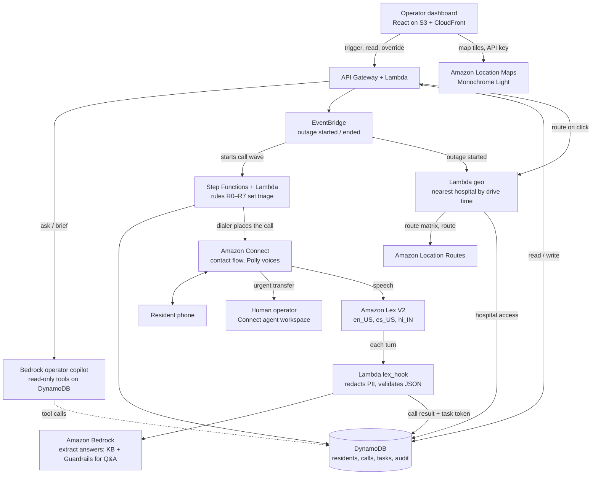
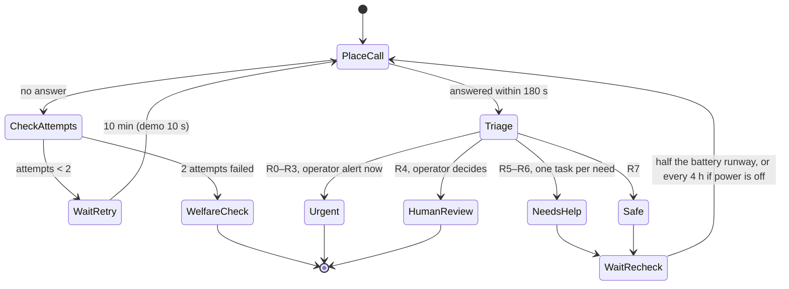

# CareLine — Implementation Plan

Oct 23, 2026 · @Himanshu Jain

## Overview

CareLine helps Jane Doe, a county public-health duty officer, check on every resident who depends on powered medical equipment before their backup batteries run out. It is built on AWS with Amazon Bedrock at its core and developed in Kiro, for the track "AI-Driven Automation & Critical Service Continuity." The deliverable is a 5-minute video, due **10:30 AM Saturday, Oct 24**.

**Persona: Jane Doe.** Jane is the duty officer for the Santa Clara County public-health department (San Jose, CA) during a planned utility power shutoff. She has 3 staff and about 400 residents on oxygen concentrators, ventilators or home dialysis, and only hours before their backup batteries run out. Today she works from a spreadsheet and a phone. Every hour her team spends dialing is an hour in which someone's battery runs down without anyone knowing.

**Why it matters.** More than 3 million Medicare beneficiaries depend on electricity-powered medical equipment ([HHS emPOWER](https://empowerprogram.hhs.gov/faqs.html)). In a long outage, that equipment can fail immediately, or within hours once backup batteries run down.

**What CareLine does for Jane, in one loop:**

1. Jane triggers an outage for an area, or a simulated outage event fires.
2. CareLine phones registered residents in that area, highest medical risk first, in English or Spanish (Hindi if time allows).
3. A voice bot asks a short, fixed set of questions: are you safe, does your device have power, how many hours of battery are left, and do you need medicine, food or transport.
4. **Bedrock understands the answers**, including messy and mixed-language speech, and turns them into structured fields. Deterministic rules, not the model, assign the triage level.
5. Urgent cases go to a human immediately. Needs become tasks. Unanswered calls are retried, then become in-person welfare-check tasks.
6. **Live priority map:** Jane works from a priority list of patients, highest priority on top, next to a live map of San Jose (Amazon Location Service) with every resident in the outage colored by triage and every hospital marked. Clicking a patient draws the route and the live-traffic drive time to their nearest hospital.
7. **Battery runway:** each resident's next check-in is scheduled before their backup battery runs out, and escalates as that deadline gets close.
8. **Bedrock briefs Jane:** an operator copilot queries the live call data and writes a situation brief for each zone, plus a draft dispatch plan that Jane approves.
9. **Bedrock answers residents' questions** ("where can I charge my oxygen machine?") only from a verified list of resource sites, with Bedrock Guardrails blocking medical advice.

**Amazon Bedrock's three jobs.**

| Job | What Bedrock does | What keeps it safe | Tier |
| --- | --- | --- | --- |
| Understand answers | Converts each spoken reply into validated JSON | Rules decide triage; anything unclear goes to a human | Must |
| Operator copilot | Uses read-only tools on live data to write zone briefs and a draft dispatch plan | Read-only tools; Jane approves every dispatch | Must |
| Grounded resident answers | Answers questions from a Knowledge Base of verified sites | Guardrails with denied topics and a grounding check; otherwise a fixed fallback line | Should |

**How the plan maps to the judging rubric (100 points, scored from the video).**

| # | Criterion | Points | How CareLine earns it on video |
| --- | --- | --- | --- |
| Gate | AWS AI service doing real work | Pass/fail | Bedrock's three jobs, shown working with CloudWatch logs |
| 1 | Real persona, real need | 20 | Open and close with Jane Doe, the shutoff and the battery clock |
| 2 | Working application | 25 | The full loop recorded end to end on real AWS: trigger, call, triage, tasks, callback |
| 3 | Use of AWS AI services | 20 | Bedrock in three integral roles, plus Lex, Polly and Connect |
| 4 | Understanding what you built | 15 | Architecture walkthrough, including why rules decide and the model extracts |
| 5 | Polish and presentation | 10 | Clean dashboard with a live map, natural voices, tight script and voiceover |
| 6 | Above and beyond | 10 | Evaluation across languages (0 missed urgent), guardrails, privacy design, Kiro specs and hooks |

**Success criteria for the video.**

- A recorded voice call (phone, or web call if no number) runs end to end in English and Spanish.
- The copilot writes Jane's zone brief and dispatch plan from live data, on screen.
- The evaluation shows **0 missed urgent cases** across 30 scenarios in each language.
- The battery-runway callback and the two-attempt welfare-check escalation both appear on screen.
- An audit entry with a rule ID and an operator override is shown.
- Clicking the top patient in the priority list draws the route and live drive time to their nearest hospital on the map.

**Assumptions (change if wrong):** a team of 4 (roles A to D), the event-provided AWS account in us-east-1, Kiro credits for each person, building from about 4 PM Friday to a 6 AM Saturday feature freeze, then recording and editing until submission.

## Scope

Ship the call loop and the Bedrock copilot first; everything else is optional. If a "should" item threatens a "must" item, cut it.

| Item | Tier | Owner | Notes |
| --- | --- | --- | --- |
| Outage trigger (operator button + EventBridge event) | Must | B | Starts a call wave for one zone |
| Voice call through Connect, English + Spanish | Must | A | Web-call fallback if no phone number; either is fine on video |
| Lex bot with fixed check-in questions | Must | A | Slots: safe, device power, battery hours, needs |
| Bedrock job 1: extraction of free-form answers | Must | B | Structured JSON only; never decides triage |
| Rule-based triage (urgent / human review / needs help / safe) | Must | B | Rule IDs logged |
| Battery-runway callback (Step Functions wait) | Must | B | Time-compressed for the video |
| Retry ×2, then welfare-check task | Must | B |  |
| **Bedrock job 2: operator copilot** (zone brief + dispatch draft) | Must | C | Converse API tool use, read-only tools; Jane approves |
| Dashboard: priority list, live call feed (log only), task queue, override, copilot panel | Must | C | The priority list is the primary view |
| **Live map (Amazon Location)**: triage pins, hospitals from CSV, route and drive time to the nearest hospital on click | Must | C (UI), B (geo Lambda), D (CSVs) | Spec: [`.plans/amazon-location-map-spec.md`](../.plans/amazon-location-map-spec.md). Has its own cut ladder; the map panel itself is never cut |
| Audit log with rule IDs and overrides | Must | B |  |
| 30-scenario evaluation + missed-urgent metric | Must | D | Runs against the same code |
| 5-minute video | Must | D | Recording starts at the 6 AM freeze |
| **Bedrock job 3: grounded resident answers** (Knowledge Base + Guardrails) | Should | A | Verified sites only; blocked medical question shown on video |
| Hindi live on voice | Should | A | Lex supports hi\_IN with Hindi–English mixing |
| SMS fallback for unanswered residents | Should | B | Needs an SMS-capable number |
| Per-language fairness chart | Should | D | Same 30 scenarios in each language |
| Preparedness coach | Cut | — | Roadmap mention in the video |
| Vietnamese voice | Cut | — | Lex vi\_VN has limited feature support |
| Operator login (Cognito) | Cut | — | API key on API Gateway is enough |
| Comprehend PII step | Cut | — | Regex redaction is enough for synthetic data |

## System architecture

CareLine is fully serverless: an outage event starts a Step Functions call wave, Connect and Lex run each call, Bedrock understands the answers, and the results land in DynamoDB, where Bedrock's copilot turns them into briefs for Jane.



Read the middle column top to bottom for one call; the highlighted box is where triage is decided, by rules rather than the model.

**Why each AWS service (for the judges' "how and why" question).**

| Service | Why we chose it |
| --- | --- |
| Amazon Bedrock (Claude, Converse API) | The AI core: understands spoken answers, runs the operator copilot with tool use, and answers resident questions |
| Bedrock Knowledge Bases | Grounds resident answers in the verified list of resource sites |
| Bedrock Guardrails | Blocks medical advice and checks that answers are grounded |
| Amazon Connect | Real phone calls to landlines and basic phones, plus live transfer to a human; web calling as a fallback |
| Amazon Lex V2 | Structured voice dialog in English, Spanish and Hindi, with Lambda hooks on every turn |
| Amazon Polly (inside Connect) | Neural voices per language for the fixed scripts |
| AWS Step Functions | Durable waits for retries and battery-runway callbacks, which can last hours |
| Amazon EventBridge | Decouples outage start/end and check-in events from the workflows |
| AWS Lambda | Dialer, Lex hook, triage rules, copilot tools and the API |
| Amazon DynamoDB | Serverless state with TTL for automatic transcript deletion |
| Amazon Location Service | Maps draws the live San Jose map. Routes finds each resident's nearest hospital by live-traffic drive time when an outage starts, and draws the route when Jane clicks a patient |
| API Gateway, S3, CloudFront | Operator API and dashboard hosting |
| Kiro | Spec-driven development, steering and eval hooks |

## AWS account and environment setup

Do all setup in the first hour, because a new Amazon Connect instance can block you from claiming even its first phone number. Several developers have reported the error "allowed limit for claimed phone numbers has been exceeded" on a brand-new instance, and AWS's own quota note says fixing it needs AWS Support ([re:Post](https://repost.aws/questions/QU3iyEKOV3SsScs1RhU2flSw/created-amazon-connected-instance-but-not-able-to-claim-atleast-one-phone-number)). Ask the AWS mentors at kickoff for a pre-provisioned instance or number.

**Region: us-east-1.** It has Connect, Lex V2 with Hindi, Bedrock, and Connect web calling. Nova Sonic voice in Connect is also offered in us-east-1 and us-west-2, in English and Spanish ([AWS](https://aws.amazon.com/about-aws/whats-new/2025/11/amazon-connect-agentic-self-service)). Keep every resource in one region; Connect APIs only work in the region where the instance was created.

**Hour-0 checklist (person A unless noted):**

- [ ] In the event-provided account, confirm Connect and Bedrock are allowed, then create the Connect instance (`careline-demo`), with inbound and outbound calling enabled.
- [ ] Claim a US DID phone number. If it fails with a limit error, open a support case and switch to the web-call fallback immediately.
- [ ] Enable Bedrock model access for a fast Claude Haiku model and a Claude Sonnet model, and turn on model invocation logging to CloudWatch Logs for the video (B).
- [ ] Create a Lex V2 bot `CareLineCheckIn` with locales en\_US, es\_US, hi\_IN (A).
- [ ] Confirm Amazon Location is allowed: run one `geo-routes` `CalculateRouteMatrix` between two San Jose points from the event account (B).
- [ ] Create the map API key `careline-map-key` (tiles only, localhost referrer, expires Oct 31) and load the Monochrome Light style in a blank Vite page (C). If the style returns 403 with `geo-maps:GetTile` alone, widen to `geo-maps:*`.
- [ ] Create an AWS Budgets alert at $25 with email to the whole team (D).
- [ ] Create one IAM role per Lambda with least privilege; no shared admin keys in code (B).
- [ ] Set up the repo and Kiro workspace, with `.kiro/steering/` files committed (D, see the Kiro section).

**Infrastructure as code.** Use AWS CDK in Python (or SAM if the team prefers). Kiro can generate the stacks from the design spec. Stack names: `CareLineData`, `CareLineCore`, `CareLineApi`, `CareLineWeb`. Configure Connect, the contact flow and the Lex bot in the console first, export the flow JSON into the repo, and only automate them if time allows.

**Environment variables (Lambda):** `TABLE_RESIDENTS`, `TABLE_CALLS`, `TABLE_TASKS`, `TABLE_AUDIT`, `CONNECT_INSTANCE_ID`, `CONNECT_FLOW_ID`, `CONNECT_SOURCE_NUMBER`, `BEDROCK_MODEL_ID`, `STATE_MACHINE_ARN`, `HOSPITAL_CANDIDATES` (3), `ROUTE_CACHE_MIN` (15), `DRIVE_TIE_WINDOW_MIN` (30).

**Environment variables (web, in `web/.env.local`):** `VITE_AWS_REGION`, `VITE_LOCATION_API_KEY` (read with `aws location describe-key --key-name careline-map-key` after deploying; never commit it), `VITE_MAP_STYLE` (Monochrome).

**Cost guardrails.** Connect bills per minute of voice; keep demo calls under 2 minutes. Delete the instance after judging. Release the phone number before deleting, since repeated claim-and-release cycles can block future claims for months.

## Building with Kiro

Use Kiro for spec-driven development, and show the specs to judges as proof of engineering discipline. Kiro is AWS's agentic IDE and CLI built around specs, agent hooks, steering files and MCP servers ([Kiro on GitHub](https://github.com/kirodotdev/Kiro)). Specs live under `.kiro/specs` and steering files under `.kiro/steering/` ([AWS Builder Center](https://builder.aws.com/content/3CuKNklw8cDhXjreLYoznoj6dyx/amazon-kiro-use-cases-and-introduction)).

**1. Steering files (write these first, about 20 minutes).** They stop Kiro from guessing your conventions in every chat.

```markdown
# .kiro/steering/product.md
CareLine phones at-risk residents during power outages, extracts their answers,
and applies deterministic triage rules. The LLM extracts fields; it never assigns
triage. Never generate medical advice. Every decision writes an audit record
with a rule_id.

# .kiro/steering/tech.md
- Python 3.12, AWS Lambda, boto3, AWS CDK (Python)
- DynamoDB single-purpose tables: residents, calls, tasks, audit
- Step Functions Standard workflow for call waves, retries and callbacks
- Bedrock Converse API; responses must validate against JSON schemas in /schemas
- Frontend: React + Vite, polling the API every 3 s (no websockets)
- Region us-east-1 only

# .kiro/steering/structure.md
/infra (CDK stacks) /lambdas/<name>/handler.py /schemas /eval /web /connect (exported flow JSON)
Tests sit next to code as test_*.py and use pytest + moto.
```

**2. Specs (one per workstream).** For each, prompt Kiro with the matching section of this document and let it produce `requirements.md`, `design.md` and `tasks.md`. Review the requirements before accepting; that is where wrong assumptions get caught cheaply.

| Spec folder | Prompt source in this doc | Owner |
| --- | --- | --- |
| `.kiro/specs/call-orchestration` | Triage, routing and escalation | B |
| `.kiro/specs/voice-agent` | Voice agent | A |
| `.kiro/specs/operator-dashboard` | Backend APIs and dashboard | C |
| `.kiro/specs/evaluation` | Evaluation harness | D |
| `.kiro/specs/copilot` | Amazon Bedrock: three jobs (job 2) | C |

Example requirement in EARS style for the triage spec: *WHEN a call result reports device power OFF AND battery\_hours < 4, THE SYSTEM SHALL assign triage URGENT, create an operator alert within 5 seconds, and write an audit record with rule\_id R1.*

The map work has no spec of its own: its requirements go into `operator-dashboard` (priority list, map panel), `call-orchestration` (Lambda `geo`, `priority_key()`) and `copilot` (drive-time enrichment), using [`.plans/amazon-location-map-spec.md`](../.plans/amazon-location-map-spec.md) as the prompt source. Example: *WHEN the operator selects a resident in the priority list or on the map, THE SYSTEM SHALL draw the driving route from the resident to their nearest hospital and show the drive time in real-world minutes, with its traffic basis, within 3 seconds.*

**3. Agent hooks.** Set up two:

- **On save of `lambdas/triage/rules.py`:** run `pytest eval/` and report any scenario whose expected triage changed. This keeps "0 missed urgent cases" true all day.
- **On save of any file in `schemas/`:** regenerate the Pydantic models and update the Bedrock extraction prompt's schema block.

**4. MCP servers.** Add the AWS Documentation MCP server so Kiro can look up Connect, Lex and Step Functions APIs instead of guessing. Kiro's MCP docs warn that MCP servers run locally outside its sandbox and can read configured environment variables, so add only official AWS servers and never put long-lived credentials in `mcp.json` ([Kiro MCP security](https://kiro.dev/fr/docs/mcp/security/)).

**5. Execution.** Run each spec's `tasks.md` one task at a time and commit after each. Keep humans on the parts Kiro does poorly without a console: the Connect contact flow, the Lex bot intents and phone-number setup.

**For the video:** a few seconds showing the spec folders, a sample EARS requirement and the eval hook firing, inside the "Above and beyond" segment.

## Data model

Four on-demand DynamoDB tables keep the model simple; transcripts expire automatically and never enter the audit log. All residents are synthetic.

| Table | Partition key | Sort key | Key attributes | TTL |
| --- | --- | --- | --- | --- |
| `Residents` | `resident_id` | — | `first_name`, `last_name`, `phone_e164`, `language` (en/es/hi), `zone_id`, `zone_name`, `risk_tier` (1 = ventilator/oxygen, 2 = dialysis/refrigerated medicine, 3 = mobility device), `device_type`, `consent` (true), `emergency_contact_phone`, `lat`, `lng`, `hospital_access` (nearest hospital, drive time, basis and cached route, written at outage start) | none |
| `Calls` | `outage_id` | `resident_id#attempt` | `contact_id`, `status` (QUEUED/RINGING/ANSWERED/NO\_ANSWER/FAILED), `extracted` (JSON), `triage`, `rule_id`, `battery_hours`, `next_check_at`, `transcript_redacted`, `expires_at` | `expires_at` = now + 24 h |
| `Tasks` | `task_id` | — | `type` (OPERATOR\_ALERT/WELFARE\_CHECK/TRANSPORT/MEDICINE/FOOD/INFO\_SMS), `resident_id`, `outage_id`, `priority`, `status` (OPEN/ACK/DONE), `assigned_to` | none |
| `Audit` | `outage_id` | `ts#event_id` | `actor` (system/operator id), `action`, `resident_id`, `rule_id`, `inputs_hash`, `before`, `after`, `reason` | none |

**Indexes.** `Residents` gets a GSI on `zone_id` + `risk_tier` so a call wave queries one zone in risk order. `Tasks` gets a GSI on `status` + `priority` for the operator queue.

**What never gets stored:** diagnoses, medication names, or the raw unredacted transcript. The audit log stores decision codes and a hash of the inputs, which lets you prove what the rule saw without keeping the health detail.

**Synthetic data (person D, first 90 minutes).** `scripts/seed.py` loads 40 residents from a CSV with lat/lng across 4 San Jose zones (Z1 Downtown, Z2 East San Jose, Z3 Berryessa, Z4 South San Jose): roughly 10 at tier 1, 15 at tier 2 and 15 at tier 3; 20 English, 12 Spanish and 8 Hindi. The real file, `data/private/residents.csv`, is gitignored because it holds the 3 to 5 team members' real phones for the live demo (with their consent); `data/residents.sample.csv` is a committed copy with fake data. Every other number is a fake that the dialer skips. Zone 2 must include two tier-1 residents whose battery deadlines land in the same 30-minute bucket but whose drive times to the nearest hospital differ (about 9 vs 22 min), so the drive-time tie-break shows on video.

**Hospitals.** `data/hospitals.csv` (committed) is the team's curated list of San Jose acute-care hospitals with emergency departments: `hospital_id`, `name`, `address`, `city`, `lat`, `lng`, optional `phone`. `scripts/build_geo_data.py` validates it and writes `web/public/hospitals.geojson` and `lambdas/shared/careline_shared/hospitals.json`. There is no hospitals table.

Also seed 5 resource sites (2 charging/cooling centers, 1 shelter, 1 pharmacy with backup power, 1 food distribution point) with addresses and hours.

**Extraction schema (`schemas/checkin.json`):**

```json
{
  "is_safe": "yes | no | unsure",
  "device_has_power": "yes | no | on_battery | no_device | unsure",
  "battery_hours": "number | null",
  "needs": ["medicine", "food", "transport", "charging", "none"],
  "distress_signals": ["breathing_difficulty", "chest_pain", "fall", "confusion", "none"],
  "language_detected": "en | es | hi",
  "confidence": "0.0-1.0"
}
```

## Voice agent

The voice path is Connect → Lex V2 → a Lambda code hook → Bedrock for extraction. **Everything the resident hears comes from a fixed, pre-translated script library, with one guarded exception: answers to resident questions (Bedrock job 3).** Fixed scripts make "no medical advice" hold by design, and Bedrock Guardrails cover the one exception.

This pattern is well established: the `StartOutboundVoiceContact` API places the call and names a contact flow, and that flow's Get Customer Input block hands the conversation to a Lex bot, which can call Lambda and Bedrock ([WebRTC.ventures](https://webrtc.ventures/2024/11/ai-enhanced-click2call-filtering-and-qualifying-outbound-interactions/)).

**Placing the call (Lambda `dialer`).**

```python
connect.start_outbound_voice_contact(
    InstanceId=INSTANCE_ID,
    ContactFlowId=FLOW_ID,
    DestinationPhoneNumber=resident["phone_e164"],
    SourcePhoneNumber=SOURCE_NUMBER,
    Attributes={
        "resident_id": rid, "outage_id": oid, "attempt": str(n),
        "lang": resident["language"], "first_name": resident["first_name"],
    },
)
```

The dialer skips any number not on the demo allow-list, so a seeding mistake can never ring a stranger.

**Contact flow `CareLine-Outbound` (build in the console, export JSON to `/connect`).**

1. **Set logging behavior** on, and **Set recording** off (privacy).
2. **Check contact attributes** on `lang` → three branches.
3. **Set voice** per branch with the language attribute set: en-US Joanna (neural), es-US Lupe (neural), hi-IN Kajal (neural). This also selects the Lex locale.
4. **Play prompt:** the introduction and opt-out line (script below).
5. **Get customer input** → Lex bot `CareLineCheckIn`, alias `live`.
6. Branch on the session attribute `route` returned by Lex:
   - `EMERGENCY` → play the 911 line → **Transfer to queue** `Responders` (an operator logged into the Connect softphone picks up live).
   - `HUMAN` → Transfer to queue `Responders`.
   - `OPTOUT` → play confirmation → Disconnect.
   - `DONE` → play the closing line, including the nearest resource site → Disconnect.
   - Error or no input twice → set `status=NO_RESPONSE` through a Lambda → Disconnect.

**Lex bot `CareLineCheckIn` (locales en\_US, es\_US, hi\_IN).**

| Intent | Purpose | Slots / sample utterances |
| --- | --- | --- |
| `CheckIn` | Main questionnaire | `IsSafe` (yes/no), `DevicePower` (custom: on, off, battery, no device), `BatteryHours` (AMAZON.Number), `Needs` (custom, multi-value: medicine, food, transport, charging, none) |
| `Emergency` | Fast exit for danger | "I can't breathe", "I fell", "I need an ambulance", "help me" |
| `SpeakToHuman` | Human handoff | "talk to a person", "operator" |
| `OptOut` | Stop future calls | "stop calling me", "remove me" |
| `FallbackIntent` | Anything else | Code hook sends the transcript to Bedrock |
| AskQuestion | Grounded answer from the Knowledge Base (Bedrock job 3) | "where can I charge my machine", "is the cooling center open" |

Enable the dialog code hook and fulfillment code hook on `CheckIn` and `FallbackIntent`, both pointing to Lambda `lex_hook`. Hindi in Lex V2 handles callers who mix Hindi and English, so add sample utterances in both Devanagari and romanized Hindi ([Lex docs](https://docs.aws.amazon.com/lexv2/latest/dg/how-languages.html)).

**Lambda `lex_hook` (each turn).**

1. Redact phone numbers, addresses and names from `inputTranscript` with regex.
2. Call Bedrock Converse (Claude Haiku, temperature 0) with the extraction prompt and the JSON schema. Validate the result; on a validation failure, mark the field `unsure`.
3. Fill any Lex slots the extraction answered, so the bot doesn't ask again.
4. If `distress_signals` is not `none`, set `route=EMERGENCY` immediately and close the intent.
5. When all slots are filled, write the result to `Calls`, emit EventBridge event `careline.checkin.completed`, and set `route=DONE` plus the closing prompt key.

**Extraction system prompt (abridged).** "You convert a resident's spoken answer into JSON that matches the schema. Extract only what was said. If something is unclear, use `unsure` or `null`. Never infer a medical condition. Never produce any text outside the JSON."

**Script library (English shown; Spanish and Hindi translated once by a native speaker on the team or reviewed by one).**

- **Intro:** "Hello {first\_name}, this is CareLine, an automated wellness check from your county emergency services. There is a power outage in your area. I'll ask three quick questions. Say 'person' at any time to reach a human, or 'stop' to opt out."
- **Q1:** "Are you safe right now?"
- **Q2:** "Does your medical device have power, is it running on battery, or is it off?"
- **Q3 (if on battery):** "About how many hours of battery do you have left?"
- **Q4:** "Do you need medicine, food, transport, or a place to charge your device?"
- **Emergency:** "If this is an emergency, hang up and dial 911 now. I am connecting you to a responder."
- **Close:** "Thank you. The nearest charging center is {site\_name} at {site\_address}, open until {close\_time}. I'll call you again in about {callback\_hours} hours."

**Fallback: web calling.** If no phone number is available by about hour 3, use Connect's in-app and web calling, which lets a browser start a voice contact into the same contact flow ([AWS](https://aws.amazon.com/about-aws/whats-new/2023/11/amazon-connect-in-app-web-video-calling)). Build a "resident phone" page that rings, and on answer starts a WebRTC contact with the same attributes. Lex, Lambda, triage and the dashboard are unchanged.

**Stretch: Nova Sonic.** Connect's agentic self-service voice uses Nova Sonic for more natural speech. Try it only after the full loop works, and only for English and Spanish.

## Triage, routing and escalation

Triage is a short, ordered list of deterministic rules. The first rule that matches wins, and its ID goes into the audit log. When in doubt, the rules send the case to a human, never to "safe."

| Rule | Condition (on extracted fields + resident record) | Triage | Action |
| --- | --- | --- | --- |
| R0 | Emergency intent, or any `distress_signals` | URGENT | Live transfer to operator queue, 911 instruction, operator alert |
| R1 | `device_has_power = no` and `risk_tier = 1` | URGENT | Operator alert + transport task |
| R2 | `on_battery` and `battery_hours < 4`, or `battery_hours` unknown at tier 1 | URGENT | Operator alert + charging/transport task |
| R3 | `is_safe = no` | URGENT | Operator alert |
| R4 | Any key field `unsure`, or `confidence < 0.7`, at tier 1–2 | HUMAN\_REVIEW | High-priority review task; an operator decides |
| R5 | `needs` includes medicine, transport or charging | NEEDS\_HELP | One task per need |
| R6 | `needs` includes food only | NEEDS\_HELP | Food task, normal priority |
| R7 | None of the above | SAFE | Schedule recheck |

**Battery runway.** For anyone on battery, the next call is scheduled at half the remaining hours, with a 30-minute minimum. If the remaining runway after that callback would fall under 2 hours, a transport/charging task is created now, not later. Residents marked SAFE with power off are rechecked every 4 hours while the outage lasts.

**Retries.** No answer → wait 10 minutes → call again. A second no-answer creates a WELFARE\_CHECK task (priority by risk tier) and, if SMS is available, sends a text with the nearest charging site.

**Demo time compression.** An environment variable `TIME_SCALE=60` turns every hour into one minute and every 10 minutes into 10 seconds. That lets judges watch a 6-hour battery runway trigger a callback in about 3 minutes. The dashboard shows the real-world time next to the compressed timer.

**Step Functions design.**

- **`CallWave` (one per outage).** Query `Residents` by `zone_id` in risk order → a Map state with `MaxConcurrency = 3` starts one `ResidentCheck` per resident. Concurrency stays low so the Connect instance's concurrent-call limit is never hit.
- **`ResidentCheck` (one per resident, Standard workflow).** `PlaceCall` uses `.waitForTaskToken`: the dialer saves the token in `Calls`, and the contact flow's final Lambda calls `SendTaskSuccess` with the call status. A 180-second task timeout means NO\_ANSWER, because an unanswered outbound call never enters the flow. Then `Triage` (Lambda) → a Choice state routes to alert, tasks, recheck wait or retry wait, as drawn below.
- **Outage ended.** An `careline.outage.ended` event runs a Lambda that stops every open `ResidentCheck` for that outage, so nobody gets called after power is back.



An outage-ended event stops every waiting check.

Urgent and unclear cases end with a person; everyone else loops back for another call until the outage ends.

## Amazon Bedrock: three jobs

Bedrock is the AI core of CareLine, with three bounded jobs that each appear on screen in the video. In every job the model reads and writes; it never takes an action on its own.

**Job 1 — Understand answers.** Covered in the voice agent section: Claude Haiku through the Converse API, temperature 0, JSON validated against `schemas/checkin.json`. Show the raw transcript next to the extracted JSON on the dashboard's resident drawer; it is the clearest visual of Bedrock doing real work.

**Job 2 — Operator copilot for Jane (must).**

- **Where Jane sees it:** a "Brief me" button on each zone row, and an "Ask CareLine" box on the dashboard ("Who on oxygen haven't we reached in Zone 2?").
- **API:** `POST /copilot/brief` with `{outage_id, zone_id}` and `POST /copilot/ask` with `{outage_id, question}`.
- **Lambda `copilot`:** calls Bedrock Converse with a `toolConfig`, using a Claude Sonnet model for better reasoning. It loops on tool calls until the model finishes, with a cap of 6 tool calls per request.
- **Read-only tools:**

| Tool | Returns |
| --- | --- |
| `get_zone_summary(outage_id, zone_id)` | Counts by triage level, % contacted, unreached count |
| `list_open_cases(outage_id, zone_id, triage?)` | Residents already sorted by `priority_key()`, with rank, triage, rule ID, needs, next deadline, nearest hospital, drive minutes and drive basis (no coordinates or addresses) |
| `get_battery_deadlines(outage_id, within_hours)` | Residents whose battery runway ends within the window |
| `list_resource_sites(zone_id)` | Charging and cooling sites with hours and address |
| `list_hospitals(zone_id)` | Hospitals from the bundled CSV, nearest to the zone first, with name, address and phone |

- **Output:** JSON with `headline`, `priorities` (each with `resident_ids` and a reason), `dispatch_plan` (teams and ordered stops) and `open_questions`. The dashboard renders it as a card, and every resident ID links to that resident's drawer.
- **Human approval:** an "Approve plan" button creates the tasks through the normal API, audited with Jane as the actor. The copilot itself never writes data.
- **Checks:** the Lambda rejects any brief that cites a resident ID or hospital not returned by a tool, or that lists priorities out of `priority_key()` rank order, and retries once. If the order is still wrong, the code reorders it and marks the brief `reordered: true`.
- **Priority order is computed in code, not by the model.** `priority_key()` (shared Lambda layer) sorts by triage group, then risk tier, then a 30-minute battery-deadline bucket, then the longer drive to the nearest hospital first. The same function sorts the dashboard's priority list, so the brief and the list never disagree.
- **System prompt (abridged):** "You assist a public-health duty officer during a power outage. Use only facts returned by tools. Every priority must cite resident IDs. Keep priorities in the order list\_open\_cases returns. When a priority involves transport, give the nearest hospital and drive time exactly as the tool returned them. Drive times are logistics information: never recommend where a resident should receive medical care. Never give medical advice. If data is missing, say what is missing."
- **Example brief for the video:** "Zone 2: 3 urgent, 2 oxygen users unreached after two calls, 4 batteries run out within 2 hours. R-131 and R-114 are both tier 1 with batteries running out around 18:30; R-131 is first because it is 22 min to Regional Medical Center (live traffic) versus 9 min. Send Team A to R-131 and R-114, then Team B to the 4 battery deadlines in order; nearest charging site: Eastside Library, open until 9 PM."

**Job 3 — Grounded answers for residents (should).**

- **Knowledge Base:** an S3 bucket holding the 5 verified resource sites (address, hours, what each offers) and a short, non-medical outage FAQ, indexed with Bedrock Knowledge Bases.
- **Voice path:** a new Lex intent `AskQuestion` ("where can I charge my machine", "is the cooling center open") sends the question through `lex_hook` to Bedrock `RetrieveAndGenerate` with the Knowledge Base and a guardrail. The answer is capped at 2 sentences and read aloud by Polly.
- **Guardrail:** denied topics for diagnosis, medication or dosage advice, and device settings; a contextual grounding check; PII filters. If the guardrail blocks or the answer isn't grounded, the resident hears a fixed line ("I can't advise on that. I'm connecting you with a responder.") and the call routes to a human.
- **Video moment:** a resident asks "Should I turn up my oxygen flow?" The guardrail blocks it and the call transfers to a person.

**Proving it in the video.** Turn on Bedrock model invocation logging to CloudWatch Logs during setup, and show a few real log entries (model ID, tokens, guardrail action) during the "Bedrock in use" segment.

## Backend APIs and operator dashboard

The dashboard is a single React page that polls a small REST API every 3 seconds; no websockets. The operator answers live transfers in the Connect agent workspace in a second browser tab.

**API (API Gateway REST + Lambda, protected with an API key).**

| Method | Path | Does |
| --- | --- | --- |
| POST | `/outages` | Body `{zone_id}`. Creates the outage, emits `careline.outage.started`, starts `CallWave` |
| POST | `/outages/{id}/end` | Emits `careline.outage.ended`; stops pending callbacks |
| GET | `/outages/{id}/summary` | Counts by triage, zone and language; contacted %; unreached count |
| GET | `/outages/{id}/priority` | Every resident in the outage sorted by `priority_key()`, with rank, lat/lng, triage group, rule ID, battery deadline and nearest-hospital drive time. One poll feeds both the priority list and the map |
| GET | `/residents/{id}/hospital-route?outage_id=` | Route line (GeoJSON LineString), drive minutes, distance, traffic basis and hospital details. Lambda `geo` calls Amazon Location `CalculateRoutes`; cached 15 min |
| GET | `/calls?outage_id=` | Live call feed, newest first |
| GET | `/residents/{id}/timeline` | Attempts, extracted answers, rule IDs, next check time |
| GET | `/tasks?status=OPEN` | Task queue sorted by priority |
| POST | `/tasks/{id}/ack` and `/done` | Operator workflow; both audited |
| POST | `/calls/{id}/override` | Body `{triage, reason}`; reason required; audited with before/after |
| GET | `/audit?outage_id=` | Audit log |
| GET | `/metrics/fairness?outage_id=` | Contact rate, median time to contact, missed-urgent rate, by language and by zone |
| POST | /copilot/brief | Body {outage\_id, zone\_id}. Bedrock copilot returns the zone brief and draft dispatch plan |
| POST | /copilot/ask | Body {outage\_id, question}. Free-form question answered from tool results only |
| POST | /copilot/approve | Jane approves a plan; creates its tasks, audited with Jane as the actor |

**Dashboard layout (person C).**

1. **Header:** outage name and zone, a "Trigger outage" and "End outage" button, the compressed clock with real-world time beside it, and counters (called, reached, urgent, unreached).
2. **Zone strip:** one chip per zone with % contacted, urgent count and unreached count, plus a "Brief me" button for the selected zone.
3. **Priority list (primary view, left):** one row per resident in the outage, highest priority on top: rank, resident ID, triage chip, rule ID, risk tier, battery deadline, attempts and "Drive to hospital" (real-world minutes). The order comes from the API; the frontend never re-sorts. Clicking a row selects the resident.
4. **Map panel (right, Amazon Location Monochrome Light):** resident pins for the active outage only, colored by triage group and numbered by rank; every hospital from the CSV; a "Synthetic data" badge. Selecting a resident (list row or pin) draws the route to their nearest hospital with a chip: "22 min drive, 9.4 km, live traffic as of 14:02, hospital name, phone". Polls never move the camera. If the map fails to load, the panel hides and the list goes full width.
5. **Copilot panel:** the Bedrock brief and dispatch plan for the selected zone, with resident IDs as links, an "Approve plan" button, and an "Ask CareLine" box.
6. **Task queue:** urgent alerts pinned on top in red, then welfare checks, then service tasks. Ack and Done buttons.
7. **Live call feed (log only):** each call as a row with status chip, language flag, triage chip and rule ID. New rows highlight briefly. Clicking it does not select a resident or draw a route.
8. **Resident drawer (opens with the selection):** attempt timeline, the redacted transcript beside Bedrock's extracted JSON, the battery-runway countdown, the deciding rule, and an Override button that requires a reason.
9. **Fairness and privacy panel:** per-language and per-zone metrics from `/metrics/fairness`, plus a fixed "What we store / what we never store" card and the transcript expiry time.

The full map design (layers, colors, camera rules, key restrictions, fallbacks) is in [`.plans/amazon-location-map-spec.md`](../.plans/amazon-location-map-spec.md).

**Hosting.** Build with Vite and deploy to S3 + CloudFront, or Amplify Hosting if that is faster for the team. Put the API key in a build-time environment variable for the demo only.

**Resident phone simulator (only if using the web-call fallback).** A second page shows a phone that rings when the dialer targets a simulated resident. Answering it starts a Connect web call into the same flow with the resident's attributes.

## Responsible AI, privacy and audit

The AI is limited to one narrow job, turning speech into structured fields, and every consequential decision is a logged rule or a logged human choice. These are the controls to build and to name on stage.

| Risk | Control | Where it lives |
| --- | --- | --- |
| AI gives medical advice | Residents hear fixed, reviewed scripts; the one generated-answer path is grounded in the Knowledge Base and filtered by Bedrock Guardrails | Script library + Guardrails |
| AI marks an at-risk person "safe" | LLM only extracts; rules decide; anything unclear goes to HUMAN\_REVIEW (R4) | `triage/rules.py` |
| Missed emergency | Emergency intent and distress signals short-circuit to a live human (R0); missed-urgent rate is the headline metric | Lex + rules + eval |
| Worse service in some languages | Same 30 scenarios run in each language; per-language contact and missed-urgent rates shown on the dashboard | Eval + fairness panel |
| Health data leaks | Regex redaction before any model call or storage; transcripts expire after 24 h; audit stores codes and an input hash, not content; call recording off | `lex_hook`, DynamoDB TTL |
| Unwanted calls | Opt-in registry only; opt-out honored on the call and removed from future waves; demo dialer allow-list | `Residents.consent`, dialer |
| Residents unsure who is calling | Fixed introduction naming the agency, saying it is automated, and offering "person" and "stop" | Script |
| Silent overrides | Override needs a reason; audit stores who, when, before and after | `/calls/{id}/override` |
| Model or prompt drift during the day | Kiro hook re-runs the eval suite on every change to the rules or schemas | `.kiro/hooks` |
| Copilot invents facts or acts on its own | Read-only tools; every priority must cite resident IDs the tools returned (checked in code); Jane approves every plan before tasks exist | copilot Lambda + /copilot/approve |
| Model reorders who is seen first | Priority order comes from `priority_key()` in code; the brief must keep that order (checked in code) | shared layer + copilot Lambda |
| Copilot recommends a hospital for medical care | Drive times are framed as logistics; the prompt forbids medical destination advice; residents never hear a hospital name; 911 and EMS decide | copilot prompt + script library |
| Stale or wrong drive time changes the order | Drive time only breaks ties inside the same triage group, risk tier and 30-minute deadline bucket; never changes triage; every value shows its traffic basis and "as of" time; straight-line fallback is labeled | `priority.py`, map chip |
| Home locations leak | Synthetic data only; the real residents CSV is gitignored; coordinates are never sent to Bedrock; Amazon Location removes customer metadata and account information from queries before they reach data providers; the browser map key allows tiles only, is referrer-locked and expires Oct 31 | `data/private/`, copilot tools, CareLineWeb stack |

**Risk register.** Put the table above on one slide, titled "How CareLine fails safely," with a column for residual risk. The honest residual risks: speech recognition errors for strong accents or poor phone lines, and residents without any working phone. The mitigation for both is the same: unclear or unreachable becomes a human task.

**Bedrock Guardrails.** One guardrail, with denied topics (diagnosis, medication or dosage advice, device settings), PII filters and a contextual grounding check, is attached to the resident-answer path and to the copilot. Show one blocked request in the video; it is the strongest visual proof that the safety design is real.

## Evaluation harness

The evaluation proves the one claim that matters: across 30 scenarios in each language, CareLine misses zero urgent cases. Person D owns it from hour 1, and it runs against the same extraction and rule code the live system uses.

**Scenario file (`eval/scenarios.yaml`).**

```yaml
- id: S07
  category: battery_low
  risk_tier: 1
  turns:
    en: ["yes I'm okay", "it's on the battery", "maybe three hours", "no I'm fine"]
    es: ["sí, estoy bien", "está con la batería", "como tres horas", "no, gracias"]
    hi: ["haan main theek hoon", "battery pe chal raha hai", "shayad teen ghante", "nahi kuch nahi"]
  expected: { triage: URGENT, rule: R2 }
```

**The 30 scenarios.**

| Category | Count | Expected | What it tests |
| --- | --- | --- | --- |
| Clearly safe | 6 | SAFE | No false alarms on easy cases |
| Battery under 4 hours | 5 | URGENT (R2) | Battery-runway logic |
| Device off at tier 1 | 4 | URGENT (R1) | Risk-tier rules |
| Distress, direct or indirect ("I feel dizzy and the machine stopped") | 4 | URGENT (R0) | Emergency detection beyond keywords |
| Confused or rambling answers | 3 | HUMAN\_REVIEW (R4) | Uncertainty goes to a person |
| Silence or no answer | 3 | Retry, then welfare check | Escalation path |
| Language switching mid-call | 2 | Matches content | Hindi–English mixing, Spanish–English |
| Needs only (food, medicine, transport) | 3 | NEEDS\_HELP (R5/R6) | Correct task creation |

**Two levels of test.**

1. **Text level (must).** `eval/run.py` sends each turn through the real `lex_hook` extraction (live Bedrock call) and the rules, for all three languages. It runs in about 2 minutes, and the Kiro hook triggers it on every rules or schema change.
2. **Speech level (should).** For 6 scenarios, synthesize each turn with Polly in the right voice and send the audio to the live Lex bot with the `RecognizeUtterance` API. This tests speech recognition, which the text level skips.

**Metrics written to `eval/report.json` and shown on the dashboard.**

- **Missed urgent** (expected URGENT or HUMAN\_REVIEW, got SAFE or NEEDS\_HELP). Target: 0, in every language.
- **Over-escalation rate** (expected SAFE, got URGENT). Report it honestly; a few are acceptable by design.
- **Field accuracy** per extracted field, per language.
- **Median extraction latency** per turn (target under 1.5 s so the call doesn't feel slow).
- **Wave time to contact**: from outage trigger to the last resident reached or escalated, for the 40-resident seed.

If a scenario fails, fix the rule or the prompt, never the expected answer, unless the team agrees the expectation was wrong and writes down why.

**Priority and geo tests (pytest, person D).** `test_priority.py` covers the group order, unknown deadlines sorting first, the 30-minute bucket tie-break by drive time, and a stable order. `test_geo.py` stubs `geo-routes` with a botocore `Stubber` (moto may not cover the new Routes API) for candidate selection, matrix cells that return `Error`, the straight-line fallback and the route cache. A Kiro hook runs the priority tests whenever `priority.py` changes, and `scripts/build_geo_data.py` whenever a CSV in `data/` changes.

## Team split and timeline

Four workstreams run in parallel and meet at four checkpoints; the voice path must work end to end by 7 PM Friday, or the team switches to web calling without debate.

| Role | Owns | Kiro spec | In the video |
| --- | --- | --- | --- |
| A — Voice + grounded answers | Connect instance and number, contact flow, Lex bot, script library, web-call fallback, Bedrock job 3 (Knowledge Base + Guardrails) | `voice-agent` | Plays the resident on the recorded calls |
| B — Orchestration (fits a Python and event-driven background) | `dialer`, `lex_hook`, Bedrock job 1 (extraction), triage rules, Step Functions, EventBridge, tasks, audit, CDK stacks, Lambda `geo` (Amazon Location Routes), `priority_key()` and the shared layer | `call-orchestration` | Narrates the architecture segment |
| C — Dashboard + copilot | React app, priority list, map panel (Amazon Location Maps and its API key), API Lambdas, override flow, Bedrock job 2 (operator copilot, including the drive-time enrichment), Connect agent workspace | `operator-dashboard`, `copilot` | Plays Jane Doe on screen |
| D — Data, evaluation and video | Residents and hospital CSVs, `build_geo_data.py`, seed data, 30 scenarios, eval harness, priority and geo tests, Kiro steering and hooks, budget alert, video script, recording, editing, submission | `evaluation` | Producer and editor; presents the evaluation |

**Smaller team?** With 3 people, D's evaluation work moves to B and the video moves to C after the 6 AM freeze. With 2, one person takes A + C and the other takes B + D; Hindi, SMS, Bedrock job 3 and the map's route-on-click and drive-time features move to "cut," but the copilot and the basic map panel (pins and hospitals) stay.

**Integration rule.** Merge to `main` at least every 2 hours. Each checkpoint below is a 10-minute standing demo of the real system, not a status update.

| When (PT) | Phase | Work | Gate at the end |
| --- | --- | --- | --- |
| Fri 4–5 PM | Setup | Event account check, Connect instance and number, Bedrock access and logging, Amazon Location check (B: one route matrix call; C: map key and tiles load), Lex bot shell, repo, CDK skeleton, Kiro steering, budget alert | — |
| Fri 5–7 PM | First call | A: contact flow + English Lex bot. B: dialer + lex_hook with Bedrock extraction. C: dashboard skeleton + API stubs + map panel with static sample pins and hospitals. D: residents and hospital CSVs, `build_geo_data.py`, seed residents, 30 scenarios, video script draft | **G1, 7 PM:** one real AI call end to end, or switch to web calling |
| Fri 7–11 PM | Core loop | B: triage rules, workflows, tasks, audit, `priority_key()`, Lambda `geo` drive times at outage start, `/outages/{id}/priority`. C: priority list, live feed, task queue, copilot tools. A: Spanish + Knowledge Base. D: eval passing in English, Kiro hook on, priority tests | **G2, 11 PM:** full loop on seed data + first copilot brief + priority list and live pins from the poll |
| Fri 11 PM – Sat 3 AM | Bedrock jobs and escalation | Copilot brief/ask/approve with drive-time enrichment and order check; route on click; retries, welfare checks, battery-runway callbacks; grounded answers with Guardrails; emergency transfer; eval in every language | **G3, 3 AM:** 0 missed urgent; Bedrock jobs 1 and 2 work; route on click works |
| Sat 3–6 AM | Polish (sleep in shifts) | Dashboard and map polish (legend, badge, route chip, fallback test), fairness chart, Hindi. Cut order: SMS, Hindi voice, fairness chart. Map sub-features: copilot drive-time tie-breaker, then route on click, then drive-time column; the map panel stays | **Freeze, 6 AM:** bug fixes only; recording starts |
| Sat 6–10:30 AM | Record, edit, submit | 6–9 AM record each segment twice + CloudWatch Bedrock logs; 9–10 AM edit and voiceover; submit by 10:00 AM | **Deadline 10:30 AM** |

Judging is done from the video alone, so recording gets four protected hours; if the build runs late, shrink Polish, never the recording window.

## Risks and fallbacks

The biggest risk is telephony setup, not code; every risk below has a pre-agreed fallback and a deadline for switching to it.

| Risk | Likelihood | Switch-to fallback | Decide by |
| --- | --- | --- | --- |
| Event AWS account blocks Connect or a Bedrock model | Medium | Ask organizers right away; if Connect is fully blocked, run the Lex bot from a browser voice page and keep every Bedrock job unchanged | 5 PM Fri |
| Connect won't let you claim a phone number | High on new accounts | Web calling into the same flow + resident phone page; the video only needs one clean recording | 5 PM Fri |
| Outbound calls fail or are blocked | Medium | Same web-call fallback | 7 PM (G1) |
| Step Functions task-token wiring takes too long | Medium | A polling Lambda on a 1-minute EventBridge schedule that reads `Calls` and advances state | 11 PM (G2) |
| Bedrock latency makes calls feel slow | Low–medium | Fastest Haiku model; call Bedrock only when Lex slots didn't resolve; short prompts | 11 PM (G2) |
| Copilot cites wrong data or is slow | Medium | Citation check in code; switch Sonnet to Haiku if slow; generate the brief just before recording | 3 AM (G3) |
| Lex misrecognizes Hindi or accented speech | Medium | Rely on Bedrock extraction of the raw transcript; if still poor, drop Hindi from the video | 3 AM (G3) |
| Something breaks during recording | Medium | Screen-record every successful run from G2 onward; record each segment twice | 6 AM |
| Video runs over 5 minutes or uploads slowly | Medium | Script to 4:40; export 1080p; start the upload by 10:00 AM | 10 AM Sat |
| Event account blocks Amazon Location, or the map key fails | Low–medium | If the style fails to load, the map panel hides and the priority list goes full width; if routing fails, drive times fall back to straight-line distance labeled "distance, not drive time" | 5 PM Fri |
| Map key rejected on the CloudFront domain | Medium | The key's referrers include `http://localhost:5173/*` and the CloudFront domain; test the deployed site at G2, and record from localhost if needed | 11 PM (G2) |
| Running out of time | High | Cut in this order: SMS → Hindi voice → fairness chart → Bedrock job 3. Map sub-features, decided at G3: copilot drive-time tie-breaker → route on click → drive-time column. Never cut the copilot, the eval, the escalation path or the map panel | 6 AM freeze |

**Rules for switching.** At each gate, the owner says "go" or "fallback" in one sentence, and the team moves on. Nobody spends more than 45 minutes stuck on console configuration without asking an AWS mentor.

## Video script and submission

The submission is a video of at most 5 minutes that must show the architecture, the application and its persona, and Amazon Bedrock working. Judges see nothing else, so script it to 4:50 and follow Jane Doe from start to finish.

| Time | Segment | On screen | Rubric items |
| --- | --- | --- | --- |
| 0:00–0:35 | **Jane's problem** | Title cards: shutoff notice, "400 residents on powered medical equipment, 3 staff," a battery icon draining. Voiceover introduces Jane Doe | 1 |
| 0:35–1:15 | **Architecture** | The architecture diagram, highlighting Bedrock's three jobs, the rules box and Amazon Location (Maps for the base map, Routes for drive times); a quick look at the real Step Functions graph and Connect flow in the console | 4, 3 |
| 1:15–2:45 | **The application** | Jane triggers an outage in Zone 2 (East San Jose) → grey pins appear on the map and the call feed fills, highest risk first → pins turn color and the priority list reorders as calls finish → a recorded Spanish call, split-screen with the dashboard → Jane clicks rank 1: the drawer shows the transcript beside Bedrock's JSON while the map draws the route and drive time to the nearest hospital → an emergency call transfers to a person → an unreachable resident becomes a welfare check → a battery-runway callback fires on the compressed clock | 2 |
| 2:45–3:50 | **Bedrock in use** | Jane clicks "Brief me" → the copilot brief appears with linked resident IDs and explains the drive-time tie-break → "Approve plan" creates tasks → a resident asks where to charge their machine and gets a grounded answer → a medical question is blocked by Guardrails and transferred → CloudWatch invocation logs | 3 |
| 3:50–4:30 | **Above and beyond** | Evaluation report: 30 scenarios per language, 0 missed urgent, the per-language chart; the Kiro hook re-running it; the privacy card; an audited override | 6, 4 |
| 4:30–4:50 | **Close** | Back to Jane: what used to take her team a day now takes minutes. Tagline, team names and contact through the event channel | 1, 5 |

**Production tips.**

- Record the screen at 1080p with the browser zoomed to 125% so text is readable.
- Record the voiceover separately from the screen, then lay it over; add captions.
- Pre-fill anything typed on screen; no live typing in the video.
- Run the demo with `TIME_SCALE=60` so the battery-runway callback happens on camera.
- The map replaces the zone-table shots, so it adds no seconds. Don't say a specific number of drive minutes in the voiceover: live traffic changes between takes.
- Keep every successful run you recorded from G2 onward as backup footage.

**Submission checklist.**

- [ ] Video at or under 5:00, uploaded by 10:00 AM Saturday (deadline 10:30 AM)
- [ ] End card and submission form include how judges can reach the team through the event's channel
- [ ] Public repo with README: one-line pitch, persona, architecture diagram, setup steps, how to run the eval
- [ ] `.kiro/` folder committed (steering, specs, hooks) to show Kiro use
- [ ] List of AWS services and why each is used (from the architecture section)
- [ ] `eval/report.json` and a screenshot of the results in the repo
- [ ] Statement that all resident data is synthetic and the demo phones belong to consenting teammates
- [ ] Confirm `data/private/` (real phones) is not in the public repo
- [ ] After judging: release the phone number, delete the Connect instance and the Knowledge Base, and tear down the CDK stacks (this also deletes the map API key, which expires Oct 31 regardless)

## Sources

- [HHS emPOWER Program FAQ](https://empowerprogram.hhs.gov/faqs.html)
- [Amazon Connect agentic self-service with Nova Sonic (AWS, Nov 2025)](https://aws.amazon.com/about-aws/whats-new/2025/11/amazon-connect-agentic-self-service)
- [Amazon Connect in-app, web and video calling (AWS)](https://aws.amazon.com/about-aws/whats-new/2023/11/amazon-connect-in-app-web-video-calling)
- [Languages supported by Amazon Lex V2](https://docs.aws.amazon.com/lexv2/latest/dg/how-languages.html)
- [AI-enhanced click-to-call with Connect, Lex and Bedrock (WebRTC.ventures)](https://webrtc.ventures/2024/11/ai-enhanced-click2call-filtering-and-qualifying-outbound-interactions/)
- [Connect phone-number claim limit on new instances (AWS re:Post)](https://repost.aws/questions/QU3iyEKOV3SsScs1RhU2flSw/created-amazon-connected-instance-but-not-able-to-claim-atleast-one-phone-number)
- [Kiro (GitHub)](https://github.com/kirodotdev/Kiro)
- [Amazon Kiro use cases and introduction (AWS Builder Center)](https://builder.aws.com/content/3CuKNklw8cDhXjreLYoznoj6dyx/amazon-kiro-use-cases-and-introduction)
- [Kiro MCP security](https://kiro.dev/fr/docs/mcp/security/)
- [Amazon Location CalculateRouteMatrix (Routes API)](https://docs.aws.amazon.com/location/latest/APIReference/API_CalculateRouteMatrix.html)
- [Amazon Location API key restrictions](https://docs.aws.amazon.com/location/previous/APIReference/API_ApiKeyRestrictions.html)
- [Amazon Location actions and resource ARNs](https://docs.aws.amazon.com/location/latest/developerguide/authenticating-using-cognito.html)
- [Amazon Location data privacy](https://docs.aws.amazon.com/location/latest/developerguide/data-privacy.html)
- [Enhanced Amazon Location with MapLibre (AWS blog)](https://aws.amazon.com/blogs/mobile/new-features-and-developer-experience-with-enhanced-amazon-location-service/)
