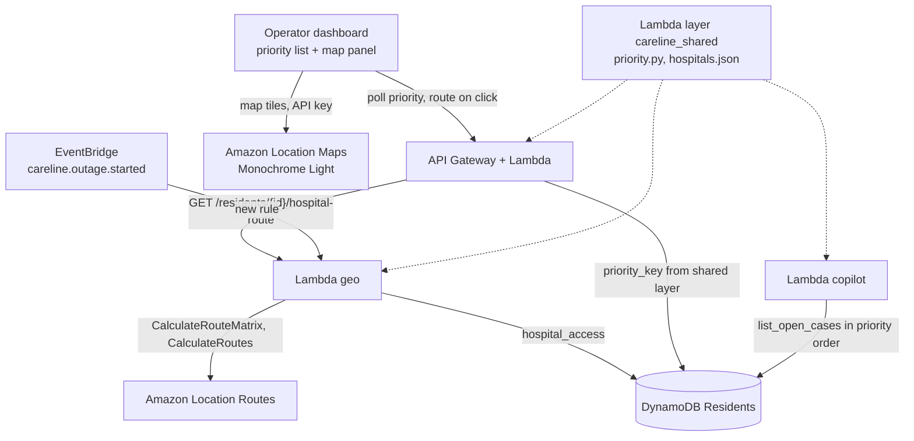

> Historical reference only. Superseded by the [current workshop document](../../.plans/amazon-location-map-spec.md).
> Preserve for design history; do not execute these tasks or use these contracts in the workshop account.

# Spec: Live priority map with Amazon Location Service

Status: agreed in interview, Oct 23 2026. Supersedes the "Map view by neighborhood
(Should, static GeoJSON)" line in `docs/careline-plan.md`.

## 1. Summary

Jane's dashboard gets a **priority list** of patients (highest priority on top) and,
beside it, a **live map of San Jose** drawn with Amazon Location Service. The map shows
every resident in the active outage as a pin colored by triage, and every hospital from
our hospital CSV. When Jane clicks a patient in the priority list (or their pin), the map
draws the **driving route to that patient's nearest hospital** and shows the drive time.

Drive times come from Amazon Location Routes. When an outage starts, one call works out
each resident's nearest hospital by live-traffic drive time. Drive time also breaks ties
in priority order. That ordering is computed in code by one shared function, so the
priority list and the Bedrock copilot's brief always agree, and the model never ranks
anyone itself.

The map is a **Must**, but the **priority list stays the primary view**. If the map fails,
the list keeps working at full width.

## 2. Decisions (from the interview)

| Topic | Decision |
| --- | --- |
| Map layers | Resident pins by triage + hospitals. No zone polygons, resource-site pins or task stops |
| Priority | Must. Priority list is primary; map is a panel beside it |
| Geography | San Jose, CA (Santa Clara County). 4 citywide zones |
| Zones | Z1 Downtown, Z2 East San Jose, Z3 Berryessa, Z4 South San Jose (`zone_id` + `zone_name` in the residents CSV) |
| Hospital data | The team's existing CSV with lat/lng, conformed to the schema in section 5. Committed to the repo. Every row is eligible as "nearest" (the CSV is curated) |
| Hospital storage | Bundled file: CSV converted at build time to GeoJSON (web) and JSON (Lambda layer). No new table |
| Hospitals shown | All rows in the CSV, always |
| Resident data | CSV with lat/lng. The real file is private (gitignored); a fake sample is committed |
| Pin position | Exact CSV lat/lng. All data is synthetic; a "Synthetic data" badge stays on the map |
| Pin scope | Active outage only. Map is empty until Jane triggers an outage |
| Click sources | Priority list rows and map pins (two-way sync). The call feed is a log only and does **not** select or route |
| Nearest hospital | Shortest drive time: 3 straight-line candidates per resident, then one `CalculateRouteMatrix` |
| When computed | Once at outage start, for the zone's residents. The route line is fetched on click |
| Traffic | Live traffic (`DepartNow`, traffic data on). Shown with an "as of" time |
| Where routing runs | Backend Lambda with IAM. The browser key only allows map tiles |
| Map style | Amazon Location `Monochrome`, Light color scheme |
| Copilot | Enriched `list_open_cases` (no extra tool call) + small `list_hospitals` tool |
| Tie-breaker | Within the same triage group and risk tier, when battery deadlines fall in the same 30-minute bucket, the longer drive ranks first. Lives in code (`priority_key()`), shared by API and copilot |
| Time display | Drive times always in real-world minutes, labeled. Only the dashboard clock is compressed |
| Layout | Zone strip on top, priority list left, map right, copilot + task queue below, call feed log at the bottom |
| Ownership | C: map panel, priority list UI, copilot changes. B: geo Lambda, priority endpoint, route endpoint. D: CSVs, build/seed scripts, tests |
| Cut ladder | 1st copilot drive-time enrichment/tie-breaker, 2nd route on click, 3rd drive-time column. Map panel with pins + hospitals is never cut |
| Video | No new seconds. The map replaces zone-table shots; the route appears on the same click that opens the resident drawer |
| Fallback | Hour-0 check by 5 PM. If the map style fails, the panel hides and the list goes full width. If routing fails, straight-line distance is shown, labeled "distance, not drive time" |
| Residents hear | Nothing new. No hospital names in any script; 911 and EMS choose destinations |

## 3. Scope

**In scope**

- Map panel (MapLibre GL JS + Amazon Location Maps, API key restricted to `geo-maps:GetTile`).
- Resident pins for the active outage, colored by triage group and numbered by priority rank.
- Hospital layer from `data/hospitals.csv`.
- Priority list (new table) sorted by `priority_key()`.
- Drive time to nearest hospital per resident, computed at outage start (Routes `CalculateRouteMatrix`).
- Route line and drive-time chip on selection (Routes `CalculateRoutes`).
- Copilot: `list_open_cases` returns cases in `priority_key()` order with hospital access; new `list_hospitals` tool.
- CSV pipeline: conform, validate, convert, seed.

**Out of scope (not planned)**

- Zone polygons, resource-site pins, task stops, dispatch routes (`OptimizeWaypoints`), isolines.
- Places API (hospitals come from the CSV).
- Geofences and trackers for field teams.
- Any change to triage rules R0-R7, the Lex bot, or the voice scripts.

## 4. Architecture changes



New components:

| Component | Owner | Purpose |
| --- | --- | --- |
| `lambdas/geo/` | B | `on_outage_started` (EventBridge) computes hospital access for the zone; `get_hospital_route` (API) returns the route line |
| `lambdas/shared/careline_shared/` (Lambda layer) | B builds, D tests | `priority.py` (`priority_key`), `hospitals.py` + `hospitals.json`, `geo_math.py` (haversine) |
| `data/hospitals.csv` | D | Source of truth for hospitals (committed) |
| `data/residents.sample.csv` / `data/private/residents.csv` | D | Fake sample (committed) / real demo data (gitignored) |
| `scripts/build_geo_data.py` | D | Validates CSVs, writes `web/public/hospitals.geojson` and `lambdas/shared/careline_shared/hospitals.json` |
| `web/src/map/` | C | Map panel, layers, selection sync |
| `web/src/priority/` | C | Priority list |
| `AWS::Location::APIKey` `careline-map-key` (CareLineWeb stack) | C | Browser key for tiles |

## 5. Data

### 5.1 Hospital CSV: `data/hospitals.csv` (committed)

Rename the columns in the existing file to match:

| Column | Type | Required | Notes |
| --- | --- | --- | --- |
| `hospital_id` | string | yes | Stable, e.g. `H-01` |
| `name` | string | yes | Shown on map and in copilot |
| `address` | string | yes | Street address |
| `city` | string | yes | |
| `lat` | float | yes | WGS 84 |
| `lng` | float | yes | WGS 84 |
| `phone` | string | no | Shown in the route chip so Jane can call ahead |

Every row is eligible as "nearest". Keep the file curated to general acute-care
hospitals with emergency departments; rehab, psychiatric and nursing facilities must
not be in it.

### 5.2 Residents CSV

- `data/private/residents.csv`: real demo file, **gitignored**, shared out of band. It
  holds the teammates' real phones for the live calls.
- `data/residents.sample.csv`: committed, same columns, fake data and `+1555...` numbers.

| Column | Type | Notes |
| --- | --- | --- |
| `resident_id` | string | `R-101`... |
| `first_name`, `last_name` | string | `first_name` is used in the intro script |
| `phone_e164` | string | Must also be on `DIALER_ALLOW_LIST` to be dialed |
| `language` | `en` / `es` / `hi` | |
| `zone_id`, `zone_name` | string | `Z1`-`Z4` as in section 2 |
| `risk_tier` | 1 / 2 / 3 | |
| `device_type` | string | Equipment category only, never a diagnosis |
| `consent` | bool | Must be true |
| `emergency_contact_phone` | string | |
| `lat`, `lng` | float | Inside San Jose |
| `sim_scenarios` | string | Pipe-separated eval scenario IDs, one per check (for example `S07\|S01`). Empty for real-phone residents. Used by the call simulator (task graph B04) |

Seed design (D): 40 residents, 10 per zone, same tier and language mix as the plan.
For the copilot video moment, Zone 2 must contain **two tier-1 residents whose battery
deadlines will land in the same 30-minute bucket**, one about 8-10 min and one about
20+ min from their nearest hospital. That makes the tie-breaker visible.

### 5.3 Build and seed

- `scripts/build_geo_data.py`: checks required columns, unique IDs, and lat/lng inside a
  San Jose sanity box. It fails loudly if a check fails. It writes
  `web/public/hospitals.geojson` (FeatureCollection, `properties` = all CSV columns
  except lat/lng) and `lambdas/shared/careline_shared/hospitals.json`. Both outputs are
  committed so teammates don't need to run it.
- `scripts/seed.py`: reads `RESIDENTS_CSV` (default `data/private/residents.csv`; it
  falls back to the sample with a warning) and writes `Residents`.

### 5.4 DynamoDB changes (no new tables)

`Residents` gains `lat`, `lng`, `zone_name`, and a map attribute written at outage start:

```json
"hospital_access": {
  "outage_id": "O-20261023-1",
  "hospital_id": "H-03",
  "hospital_name": "Regional Medical Center",
  "drive_seconds": 1320,
  "distance_m": 9400,
  "basis": "live_traffic | straight_line",
  "computed_at": "2026-10-23T21:02:11Z",
  "route": { "computed_at": "...", "geometry": { "type": "LineString", "coordinates": [] } }
}
```

`route` is filled on the first click and reused for 15 minutes (`ROUTE_CACHE_MIN`).

## 6. Backend

### 6.1 Geo Lambda: `on_outage_started`

Trigger: a new EventBridge rule on `careline.outage.started`. It runs in parallel with
`CallWave`; nothing waits on it.

1. Query `Residents` by `zone_id` (existing GSI).
2. For each resident, pick the 3 closest hospitals by haversine (`HOSPITAL_CANDIDATES=3`).
3. Destinations = the union of all candidates. Origins = the zone's residents.
4. One `geo-routes` `CalculateRouteMatrix` call:
   - `Origins`, `Destinations` as `[lng, lat]`
   - `DepartNow=true`, `TravelMode=Car`, `Traffic.Usage=UseTrafficData`
   - `RoutingBoundary.Geometry.BoundingBox` = the bounding box of all origins and
     destinations plus about 5 km. **Do not use `Unbounded`:** it caps a request at 15
     origins and 100 pairs. A geometry boundary allows 500 x 500.
5. For each resident, take the candidate with the smallest `Duration`, skipping cells
   that have an `Error`. If every candidate fails, write `basis=straight_line` with
   `distance_m` from haversine and no `drive_seconds`.
6. On a whole-call failure (AccessDenied, throttling, timeout after 1 retry), write
   straight-line results for everyone and log a warning.
7. `UpdateItem` `hospital_access` on each resident.

Cost: billed per origin-destination pair. About 10 residents x 6-8 destinations per
outage is negligible; the existing $25 budget alert covers it.

### 6.2 Geo Lambda: `get_hospital_route`

`GET /residents/{id}/hospital-route?outage_id=...`

1. Read `hospital_access`. If `route` is less than 15 minutes old, return it.
2. Otherwise call `CalculateRoutes` from the resident to the stored hospital, with
   `DepartNow=true`, `TravelMode=Car`, traffic on and `LegGeometryFormat=Simple`
   (LineString coordinates, so the browser doesn't have to decode a polyline).
3. Update `drive_seconds` with the fresh summary duration, store `route`, and return:

```json
{
  "resident_id": "R-131",
  "hospital": { "hospital_id": "H-03", "name": "Regional Medical Center", "address": "...", "phone": "..." },
  "drive_minutes": 22, "distance_km": 9.4,
  "basis": "live_traffic", "computed_at": "2026-10-23T21:14:40Z",
  "geometry": { "type": "LineString", "coordinates": [[-121.84, 37.35]] }
}
```

If `basis=straight_line`, return a 2-point straight `LineString` and the UI shows the
fallback label instead of a drive time.

### 6.3 Priority endpoint

`GET /outages/{id}/priority` (API Lambda, C). It returns every resident in the outage
sorted by `priority_key()`, with `rank`, `lat`, `lng`, `triage_group`, `rule_id`,
`risk_tier`, `device_type`, `attempts`, `battery_deadline_real`,
`minutes_to_battery_deadline`, and a `hospital_access` summary (`hospital_name`,
`drive_minutes`, `distance_km`, `basis`, `computed_at`). The map and the list both read
this **one** poll (every 3 s).

### 6.4 `priority_key()`: `lambdas/shared/careline_shared/priority.py`

Triage groups, top to bottom:

| Order | Group | Source |
| --- | --- | --- |
| 0 | `URGENT` | R0-R3 |
| 1 | `HUMAN_REVIEW` | R4 |
| 2 | `UNREACHED` | Two failed attempts (welfare check created) |
| 3 | `NEEDS_HELP` | R5-R6 |
| 4 | `PENDING` | Not yet called, ringing, or waiting for a retry |
| 5 | `SAFE` | R7 |

The sort key, in order:

1. Group order (table above).
2. `risk_tier` ascending.
3. Battery-deadline bucket = `floor(minutes_to_deadline / 30)`, using real-world
   minutes. Unknown deadline = bucket `-1` (sorts first: unknown is treated as
   soonest, matching R2).
4. Drive time **descending** (longer drive first). Unknown drive time sorts first among
   ties (unknown access is treated as farthest).
5. Exact `minutes_to_deadline` ascending, then `resident_id` (stable order).

Buckets keep the sort transitive. "Within 30 minutes of each other" would not be, so
two deadlines 29 minutes apart across a bucket edge are not tied. That is acceptable
and documented.

This function never changes triage, tasks or rule IDs. It only orders a view.

## 7. Copilot (Bedrock job 2) changes

- **`list_open_cases(outage_id, zone_id, triage?)`** returns cases **already sorted by
  `priority_key()`**, each with `rank`, `nearest_hospital {hospital_id, name}`,
  `drive_minutes`, `drive_basis`, `drive_computed_at`. **No lat/lng and no addresses**
  (data minimization: Bedrock never sees home locations).
- **New `list_hospitals(zone_id)`**: hospitals from the bundled JSON, sorted by distance
  from the zone's residents. Returns `hospital_id`, `name`, `address`, `phone`. It is
  only for questions like "which hospitals are near Zone 2?"
- The cap stays at 6 tool calls. The tie-breaker costs no extra call.
- System prompt additions:
  - "Keep priorities in the order `list_open_cases` returns. Do not reorder."
  - "When a priority involves transport, give the nearest hospital and drive time
    exactly as the tool returned them, with the basis (live traffic or straight-line)."
  - "Drive times are logistics information. Never recommend where a resident should
    receive medical care; 911 and EMS decide destinations."
- Citation check additions (in code, retry once on failure):
  - The resident IDs in `priorities` must appear in the same relative order as their
    `rank`. If the retry still fails, reorder in code and mark the brief `reordered: true`.
  - Any hospital ID or name in the brief must have been returned by a tool.
- Example brief line for the video: "R-131 and R-114 are both tier 1, with batteries
  running out around 18:30. R-131 is listed first: 22 min to Regional Medical Center
  (live traffic) versus 9 min."

## 8. Frontend

### 8.1 Layout

```
+-----------------------------------------------------------+
| Outage: Zone 2   clock 02:14 (real 14:02)   called 7/10   |
| [Z1 12/12] [Z2 7/10 !3] [Z3 -] [Z4 -]          [Brief me] |
+----------------------------+------------------------------+
| PRIORITY LIST              | MAP (Amazon Location)        |
| 1 R-114 URGENT  R1 T1  9m  |   pins by triage, rank no.   |
| 2 R-131 URGENT  R2 T1 22m  |   H hospitals                |
| 3 R-102 REVIEW  R4 T2 11m  |   route to nearest hospital  |
| 4 R-120 UNREACHED x2  14m  |   [22 min drive, live, 14:02]|
+----------------------------+-----------+------------------+
| Copilot brief / Ask CareLine           | Task queue       |
+----------------------------------------+------------------+
| Call feed (log only, not clickable for routing)           |
+-----------------------------------------------------------+
```

The zone strip replaces the zone table and keeps "Brief me". The resident drawer
(transcript, Bedrock JSON, override) opens on the same selection as the route.

### 8.2 Priority list columns

Rank, resident ID, triage chip, rule ID, risk tier, battery deadline (real-world),
attempts, "Drive to hospital" (`22 min`, or `9.4 km straight-line` in fallback, or `-`
before it is computed). The order comes from the API; the frontend never re-sorts.

### 8.3 Map

- Library: `maplibre-gl` (pin an exact version when installing). A thin React wrapper
  in `web/src/map/MapPanel.tsx`; no extra map framework.
- Style URL:
  `https://maps.geo.${VITE_AWS_REGION}.amazonaws.com/v2/styles/Monochrome/descriptor?key=${VITE_LOCATION_API_KEY}&color-scheme=Light`
- Sources and layers:
  - `residents` (GeoJSON from the priority poll): circle layer, color by group.
    `URGENT` red, `HUMAN_REVIEW` amber, `UNREACHED` hollow purple ring, `NEEDS_HELP`
    teal, `PENDING` grey, `SAFE` green. The rank number is drawn on the top 10 pins so
    the list and map read together (color is never the only cue).
  - `hospitals` (`/hospitals.geojson`): navy square with "H", name label from zoom 13.
  - `route`: dark-blue line with a white casing.
  - Selected resident: larger radius plus halo.
- Camera: on outage start, fit to the zone's residents once. On selection, fit to the
  resident and the hospital (padding 60 px) once per selection. **Polls never move the
  camera**, and sources are only updated with `setData` when the data changed.
- Route chip (top of map): "22 min drive - 9.4 km - live traffic as of 14:02 -
  Regional Medical Center - phone". In fallback: "9.4 km straight-line (not drive time)".
- Legend bottom-left; a "Synthetic data" badge bottom-right, always visible.
- Click a pin: selects that resident (list row highlights and scrolls into view, drawer
  opens). Click a list row: same selection. Call feed rows do neither.
- Failure: if the style fails to load (an `error` event before `load`, or HTTP 403),
  hide the panel, widen the list to full width, and show "Map unavailable" in the header.

### 8.4 Browser key

CDK in `CareLineWeb` (L1, avoiding the alpha L2):

```python
location.CfnAPIKey(
    self, "MapKey",
    key_name="careline-map-key",
    description="CareLine dashboard map tiles - demo only",
    restrictions=location.CfnAPIKey.ApiKeyRestrictionsProperty(
        allow_actions=["geo-maps:GetTile"],
        allow_resources=[f"arn:aws:geo-maps:{self.region}::provider/default"],
        allow_referers=[
            "http://localhost:5173/*",
            f"https://{distribution.distribution_domain_name}/*",
        ],
    ),
    expire_time="2026-10-31T00:00:00Z",
)
```

- The key value is not a CloudFormation output. After deploying, read it with
  `aws location describe-key --key-name careline-map-key`, put it in
  `web/.env.local` (gitignored), then build and deploy the web app.
- It is a browser credential: it ships in the JS bundle, and the restrictions are what
  protect it. It expires after judging.
- If the style descriptor, sprites or glyphs return 403 with `GetTile` alone, widen to
  `geo-maps:*`. Check this at hour 0.

### 8.5 IAM (geo Lambda role)

- `geo-routes:CalculateRouteMatrix`, `geo-routes:CalculateRoutes` on
  `arn:aws:geo-routes:us-east-1::provider/default`.
- `dynamodb:Query` on the `Residents` zone GSI, and `GetItem`/`UpdateItem` on `Residents`.
- Use `boto3.client("geo-routes")`, and pin `boto3` in the layer's requirements so the
  client exists whatever runtime version is bundled.

## 9. Configuration

| Variable | Where | Value |
| --- | --- | --- |
| `HOSPITAL_CANDIDATES` | geo Lambda | `3` |
| `DRIVE_TIE_WINDOW_MIN` | shared layer | `30` |
| `ROUTE_CACHE_MIN` | geo Lambda | `15` |
| `RESIDENTS_CSV` | seed script | `data/private/residents.csv` |
| `VITE_AWS_REGION` | web | `us-east-1` |
| `VITE_LOCATION_API_KEY` | web (`web/.env.local`) | from `describe-key` |
| `VITE_MAP_STYLE` | web | `Monochrome` |

## 10. Responsible AI and privacy

| Risk | Control |
| --- | --- |
| Copilot recommends a hospital for medical care | Drive times are framed as logistics; the prompt forbids medical destination advice; residents never hear hospital names; 911/EMS decide |
| Model reorders patients | Order comes from `priority_key()` in code; the citation check enforces it; the model only explains it |
| Stale or wrong drive time changes who is seen first | Only breaks ties inside the same group, tier and 30-min bucket; never changes triage; every value shows its basis and "as of" time |
| Home locations leak | Data is synthetic; the real residents CSV is gitignored; coordinates never go to Bedrock; Amazon Location removes customer metadata and account information from queries before they reach data providers ([docs](https://docs.aws.amazon.com/location/latest/developerguide/data-privacy.html)) |
| Pins on real houses in the video look like real patients | Persistent "Synthetic data" badge; the video and README state that all residents are synthetic |
| Browser key abused | Tiles only, referrer-locked, expires Oct 31 |

## 11. Tests

- `lambdas/shared/careline_shared/test_priority.py`: group order; tier order; unknown
  deadline sorts first; same-bucket drive tie-breaker; cross-bucket no tie; unknown
  drive sorts first among ties; stable for equal keys.
- `lambdas/geo/test_geo.py` with a botocore `Stubber` on `geo-routes` (moto may not
  cover the new Routes API): candidate selection, matrix parsing with `Error` cells,
  all-candidates-fail fallback, whole-call failure fallback, route cache hit and miss.
- `scripts/test_build_geo_data.py`: missing column, duplicate ID, out-of-box coordinate.
- Kiro hooks (new): on save of `data/*.csv`, run `scripts/build_geo_data.py`; on save of
  `lambdas/shared/careline_shared/priority.py`, run the priority tests.
- Manual checklist before recording: triggering Zone 2 fits the camera; pins change
  color within one poll of a triage; clicking rank 1 draws the route within 3 s; the
  call feed click does not route; the fallback label appears when the geo Lambda's
  Routes permission is removed.

Example EARS requirements for the Kiro specs:

- *WHEN the operator selects a resident in the priority list or on the map, THE SYSTEM
  SHALL draw the driving route from the resident to their nearest hospital and show the
  drive time in real-world minutes, with its traffic basis, within 3 seconds.*
- *WHEN an outage starts, THE SYSTEM SHALL compute each zone resident's nearest
  hospital by drive time and store it, without delaying the call wave.*
- *THE SYSTEM SHALL order the priority list and the copilot's `list_open_cases` output
  with the same `priority_key()` function.*

## 12. Timeline additions

| When (PT) | Who | Work | Gate |
| --- | --- | --- | --- |
| Fri 4-5 PM | B | One `CalculateRouteMatrix` between two San Jose points from the event account | Location allowed? |
| Fri 4-5 PM | C | Map key (console is fine at first), Monochrome Light loads in a blank Vite page | Tiles load? |
| Fri 5-7 PM | D | Conform hospital CSV; residents sample + private CSV; `build_geo_data.py`; seed | - |
| Fri 5-7 PM | C | Map panel with static sample pins and hospitals | - |
| Fri 7-11 PM | B | `on_outage_started`, `priority_key()`, `/outages/{id}/priority` | **G2:** list + live pins from the poll |
| Fri 11 PM-3 AM | B, C | Route endpoint + route on click; copilot enrichment and order check | **G3:** route on click works; brief shows a drive-time tie-break |
| Sat 3-6 AM | C | Legend, badge, chip polish, fallback test | Freeze |

**Cut ladder** (applied at G3 by B and C): 1) copilot drive-time enrichment and
tie-breaker (drop drive time from `priority_key()`), 2) route on click, 3) drive-time
column. The map panel with pins and hospitals stays.

## 13. Video

No new seconds. In "The application" (1:15-2:45), the map replaces the zone-table
shots: Jane triggers Zone 2, grey pins appear across East San Jose and turn color as
calls finish, and the list reorders. Jane clicks rank 1: the drawer opens with the
transcript and Bedrock JSON, and at the same moment the map draws the route with
"N min drive, live traffic". In "Bedrock in use", the brief explains the drive-time
tie-break. The architecture diagram adds Amazon Location (Maps for the base map, Routes
for drive times).

**Don't say a specific number of minutes in the voiceover.** Live traffic changes between takes.

## 14. Acceptance criteria

- [ ] Triggering an outage shows only that zone's residents, grey until called.
- [ ] Pins and list update from one 3 s poll; the camera never jumps on a poll.
- [ ] List order equals `priority_key()` order; the copilot brief keeps that order.
- [ ] Clicking a list row or pin draws the route to the nearest hospital, with drive
      time in real minutes, basis and "as of" time; call feed clicks do nothing on the map.
- [ ] All CSV hospitals are shown, with names from zoom 13.
- [ ] Routing failure shows the straight-line label; map failure hides the panel and
      widens the list.
- [ ] No hospital name appears in any resident-facing script; Bedrock never receives coordinates.
- [ ] The browser key allows tiles only, is referrer-locked and expires Oct 31.
- [ ] `test_priority.py`, `test_geo.py` and `test_build_geo_data.py` pass.

## 15. Assumptions to confirm

- The hospital CSV can be renamed to the section 5.1 columns and contains only
  ER-capable acute-care hospitals.
- Zone names (Downtown, East San Jose, Berryessa, South San Jose) were chosen in this
  spec from the "citywide mix" option; change them in the CSV if the team prefers others.
- The map sub-features follow their own cut ladder; the general cut order drops "map"
  and is now SMS, then Hindi voice, then the fairness chart, then Bedrock job 3.
- `LegGeometryFormat=Simple` returns LineString coordinates in `CalculateRoutes`, and
  `geo-maps:GetTile` alone is enough for the style descriptor. Check both at hour 0.

## Sources

- [SearchNearby / Places API reference](https://docs.aws.amazon.com/location/latest/APIReference/API_geoplaces_SearchNearby.html) (IntendedUse; Places not used in this design)
- [CalculateRouteMatrix (Routes API)](https://docs.aws.amazon.com/location/latest/APIReference/API_CalculateRouteMatrix.html)
- [ApiKeyRestrictions](https://docs.aws.amazon.com/location/previous/APIReference/API_ApiKeyRestrictions.html)
- [Amazon Location actions and resource ARNs (Cognito guide)](https://docs.aws.amazon.com/location/latest/developerguide/authenticating-using-cognito.html)
- [Amazon Location data privacy](https://docs.aws.amazon.com/location/latest/developerguide/data-privacy.html)
- [Enhanced Amazon Location: style descriptor with MapLibre](https://aws.amazon.com/blogs/mobile/new-features-and-developer-experience-with-enhanced-amazon-location-service/)
