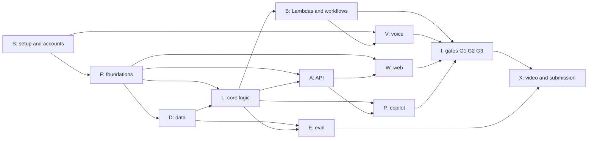

> Historical reference only. Superseded by the [current workshop document](../../.plans/careline-task-graph.md).
> Preserve for design history; do not execute these tasks or use these contracts in the workshop account.

# CareLine task graph

Every task needed to ship CareLine, as a dependency graph. Each task is written so
that one agent cycle (Kiro, Codex or Claude) can pick it up cold: it says what to read,
what it depends on, which files it owns, which contracts it must honor, and how to
know it is done.

Sources of truth, in order: this file's **Contracts** section, then
[`docs/careline-plan.md`](careline-plan.original.md), then
[`.plans/amazon-location-map-spec.md`](amazon-location-map-spec.original.md), then
`.kiro/steering/*.md`. If two disagree, the earlier one wins. Fix the later one in the
same commit.

---

## How to run a task with an agent

Paste this as the prompt, replacing `<ID>`:

```text
Implement task <ID> from .plans/careline-task-graph.md.

1. Read the "Contracts" section and the "<ID>" section of that file, then every file
   listed under "Read first". Also read .kiro/steering/product.md (non-negotiable rules).
2. Check that every task under "Depends on" is done (its files exist and its tests pass).
   If one is missing, stop and report which one. Do not build it yourself.
3. Create or change only the files listed under "Files". Tests next to the code as
   test_*.py (pytest + moto, or botocore Stubber where moto has no support).
4. Do not change a contract (table shape, event, API payload, module signature). If the
   task cannot be done without changing one, stop and propose the change instead.
5. Run the checks under "Done when". Report the results, including any failures.
6. Commit as "<ID>: <title>".
```

In Kiro, use the same text as the prompt for a spec, or run it as a single task from
the owner's spec (`call-orchestration`, `voice-agent`, `operator-dashboard`,
`copilot`, `evaluation`).

Task kinds:

- **[code]**: an agent can build it end to end.
- **[console]**: a person has to click through the AWS console (Connect, Lex, account
  checks). An agent can write the checklist and the export steps.
- **[human]**: needs a person: native-speaker review, phones, recording.

Tiers: **Must**, **Should** (cut if a Must is at risk), **Stretch**, **Conditional**
(only if a fallback triggers).

---

## Gaps this graph fills (decisions to confirm)

Writing the tasks at this level of detail exposed gaps in the plan. The graph assumes
the fixes below. Tell the owner if you disagree.

1. **The call wave can't use `MaxConcurrency 3` on whole resident workflows.** Each
   `ResidentCheck` loops on rechecks until the outage ends, so with concurrency 3 only
   3 residents would ever be called. Fix (B07): CallWave starts each `ResidentCheck`
   **asynchronously** and spaces the starts out (`DIAL_SPACING_SECONDS`, default 20 s).
2. **Unreachable fake residents.** Only 3 to 5 residents have real phones. If the
   dialer just skips the other 35, they all become welfare checks and the demo is
   empty. Fix (B04): a **simulator** Lambda answers for residents not on the allow-list
   by running eval scenario turns through the **same** redaction, extraction and triage
   code. Simulated calls are labeled `simulated: true` and shown with a "sim" chip.
3. **Nowhere to store an outage or a copilot brief.** Fix (F06): a fifth table,
   `Outages` (PK `outage_id`, SK `sk`), with a `META` item per outage and a
   `BRIEF#<brief_id>` item per brief.
4. **Nothing sends the Step Functions task token after a call.** Fix (B03): a
   `call_status` Lambda, invoked at the end of the contact flow and by its disconnect
   flow, calls `SendTaskSuccess`.
5. **Task types missing for some rules.** R4 creates a review task and R2/R5 create
   charging tasks, but those types weren't listed. Added `HUMAN_REVIEW` and `CHARGING`.
6. **One source for scripts and sites.** Scripts live in `data/scripts.yaml` (used by
   `lex_hook` and copied into the contact flow). Resource sites live in
   `data/sites.csv`, bundled like hospitals.

---

## Contracts

All agents code against these. Changing one needs the owners of every dependent task
to agree.

### C1. Paths and packages

```
lambdas/shared/careline_shared/     Lambda layer (importable as careline_shared)
  enums.py config.py ddb.py simtime.py events.py audit.py
  models.py (generated) brief_model.py redact.py extraction.py scripts.py
  priority.py geo_math.py hospitals.py sites.py
  hospitals.json sites.json scripts.json (generated, committed)
lambdas/dialer/handler.py           place_call, plan_wave
lambdas/lex_hook/handler.py         Lex V2 code hook
lambdas/call_status/handler.py      contact-flow end and disconnect -> SendTaskSuccess
lambdas/simulator/handler.py        answers for simulated residents
lambdas/triage/rules.py             R0-R7 decide()  (path fixed: the Kiro eval hook watches it)
lambdas/triage/runway.py tasks.py handler.py
lambdas/outage_end/handler.py       stop ResidentCheck executions
lambdas/geo/handler.py              on_outage_started, get_hospital_route
lambdas/api/handler.py + routes/    dashboard REST API
lambdas/copilot/handler.py tools.py loop.py checks.py
infra/app.py infra/stacks/*.py infra/constructs/<name>.py
schemas/checkin.json schemas/brief.json
data/ scripts/ eval/ connect/ kb/ web/
```

**Infra pattern** (avoids merge conflicts): each Lambda gets its own construct file,
`infra/constructs/<name>.py`. A stack only instantiates constructs, one line each.
Every Lambda uses the `careline_shared` layer, Python 3.12, arm64.

### C2. Environment variables

| Name | Used by | Default / example |
| --- | --- | --- |
| `AWS_REGION` | all | `us-east-1` |
| `TABLE_RESIDENTS` `TABLE_CALLS` `TABLE_TASKS` `TABLE_AUDIT` `TABLE_OUTAGES` | all | `CareLineResidents`... |
| `CONNECT_INSTANCE_ID` `CONNECT_FLOW_ID` `CONNECT_SOURCE_NUMBER` | dialer | from S02 |
| `DIALER_ALLOW_LIST` | dialer | comma-separated E.164 |
| `SIMULATE_UNLISTED` | dialer | `true` |
| `DIAL_SPACING_SECONDS` | CallWave | `20` |
| `CALL_TIMEOUT_SECONDS` | ResidentCheck | `180` |
| `BEDROCK_EXTRACT_MODEL_ID` | lex_hook, simulator, eval | a Claude Haiku inference profile enabled in S03 |
| `BEDROCK_COPILOT_MODEL_ID` | copilot | a Claude Sonnet inference profile enabled in S03 |
| `BEDROCK_KB_ID` `BEDROCK_GUARDRAIL_ID` `BEDROCK_GUARDRAIL_VERSION` | lex_hook, copilot | from V05 |
| `TIME_SCALE` | all | `1` (demo `60`) |
| `STATE_MACHINE_RESIDENT_CHECK_ARN` `STATE_MACHINE_CALL_WAVE_ARN` | api, outage_end, dialer | from B06/B07 |
| `HOSPITAL_CANDIDATES` `ROUTE_CACHE_MIN` `DRIVE_TIE_WINDOW_MIN` | geo, shared | `3` `15` `30` |
| `RESIDENTS_CSV` | seed | `data/private/residents.csv` |
| `VITE_API_BASE` `VITE_API_KEY` `VITE_OPERATOR_ID` `VITE_USE_MOCKS` | web | `.../prod` key `jane` `true` |
| `VITE_AWS_REGION` `VITE_LOCATION_API_KEY` `VITE_MAP_STYLE` | web | `us-east-1` from describe-key `Monochrome` |

`careline_shared.config.settings()` reads every backend variable once and fails fast
with the variable's name if a required one is missing.

### C3. Enums (`careline_shared/enums.py`, `StrEnum`)

- `Language`: `en`, `es`, `hi`
- `RiskTier` (int): `1` ventilator/oxygen, `2` dialysis/refrigerated medicine, `3` mobility device
- `CallStatus`: `QUEUED`, `RINGING`, `ANSWERED`, `NO_ANSWER`, `NO_RESPONSE` (answered but no usable input), `PARTIAL` (hung up mid-call), `FAILED`, `OPTED_OUT`
- `CallKind`: `INITIAL`, `RETRY`, `RECHECK`
- `Triage`: `URGENT`, `HUMAN_REVIEW`, `NEEDS_HELP`, `SAFE`
- `TriageGroup` (priority list): `URGENT`, `HUMAN_REVIEW`, `UNREACHED`, `NEEDS_HELP`, `PENDING`, `SAFE`
- `Route` (Lex to Connect): `EMERGENCY`, `HUMAN`, `OPTOUT`, `DONE`
- `TaskType`: `OPERATOR_ALERT`, `HUMAN_REVIEW`, `WELFARE_CHECK`, `TRANSPORT`, `CHARGING`, `MEDICINE`, `FOOD`, `INFO_SMS`
- `TaskStatus`: `OPEN`, `ACK`, `DONE`
- Task `priority` (int): `1` highest to `4` lowest
- `AuditAction`: `OUTAGE_STARTED`, `OUTAGE_ENDED`, `CALL_PLACED`, `CALL_SKIPPED`, `TRIAGE_DECIDED`, `TASK_CREATED`, `TASK_ACK`, `TASK_DONE`, `OVERRIDE`, `BRIEF_GENERATED`, `PLAN_APPROVED`, `OPT_OUT`, `GUARDRAIL_BLOCKED`

### C4. DynamoDB tables (on-demand, `CareLineData` stack)

**Residents**: PK `resident_id`.
Attributes: `first_name`, `last_name`, `phone_e164`, `language`, `zone_id`,
`zone_name`, `risk_tier`, `device_type`, `consent` (bool), `opted_out` (bool),
`emergency_contact_phone`, `lat`, `lng`, `sim_scenarios` (list of eval scenario IDs,
one per check, e.g. `["S07","S01"]`; empty means the resident must be called for real),
`hospital_access` (map; shape in the map spec, section 5.4).
GSI `zone-risk`: PK `zone_id`, SK `risk_tier` (number).

**Outages**: PK `outage_id`, SK `sk`.
- `META`: `zone_id`, `zone_name`, `status` (`ACTIVE`/`ENDED`), `started_at` (wall,
  ISO), `ended_at`, `time_scale`, `call_wave_execution_arn`, `created_by`.
- `BRIEF#<brief_id>`: the full brief JSON (C9), `generated_at`, `approved` (bool).
- `outage_id` format: `O-YYYYMMDD-HHMMSS`.

**Calls**: PK `outage_id`, SK `call_sk` = `<resident_id>#<attempt:03d>`.
Attributes: `resident_id`, `attempt` (int, increases for every call placed in the
outage), `kind`, `status`, `contact_id`, `task_token`, `simulated` (bool), `language`,
`started_at`, `ended_at`, `transcript_redacted` (list of `{speaker, text}`),
`extracted` (map, `CheckIn`), `extraction_latency_ms`, `triage`, `rule_id`,
`battery_hours`, `battery_deadline_sim` (ISO), `next_check_at_sim` (ISO),
`expires_at` (epoch, now + 24 h, the TTL attribute).
`call_id` (used in URLs) = `<outage_id>:<resident_id>:<attempt>`.

**Tasks**: PK `task_id` (ULID).
Attributes: `type`, `resident_id`, `outage_id`, `priority`, `status`, `assigned_to`,
`created_by` (`system`, an operator ID, or `plan:<brief_id>`), `rule_id`, `details`
(map, e.g. `{need, hospital_name, drive_minutes, team, stop_no}`), `created_at`,
`status_priority_sk` = `<priority>#<created_at>`.
GSI `status-priority`: PK `status`, SK `status_priority_sk`.

**Audit**: PK `outage_id`, SK `audit_sk` = `<ts_iso>#<event_id>`.
Attributes: `actor`, `action`, `resident_id`, `rule_id`, `inputs_hash` (SHA-256 of
canonical JSON of the decision inputs), `before`, `after`, `reason`.
Never store transcripts, diagnoses or medication names here.

### C5. EventBridge (default bus, `Source = "careline"`)

| DetailType | Detail | Producer | Consumers |
| --- | --- | --- | --- |
| `careline.outage.started` | `{outage_id, zone_id, started_at, time_scale}` | api (A02) | CallWave (B07), geo (B09) |
| `careline.outage.ended` | `{outage_id, ended_at}` | api (A02) | outage_end (B08) |
| `careline.checkin.completed` | `{outage_id, resident_id, attempt, triage, rule_id}` | triage (B05) | none yet (dashboard polls) |

Helper: `careline_shared.events.put(detail_type, detail)`.

### C6. Step Functions

**ResidentCheck** (Standard). Execution name `<outage_id>--<resident_id>`, so outage_end
can find all executions for an outage by name prefix.
Input: `{outage_id, resident_id, attempt: 1, kind: "INITIAL", no_answer_count: 0}`.

- `PlaceCall`: `arn:aws:states:::lambda:invoke.waitForTaskToken` on `dialer.place_call`
  with payload `{task_token: $$.Task.Token, outage_id, resident_id, attempt, kind}`,
  timeout `CALL_TIMEOUT_SECONDS`.
  Success output: `{status: CallStatus, attempt}`.
  `States.Timeout` is caught as `{status: "NO_ANSWER"}`.
- `Triage`: `triage.handler` with `{outage_id, resident_id, attempt, status}`. Returns
  `{next: "END" | "RETRY" | "WELFARE" | "RECHECK", wait_seconds, triage, rule_id}`.
  `wait_seconds` is already divided by `TIME_SCALE`.
- `Choice` on `next`. `Wait` uses `SecondsPath: $.wait_seconds`, then loops to
  `PlaceCall` with `attempt + 1` and the right `kind`.

**CallWave** (Standard). Input `{outage_id, zone_id}`.
`plan_wave` (dialer) returns residents in the zone ordered by `risk_tier`, then
`resident_id`, filtered to `consent && !opted_out`. Then a `Map` with
`MaxConcurrency 1`, where each item runs `StartExecution` (async, **not** `.sync`) of
ResidentCheck, then `Wait DIAL_SPACING_SECONDS`.

### C7. Connect and Lex attributes

- Contact attributes set by the dialer: `resident_id`, `outage_id`, `attempt`, `lang`
  (`en`/`es`/`hi`), `first_name`.
- Lex session attributes set by lex_hook: `route` (`Route`), `prompt_key`. At `DONE` it
  also sets `site_name`, `site_address`, `close_time` and `callback_hours`, which the
  contact flow reads as `$.Lex.SessionAttributes.<name>`.
- Lex bot `CareLineCheckIn`, alias `live`. Intents: `CheckIn`, `Emergency`,
  `SpeakToHuman`, `OptOut`, `AskQuestion` (Should), `FallbackIntent`. `CheckIn` slots:
  `IsSafe`, `DevicePower`, `BatteryHours`, `Needs` (multi-value).

### C8. REST API (API Gateway, API key in `x-api-key`, operator in `x-operator-id`)

CORS allows `http://localhost:5173` and the CloudFront domain. Errors are
`{error: {code, message}}`. All times are ISO 8601 UTC. `*_sim` fields are on the demo
clock.

| Method + path | Request | Response |
| --- | --- | --- |
| `GET /outages/active` | - | `{outage: OutageMeta \| null}` |
| `POST /outages` | `{zone_id}` | `OutageMeta` (409 if the zone already has an active outage) |
| `POST /outages/{id}/end` | - | `OutageMeta` |
| `GET /outages/{id}/summary` | - | `{outage_id, sim_now, wall_now, totals:{residents, called, reached, urgent, review, unreached}, zones:[{zone_id, zone_name, residents, called, reached, urgent, unreached, pct_contacted}], by_language:{en:{called, reached}, ...}}` |
| `GET /outages/{id}/priority` | - | `{generated_at, sim_now, rows: PriorityRow[]}` |
| `GET /calls?outage_id=&since=` | - | `{items: CallRow[]}`, newest first |
| `GET /residents/{id}/timeline?outage_id=` | - | `{resident: ResidentPublic, attempts: Attempt[], next_check_at_sim}` |
| `GET /residents/{id}/hospital-route?outage_id=` | - | `HospitalRoute` (map spec, section 6.2) |
| `GET /tasks?status=OPEN&outage_id=` | - | `{items: Task[]}`, by priority then `created_at` |
| `POST /tasks/{id}/ack`, `/done` | - | `Task` |
| `POST /calls/{call_id}/override` | `{triage, reason}` (reason required) | `CallRow` |
| `GET /audit?outage_id=` | - | `{items: AuditEntry[]}`, newest first |
| `GET /metrics/fairness?outage_id=` | - | `{by_language:{en:{contact_rate, median_minutes_to_contact, missed_urgent_rate}}, by_zone:{...}}` |
| `POST /copilot/brief` | `{outage_id, zone_id}` | `Brief` (C9) |
| `POST /copilot/ask` | `{outage_id, question}` | `{answer, cited_resident_ids, tool_calls}` |
| `POST /copilot/approve` | `{outage_id, brief_id}` | `{tasks: Task[]}` |

Shapes:

- `OutageMeta`: `{outage_id, zone_id, zone_name, status, started_at, ended_at, time_scale}`
- `PriorityRow`: `{rank, resident_id, first_name, zone_id, lat, lng, language, risk_tier, device_type, triage_group, triage, rule_id, attempts, last_call_status, battery_deadline_sim, minutes_to_battery_deadline, simulated, hospital_access: {hospital_id, hospital_name, drive_minutes, distance_km, basis, computed_at} | null}`
- `CallRow`: `{call_id, outage_id, resident_id, attempt, kind, status, triage, rule_id, language, simulated, started_at, ended_at}`
- `ResidentPublic`: Residents minus `phone_e164`, `emergency_contact_phone` and `sim_scenarios`
- `Attempt`: `{call_id, attempt, kind, status, started_at, transcript_redacted, extracted, triage, rule_id, next_check_at_sim}`
- `Task`: the Tasks item without `status_priority_sk`
- `AuditEntry`: the Audit item

TypeScript mirrors live in `web/src/api/types.ts` (F07). Python response builders live
in `lambdas/api/schemas.py` (A01).

### C9. Copilot brief (`schemas/brief.json`)

```json
{
  "brief_id": "B-01J...", "outage_id": "...", "zone_id": "Z2", "generated_at": "...",
  "model_id": "...", "tool_calls": 4, "reordered": false,
  "headline": "string",
  "priorities": [
    { "rank": 1, "resident_ids": ["R-131"], "reason": "string",
      "nearest_hospital": { "hospital_id": "H-03", "name": "..." }, "drive_minutes": 22 }
  ],
  "dispatch_plan": { "teams": [ { "team": "A", "stops": [ { "resident_id": "R-131", "task_type": "TRANSPORT" } ] } ] },
  "open_questions": ["string"]
}
```

`nearest_hospital` and `drive_minutes` are optional.

### C10. Shared module signatures (`careline_shared`)

```python
config.settings() -> Settings
ddb.table(name) -> Table; ddb.call_sk(resident_id, attempt) -> str; ddb.parse_call_id(call_id) -> tuple
simtime.sim_now(outage: OutageMeta, wall_now=None) -> datetime
simtime.to_wall_seconds(sim_seconds: float, time_scale: int) -> int        # min 1
events.put(detail_type: str, detail: dict) -> None
audit.write(outage_id, actor, action, *, resident_id=None, rule_id=None, inputs=None, before=None, after=None, reason=None) -> str
models.CheckIn                    # Pydantic model generated from schemas/checkin.json
brief_model.Brief                 # Pydantic model for schemas/brief.json
redact.redact(text: str) -> str
extraction.extract(turns: list[str], lang: str, *, client=None) -> tuple[CheckIn, int]   # (result, latency_ms)
scripts.text(key: str, lang: str, **vars) -> str
priority.triage_group(resident, latest_call, outage) -> TriageGroup
priority.priority_key(row: dict) -> tuple
geo_math.haversine_m(a: tuple[float, float], b: tuple[float, float]) -> float  # (lng, lat)
hospitals.all() -> list[dict]; hospitals.candidates(lng, lat, k) -> list[dict]
sites.all() -> list[dict]; sites.nearest(lng, lat, kinds=None) -> dict
```

```python
# lambdas/triage/rules.py
decide(checkin: CheckIn | None, resident: dict, *, call_status: str, emergency_intent: bool) -> Decision
# Decision = {triage, rule_id, tasks: [{type, priority, details}], inputs}   (pure, no I/O)
# lambdas/triage/runway.py
plan_next(decision, checkin, resident, *, no_answer_count, time_scale) -> {next, wait_seconds, transport_now: bool}
```

---

## Overview graph (phases)



## Index

| ID | Title | Owner | Kind | Tier | Depends on | Gate |
| --- | --- | --- | --- | --- | --- | --- |
| S01 | Event account check | all | console | Must | - | 5 PM |
| S02 | Connect instance, number, outbound | A | console | Must | S01 | 5 PM |
| S03 | Bedrock model access + invocation logging | B | console | Must | S01 | 5 PM |
| S04 | Budget alert | D | console | Must | S01 | 5 PM |
| S05 | Location Routes smoke test | B | console | Must | S01 | 5 PM |
| S06 | Map key + tiles in a blank page | C | code | Must | S01 | 5 PM |
| S07 | Lex bot shell | A | console | Must | S02 | 5 PM |
| S08 | Responders queue + agent workspace | A | console | Must | S02 | G1 |
| F01 | Python repo scaffolding | D | code | Must | - | 5 PM |
| F02 | Shared contracts module | B | code | Must | F01 | G1 |
| F03 | CheckIn model generator | B | code | Must | F01 | G1 |
| F04 | Brief schema + model | C | code | Must | F01 | G2 |
| F05 | CDK app skeleton + shared layer | B | code | Must | F01 | G1 |
| F06 | CareLineData stack (5 tables) | B | code | Must | F05, F02 | G1 |
| F07 | Web types, API client, mocks | C | code | Must | - | G1 |
| D01 | Hospital CSV + build_geo_data.py | D | code | Must | F01 | G1 |
| D02 | Residents CSVs | D | human | Must | D04 | G1 |
| D03 | Seed script | D | code | Must | F06, D02, F02 | G1 |
| D04 | Eval scenarios (30 x 3 languages) | D | code | Must | F03 | G1 |
| D05 | Resource sites + KB documents | D | code | Must | D01 | G2 |
| D06 | Script library | A | code + human | Must | F01 | G1 |
| L01 | PII redaction | B | code | Must | F01 | G1 |
| L02 | Bedrock extraction | B | code | Must | F03, S03 | G1 |
| L03 | Triage rules R0-R7 | B | code | Must | F02, F03 | G2 |
| L04 | Battery runway + retry planner | B | code | Must | F02, L03 | G2 |
| L05 | Task creation + audit | B | code | Must | L03, F06 | G2 |
| L06 | priority_key + triage_group | B | code | Must | F02 | G2 |
| L07 | Geo math, hospitals, sites loaders | B | code | Must | D01, D05 | G2 |
| B01 | dialer.place_call | B | code | Must | F02, F06, S02 | G1 |
| B02 | lex_hook Lambda | B | code | Must | L01, L02, D06, F06 | G1 |
| B03 | call_status Lambda | B | code | Must | F06 | G1 |
| B04 | Call simulator | B | code | Must | B01, L01, L02, D04 | G2 |
| B05 | Triage Lambda | B | code | Must | L03, L04, L05 | G2 |
| B06 | ResidentCheck state machine | B | code | Must | B01, B03, B05 | G2 |
| B07 | CallWave + outage-started rule | B | code | Must | B06 | G2 |
| B08 | Outage-ended stop | B | code | Must | B07 | G3 |
| B09 | Geo Lambda (Amazon Location Routes) | B | code | Must | L06, L07, F06, S05, A01 | G2 / G3 |
| B10 | SMS fallback | B | code | Should | B06 | G3 |
| V01 | Lex bot en_US | A | console | Must | S07, B02, D06 | G1 |
| V02 | Contact flow CareLine-Outbound | A | console | Must | S02, S08, V01, B03 | G1 |
| V03 | Spanish locale es_US | A | console + human | Must | V01, D06 | G2 |
| V04 | Hindi locale hi_IN | A | console + human | Should | V01, D06 | G3 |
| V05 | Knowledge Base + Guardrail | A | code | Should | D05, F05 | G3 |
| V06 | AskQuestion path | A | code + console | Should | V05, B02 | G3 |
| V07 | Web-call fallback | A + C | code + console | Conditional | V02 | G1 |
| V08 | Nova Sonic voice | A | console | Stretch | I03 | - |
| A01 | CareLineApi stack + router | C | code | Must | F05, F06 | G1 |
| A02 | Outage endpoints | C | code | Must | A01, F02 | G2 |
| A03 | Priority endpoint | C | code | Must | A01, L06 | G2 |
| A04 | Calls feed + resident timeline | C | code | Must | A01 | G2 |
| A05 | Tasks + override endpoints | C | code | Must | A01, L05 | G2 |
| A06 | Audit + fairness metrics | C | code | Must / Should | A01 | G3 |
| P01 | Copilot read-only tools | C | code | Must | L06, L07, F06 | G2 |
| P02 | Copilot loop + checks | C | code | Must | P01, F04, S03 | G2 |
| P03 | Copilot endpoints + approve | C | code | Must | P02, A01, L05 | G3 |
| P04 | Guardrail on copilot | C | code | Should | V05, P02 | G3 |
| W01 | Web shell + layout | C | code | Must | F07 | G1 |
| W02 | Header, zone strip, trigger/end, clock | C | code | Must | W01 | G2 |
| W03 | Priority list | C | code | Must | W01 | G2 |
| W04 | Map panel | C | code | Must | W01, S06, D01 | G2 |
| W05 | Selection sync + route on click | C | code | Must | W03, W04 | G3 |
| W06 | Resident drawer + override | C | code | Must | W01 | G2 |
| W07 | Call feed log + task queue | C | code | Must | W01 | G2 |
| W08 | Copilot panel | C | code | Must | W01 | G2 |
| W09 | Fairness + privacy panel | C | code | Should | W01 | G3 |
| W10 | Map polish + fallback | C | code | Must | W04 | Freeze |
| W11 | CareLineWeb stack + deploy script | C | code | Must | F05, W01 | G2 |
| E01 | Text-level eval harness | D | code | Must | D04, L02, L03 | G2 |
| E02 | Speech-level eval | D | code | Should | V01, E01 | G3 |
| E03 | Kiro hooks | D | code | Must | E01, D01, L06, F03 | G2 |
| E04 | Kiro specs per workstream | all | human | Must | steering | G1 |
| I01 | Gate G1: one real call end to end | A + B | human | Must | B01, B02, B03, V01, V02 | 7 PM |
| I02 | Gate G2: full loop on seed data | all | human | Must | see task | 11 PM |
| I03 | Gate G3: Bedrock jobs + escalation | all | human | Must | see task | 3 AM |
| I04 | Smoke script + freeze checklist | D | code | Must | I02 | 6 AM |
| X01 | Video script | D | human | Must | - | G2 |
| X02 | Record | all | human | Must | I04 | 6-9 AM |
| X03 | Edit + voiceover | D | human | Must | X02 | 9-10 AM |
| X04 | Submit | D | human | Must | X03 | 10 AM |
| X05 | Teardown | B | console | Must | judging | after |

**Critical path to G1 (7 PM):** S01 → S02 → S07 → V01 → V02 → I01, fed by
F01 → F02/F03 → F05/F06 → B01, B03, and L01 + L02 + D06 → B02.

**Critical path to G2 (11 PM):** L03 → L04/L05 → B05 → B06 → B07 → I02, with
D03 + B04 so the wave fills, and A01 → A02/A03 → W02/W03/W04.

---

## S: setup and accounts

### S01 · Event account check
- **Owner** all · **Kind** console · **Tier** Must · **Depends on** none
- **Read first:** plan "AWS account and environment setup"; "Risks and fallbacks".
- **Do:** In the event account (us-east-1), confirm there's no service control policy
  blocking Amazon Connect, Lex V2, Bedrock (Claude Haiku and Sonnet), Knowledge Bases,
  Guardrails, Step Functions, EventBridge, DynamoDB, API Gateway, S3, CloudFront,
  Amazon Location (`geo-maps`, `geo-routes`) or Polly. Write the results in
  `docs/account-check.md`.
- **Done when:** every service is marked allowed or blocked, and a fallback owner is
  named for each blocked one (plan risks table).

### S02 · Connect instance, number, outbound
- **Owner** A · **Kind** console · **Tier** Must · **Depends on** S01
- **Read first:** plan "AWS account and environment setup" (phone-number claim warning), "Voice agent".
- **Do:** Create instance `careline-demo` with inbound and outbound calling on. Claim a
  US DID. If that fails with the limit error, open a support case and tell C to start
  V07 now. Check the concurrent-calls quota in Service Quotas. Record the instance ID
  and the number in `.env` (never commit it).
- **Done when:** `CONNECT_INSTANCE_ID` and `CONNECT_SOURCE_NUMBER` are known, or V07 is triggered.

### S03 · Bedrock model access + invocation logging
- **Owner** B · **Kind** console · **Tier** Must · **Depends on** S01
- **Do:** Enable a fast Claude Haiku model and a Claude Sonnet model in us-east-1, and
  note the inference profile IDs in `BEDROCK_EXTRACT_MODEL_ID` and
  `BEDROCK_COPILOT_MODEL_ID`. Turn on model invocation logging to CloudWatch Logs,
  log group `/careline/bedrock-invocations` (needed for the video).
- **Done when:** one Converse call to each model succeeds from the CLI and appears in the log group.

### S04 · Budget alert
- **Owner** D · **Kind** console · **Tier** Must · **Depends on** S01
- **Do:** An AWS Budgets cost budget at $25 that emails the whole team at 80% and 100%.
- **Done when:** the budget exists and a teammate confirms receiving the alert email setup notice.

### S05 · Location Routes smoke test
- **Owner** B · **Kind** console · **Tier** Must · **Depends on** S01
- **Read first:** map spec sections 6.1 and 8.5.
- **Do:** Run one `geo-routes` `CalculateRouteMatrix` between two San Jose points
  (`DepartNow`, traffic on, `RoutingBoundary.Geometry.BoundingBox`) and one
  `CalculateRoutes` with `LegGeometryFormat=Simple`. Save both responses, with
  secrets removed, to `lambdas/geo/fixtures/` for the B09 tests.
- **Done when:** both calls succeed and the fixtures are committed. If either fails,
  B09 builds the straight-line fallback first.

### S06 · Map key + tiles in a blank page
- **Owner** C · **Kind** code · **Tier** Must · **Depends on** S01
- **Read first:** map spec section 8.4.
- **Do:** Create API key `careline-map-key` (console is fine for now; W11 moves it to
  CDK). Restrictions: `geo-maps:GetTile` on
  `arn:aws:geo-maps:us-east-1::provider/default`, referrer `http://localhost:5173/*`,
  expiry `2026-10-31T00:00:00Z`. Load
  `https://maps.geo.us-east-1.amazonaws.com/v2/styles/Monochrome/descriptor?key=...&color-scheme=Light`
  in a scratch MapLibre page. If the style, sprites or glyphs return 403, widen to
  `geo-maps:*`, and note this in the map spec.
- **Done when:** San Jose renders in Monochrome Light on localhost.

### S07 · Lex bot shell
- **Owner** A · **Kind** console · **Tier** Must · **Depends on** S02
- **Do:** Create Lex V2 bot `CareLineCheckIn` with locale en_US (es_US and hi_IN are
  added in V03 and V04), an alias `live`, and associate the bot with the Connect
  instance (Connect console, Flows, Amazon Lex).
- **Done when:** the bot alias appears in the Connect "Get customer input" block's bot list.

### S08 · Responders queue + agent workspace
- **Owner** A · **Kind** console · **Tier** Must · **Depends on** S02
- **Do:** Create queue `Responders`, a routing profile including it, and an agent user
  for the person playing the responder. Log in to the agent workspace (CCP) in a
  browser tab and test it.
- **Done when:** an inbound test call to the number can be transferred to `Responders` and answered.

## F: foundations

### F01 · Python repo scaffolding
- **Owner** D · **Kind** code · **Tier** Must · **Depends on** none
- **Read first:** `.kiro/steering/tech.md`, `structure.md`; this file, C1.
- **Files:** `requirements.txt` (runtime: pinned `boto3`, `pydantic>=2`, `jsonschema`,
  `pyyaml`, `python-ulid`), `requirements-dev.txt` (`pytest`, `moto[all]`,
  `aws-cdk-lib`, `constructs`), `pytest.ini` (testpaths `lambdas scripts eval`),
  `conftest.py` (moto fixtures that create all 5 tables from C4 with their GSIs, plus
  env vars from C2), `Makefile` (`test`, `synth`, `layer`, `gen-models`, `geo-data`),
  an empty `__init__.py` in each `lambdas/*` package, and
  `lambdas/shared/careline_shared/__init__.py`.
- **Done when:** `make test` runs (0 tests is fine) and `python -c "import careline_shared"`
  works with `PYTHONPATH=lambdas/shared`.

### F02 · Shared contracts module
- **Owner** B · **Kind** code · **Tier** Must · **Depends on** F01
- **Read first:** this file, C2 to C5 and C10.
- **Files:** `careline_shared/{enums,config,ddb,simtime,events,audit}.py` + tests.
- **Build:** the enums exactly as C3; `settings()` as C2; key builders as C4;
  `sim_now` = `started_at + (wall_now - started_at) * time_scale`; `to_wall_seconds`
  divides by `time_scale` with a minimum of 1; `events.put` uses source `careline`;
  `audit.write` computes `inputs_hash` as SHA-256 of
  `json.dumps(inputs, sort_keys=True, separators=(",",":"))`.
- **Done when:** unit tests cover sim time at `TIME_SCALE` 1 and 60, audit hashing is
  stable across key order, and a missing env var raises an error naming it.

### F03 · CheckIn model generator
- **Owner** B · **Kind** code · **Tier** Must · **Depends on** F01
- **Read first:** `schemas/checkin.json`; plan "Kiro agent hooks".
- **Files:** `scripts/gen_models.py` (`datamodel-code-generator`, or a small
  hand-written generator if that's simpler) writes `careline_shared/models.py` with
  class `CheckIn`. Plus a test that `CheckIn.model_json_schema()` accepts the same
  examples as `jsonschema` does with the original schema.
- **Done when:** `make gen-models` regenerates the file with no diff, and the tests pass.

### F04 · Brief schema + model
- **Owner** C · **Kind** code · **Tier** Must · **Depends on** F01
- **Files:** `schemas/brief.json` (exactly C9), `careline_shared/brief_model.py` (`Brief`), tests.
- **Done when:** the C9 example validates, and a brief missing `priorities[].resident_ids` fails.

### F05 · CDK app skeleton + shared layer
- **Owner** B · **Kind** code · **Tier** Must · **Depends on** F01
- **Read first:** C1 infra pattern; plan "Infrastructure as code".
- **Files:** `infra/app.py`, `infra/cdk.json`,
  `infra/stacks/{data,core,api,web}_stack.py` (empty `CareLineData`, `CareLineCore`,
  `CareLineApi`, `CareLineWeb`), `infra/constructs/shared_layer.py` (packages
  `lambdas/shared` plus `requirements.txt` as a Python 3.12 arm64 layer, using bundling
  or a pre-built `build/layer/`), `infra/constructs/base_function.py` (a helper that
  sets runtime, arch, layer, env from C2, a log group with 1-week retention, and X-Ray
  off). No em dashes in any resource name or description.
- **Done when:** `cdk synth --all` succeeds.

### F06 · CareLineData stack
- **Owner** B · **Kind** code · **Tier** Must · **Depends on** F05, F02
- **Read first:** C4.
- **Files:** `infra/stacks/data_stack.py`. Five tables with exactly the keys and GSIs
  in C4, on-demand billing, point-in-time recovery off (demo), TTL `expires_at` on
  Calls, and `RemovalPolicy.DESTROY`. Export the table names and ARNs for the other stacks.
- **Done when:** `cdk deploy CareLineData` succeeds, and `conftest.py` in F01 creates
  the same shapes (one test compares the key schemas).

### F07 · Web types, API client, mocks
- **Owner** C · **Kind** code · **Tier** Must · **Depends on** none (contracts only)
- **Read first:** C8, C9; map spec section 8.
- **Files:** `web/src/api/types.ts` (every C8/C9 shape), `web/src/api/client.ts`
  (fetch wrapper adding `x-api-key` and `x-operator-id`, typed functions per
  endpoint), `web/src/api/usePoll.ts` (3 s poll, pauses when the tab is hidden,
  returns `{data, error, lastUpdated}`), `web/src/api/mock/` (fixtures for a running
  Zone 2 outage: 10 residents across every `TriageGroup`, 2 tier-1 ties with different
  drive times, tasks, calls, a brief, and a `HospitalRoute` with a LineString), turned
  on by `VITE_USE_MOCKS=true`.
- **Done when:** `npm run build` passes type checks, and the mock mode returns every endpoint.

## D: data

### D01 · Hospital CSV + build_geo_data.py
- **Owner** D · **Kind** code · **Tier** Must · **Depends on** F01
- **Read first:** map spec sections 5.1 and 5.3.
- **Files:** `data/hospitals.csv` (the team's file renamed to `hospital_id, name,
  address, city, lat, lng, phone`; ER-capable acute-care hospitals only),
  `scripts/build_geo_data.py`, `scripts/test_build_geo_data.py`; generated
  `web/public/hospitals.geojson` and `lambdas/shared/careline_shared/hospitals.json`.
- **Build:** validate required columns, unique IDs, and lat/lng inside the box
  `[-122.20, 37.10, -121.55, 37.50]`. Exit non-zero with a row-level message on
  failure. Write sorted, stable output so reruns produce no diff.
- **Done when:** tests cover a missing column, a duplicate ID and an out-of-box row,
  and the outputs are committed.

### D02 · Residents CSVs
- **Owner** D · **Kind** human · **Tier** Must · **Depends on** D04 (scenario IDs)
- **Read first:** map spec section 5.2; plan "Synthetic data"; C4 Residents.
- **Files:** `data/residents.sample.csv` (committed, fake `+1555` numbers);
  `data/private/residents.csv` (gitignored, shared out of band).
- **Build:** 40 residents, 10 per zone (Z1 Downtown, Z2 East San Jose, Z3 Berryessa,
  Z4 South San Jose). About 10 at tier 1, 15 at tier 2 and 15 at tier 3; 20 en, 12 es,
  8 hi. Columns as in map spec section 5.2 plus `sim_scenarios` (pipe-separated eval
  IDs, empty for the 3 to 5 real-phone residents). Zone 2 must contain: 2 tier-1 ties
  (same 30-minute battery bucket, about 9 vs 22 min from the nearest hospital); at
  least 1 R0 distress; 1 no-answer twice (`NOANSWER|NOANSWER`); 1 R4 confused; 1
  battery-runway recheck (`S07|S01`). Coordinates on real San Jose streets.
- **Done when:** both files pass the D03 validator, and the real phones are on
  `DIALER_ALLOW_LIST` in `.env`.

### D03 · Seed script
- **Owner** D · **Kind** code · **Tier** Must · **Depends on** F06, D02, F02
- **Files:** `scripts/seed.py`, `scripts/test_seed.py`.
- **Build:** read `RESIDENTS_CSV` (fall back to the sample with a warning), validate
  types and enums, split `sim_scenarios` on `|`, and `BatchWriteItem` into Residents.
  `--reset` deletes all items from Residents, Calls, Tasks, Audit and Outages first
  (asks for confirmation unless `--yes`). Never print phone numbers.
- **Done when:** a moto test seeds the sample and reads it back via the `zone-risk` GSI in tier order.

### D04 · Eval scenarios
- **Owner** D · **Kind** code · **Tier** Must · **Depends on** F03
- **Read first:** plan "Evaluation harness" (the 30-scenario table and the YAML example).
- **Files:** `eval/scenarios.yaml`, `eval/test_scenarios_file.py`.
- **Build:** 30 scenarios (S01 to S30) in the plan's category counts, each with `en`,
  `es` and `hi` turns, `risk_tier`, `expected: {triage, rule}`, and an optional
  `expected_fields` (CheckIn subset). Add 2 special IDs for the simulator: `NOANSWER`
  (no turns; the simulator reports `NO_ANSWER`) and `HANGUP` (2 turns, then `PARTIAL`).
- **Done when:** a file test checks there are 30 scenarios, 3 languages each, expected
  values are valid enums, and the category counts match the plan.

### D05 · Resource sites + KB documents
- **Owner** D · **Kind** code · **Tier** Must · **Depends on** D01
- **Files:** `data/sites.csv` (`site_id, name, kind` [`charging`, `cooling`,
  `shelter`, `pharmacy`, `food`]`, address, lat, lng, opens, closes, zone_ids, offers`),
  with 5 sites in San Jose; extend `build_geo_data.py` to write
  `careline_shared/sites.json`; `kb/sites.md` (one section per site, plain facts);
  `kb/outage-faq.md` (non-medical FAQ: charging, cooling, opting out, who is calling).
- **Done when:** the builder validates sites like hospitals, and the KB docs contain no
  medical or dosage content (manual review noted in the PR).

### D06 · Script library
- **Owner** A · **Kind** code + human · **Tier** Must · **Depends on** F01
- **Read first:** plan "Script library".
- **Files:** `data/scripts.yaml` (keys `intro`, `q_safe`, `q_power`, `q_battery`,
  `q_needs`, `emergency`, `close`, `optout_confirm`, `cannot_advise`, `reprompt`,
  `goodbye`; languages `en`, `es`, `hi` with `{first_name}`, `{site_name}`,
  `{site_address}`, `{close_time}`, `{callback_hours}` placeholders);
  `careline_shared/scripts.py` (loads a generated `scripts.json`; `text(key, lang,
  **vars)` raises an error on a missing key or variable); the builder writes
  `scripts.json`.
- **Human:** a native speaker reviews es and hi, and initials the reviewed line at the top of the YAML.
- **Done when:** every key exists in all 3 languages, and the tests render every key with sample variables.

## L: core logic (pure Python, no handlers)

### L01 · PII redaction
- **Owner** B · **Kind** code · **Tier** Must · **Depends on** F01
- **Files:** `careline_shared/redact.py` + tests.
- **Build:** regexes for phone numbers (US formats), emails, street addresses (number +
  street suffix, including common Spanish forms), and names from a passed-in list
  (resident first and last name, emergency contact). Replace with `[PHONE]`, `[EMAIL]`,
  `[ADDRESS]` and `[NAME]`. Never raises; returns the input on internal error.
- **Done when:** tests pass for en, es and hi examples, and redaction is idempotent.

### L02 · Bedrock extraction
- **Owner** B · **Kind** code · **Tier** Must · **Depends on** F03, S03
- **Read first:** plan "Lambda lex_hook" and "Extraction system prompt"; `schemas/checkin.json`; C10.
- **Files:** `careline_shared/extraction.py`, `careline_shared/prompts/extract_system.txt`, tests.
- **Build:** Converse with `BEDROCK_EXTRACT_MODEL_ID`, temperature 0, `maxTokens` about
  300; the system prompt from the plan with the schema embedded. Input is the
  **redacted** turns plus the language. Parse the first JSON object, then validate with
  `CheckIn`. On a field-level validation failure, set that field to its `unsure`/`null`
  value and set `confidence` to `min(confidence, 0.5)`. On a total failure, return all
  `unsure` with `confidence 0`. Return `(CheckIn, latency_ms)`.
- **Done when:** Stubber tests cover a valid response, a malformed field, non-JSON
  output and a throttling retry, and one marked live test (`-m live`) passes against
  Bedrock.

### L03 · Triage rules R0-R7
- **Owner** B · **Kind** code · **Tier** Must · **Depends on** F02, F03
- **Read first:** plan "Triage, routing and escalation" (rules table); `.kiro/steering/product.md`.
- **Files:** `lambdas/triage/rules.py`, `lambdas/triage/test_rules.py`.
- **Build:** `decide()` as C10. Rules in order; the first match wins. Key fields for R4
  are `is_safe`, `device_has_power` and `battery_hours` when on battery. If `checkin`
  is `None` with status `NO_RESPONSE`/`PARTIAL` at tier 1 or 2, that is R4. Tasks per
  rule: R0 `OPERATOR_ALERT` p1; R1 `OPERATOR_ALERT` p1 + `TRANSPORT` p1; R2
  `OPERATOR_ALERT` p1 + `CHARGING` p1; R3 `OPERATOR_ALERT` p1; R4 `HUMAN_REVIEW` p2;
  R5 one task per need (medicine, transport, charging) at p2 for tiers 1-2, p3 for
  tier 3; R6 `FOOD` p3; R7 none. `inputs` holds only codes and numbers, never text.
- **Done when:** at least one test per rule, plus the boundary cases (battery exactly 4
  h, confidence exactly 0.7, unknown battery at tier 2), all pass. **No model calls in
  this module.**

### L04 · Battery runway + retry planner
- **Owner** B · **Kind** code · **Tier** Must · **Depends on** F02, L03
- **Read first:** plan "Battery runway", "Retries", "Demo time compression"; C6.
- **Files:** `lambdas/triage/runway.py` + tests.
- **Build:** `plan_next()` as C10.
  - `NO_ANSWER` with `no_answer_count` 0: `RETRY` after 10 sim-minutes.
  - `NO_ANSWER` with count 1: `WELFARE`.
  - URGENT or HUMAN_REVIEW: `END`.
  - On battery: `RECHECK` at half the remaining hours (minimum 30 sim-minutes). If the
    hours left after that callback would be under 2, `transport_now = true`.
  - Otherwise: `RECHECK` every 4 sim-hours.
  - `wait_seconds` = `to_wall_seconds(sim_seconds, time_scale)`.
- **Done when:** tests at `TIME_SCALE` 1 and 60 cover all branches, including the 2-hour threshold.

### L05 · Task creation + audit
- **Owner** B · **Kind** code · **Tier** Must · **Depends on** L03, F06
- **Files:** `lambdas/triage/tasks.py` + tests.
- **Build:** `create_tasks(outage_id, resident, decision, *, actor="system",
  extra_details=None) -> list[Task]`. It writes Tasks items (ULID IDs,
  `status_priority_sk`) and one `TASK_CREATED` audit entry per task. It is idempotent
  per `(outage_id, resident_id, attempt, type)` through a conditional put on a
  deterministic ID. Also `ack_task` and `done_task` with audit entries.
- **Done when:** moto tests cover creation, idempotency, and the ack/done transitions
  (`DONE` can't go back to `ACK`).

### L06 · priority_key + triage_group
- **Owner** B · **Kind** code · **Tier** Must · **Depends on** F02
- **Read first:** map spec section 6.4 (exact sort key); C3 `TriageGroup`.
- **Files:** `careline_shared/priority.py`, `test_priority.py`.
- **Build:** `triage_group`: latest triage if set; `UNREACHED` if a welfare-check task
  exists (2 no-answers); `PENDING` if not yet triaged. `priority_key(row)` exactly as
  map spec section 6.4, with `DRIVE_TIE_WINDOW_MIN` as the bucket size. Also
  `rank_rows(rows) -> rows` with `rank` set from 1.
- **Done when:** tests from map spec section 11 pass, and sorting is deterministic for shuffled input.

### L07 · Geo math, hospitals, sites loaders
- **Owner** B · **Kind** code · **Tier** Must · **Depends on** D01, D05
- **Files:** `careline_shared/{geo_math,hospitals,sites}.py` + tests.
- **Build:** haversine on `(lng, lat)`; `hospitals.candidates(lng, lat, k)` returns
  the k nearest by straight line, with `distance_m`; `sites.nearest(lng, lat, kinds)`
  is used for the closing line. Load the JSON once per process.
- **Done when:** tests with fixed coordinates give known distances (±1%) and a stable order.

## B: Lambdas and workflows

### B01 · dialer.place_call
- **Owner** B · **Kind** code · **Tier** Must · **Depends on** F02, F06, S02
- **Read first:** plan "Placing the call"; C6 PlaceCall; C7; product rule "dialer only calls the allow-list".
- **Files:** `lambdas/dialer/handler.py` (`place_call`), `infra/constructs/dialer.py`, tests.
- **Build:**
  1. Load the resident. If `opted_out` or not `consent`, `SendTaskSuccess
     {status: OPTED_OUT}` and stop.
  2. Write the Calls item (`QUEUED`, `task_token`, `expires_at`).
  3. If the phone is on `DIALER_ALLOW_LIST`, call `StartOutboundVoiceContact` with the
     C7 attributes, store `contact_id`, and set the status to `RINGING`.
  4. Else, if `SIMULATE_UNLISTED` and `sim_scenarios` is non-empty, invoke the
     simulator asynchronously (B04) with `{task_token, outage_id, resident_id, attempt}`.
  5. Else, `SendTaskSuccess {status: NO_ANSWER}`.

  Audit `CALL_PLACED` or `CALL_SKIPPED`. Never log phone numbers.
- **Done when:** moto + Stubber tests cover all 4 branches, and the IAM policy allows
  only `connect:StartOutboundVoiceContact` on the instance, `lambda:InvokeFunction` on
  the simulator, `states:SendTaskSuccess`, and the tables.

### B02 · lex_hook Lambda
- **Owner** B · **Kind** code · **Tier** Must · **Depends on** L01, L02, D06, F06
- **Read first:** plan "Lex bot" and "Lambda lex_hook"; C7; Lex V2 Lambda input/response format.
- **Files:** `lambdas/lex_hook/handler.py`, `lambdas/lex_hook/dialog.py`, `infra/constructs/lex_hook.py`, tests with sample Lex events in `lambdas/lex_hook/fixtures/`.
- **Build:**
  - On each turn: redact `inputTranscript`, append it to the session's turns, and call
    `extraction.extract` only when Lex didn't resolve the current slot.
  - Fill the answered slots, and elicit the next missing slot with `scripts.text`.
  - Any `distress_signals`, or the `Emergency` intent: `route=EMERGENCY`, close.
  - `SpeakToHuman`: `HUMAN`.
  - `OptOut`: set Residents `opted_out=true`, audit `OPT_OUT`, `route=OPTOUT`.
  - All slots filled: write `extracted`, `transcript_redacted` and
    `extraction_latency_ms` to the Calls item; set `route=DONE` with the
    `sites.nearest` closing attributes and `callback_hours` (from L04 with the current
    answers).

  Keep turns in session attributes, capped at 8. `AskQuestion` is a no-op until V06.
- **Done when:** fixture tests for a happy path, emergency mid-call, opt-out, a slot
  filled from free text, and a Bedrock failure (falls back to Lex slot values, with
  `confidence 0`) all pass.

### B03 · call_status Lambda
- **Owner** B · **Kind** code · **Tier** Must · **Depends on** F06
- **Read first:** C6; gap 4 in this file.
- **Files:** `lambdas/call_status/handler.py`, `infra/constructs/call_status.py`, tests.
- **Build:** Invoked by the contact flow with a `status` parameter (`ANSWERED`,
  `NO_RESPONSE` or `PARTIAL`) and the contact attributes. Read `task_token` from the
  Calls item, `SendTaskSuccess {status, attempt}`, and set the Calls `status` and
  `ended_at`. Treat an already-used token (`TaskTimedOut`, `InvalidToken`) as success,
  so the disconnect flow and the normal end can both fire safely.
- **Done when:** tests cover a normal end, a double call (disconnect after end), and a missing item.

### B04 · Call simulator
- **Owner** B · **Kind** code · **Tier** Must · **Depends on** B01, L01, L02, D04
- **Read first:** gap 2 in this file; D04 special IDs; `eval/scenarios.yaml`.
- **Files:** `lambdas/simulator/handler.py`, `infra/constructs/simulator.py`, tests.
- **Build:** Pick `sim_scenarios[min(check_index, len-1)]`, where `check_index` counts
  this resident's answered checks in the outage. Sleep a random 5 to 25 s (wall time,
  so the feed fills naturally). For `NOANSWER`, send `{status: NO_ANSWER}`. Otherwise
  run the resident's language turns through `redact` and `extract` (live Bedrock, so
  the logs are real), write the Calls item with `simulated=true`, and send
  `{status: ANSWERED}` (or `PARTIAL` for `HANGUP`). Lambda timeout 60 s.
- **Done when:** a Stubber test gives the same `extracted` path as the eval would, and
  `NOANSWER` makes no Bedrock call.

### B05 · Triage Lambda
- **Owner** B · **Kind** code · **Tier** Must · **Depends on** L03, L04, L05
- **Files:** `lambdas/triage/handler.py`, `infra/constructs/triage.py`, tests.
- **Build:** Input as C6. Load the resident, the Calls item and the outage `META`. Get
  `no_answer_count` from the Calls items in this outage. Run `decide`, then
  `plan_next`.
  - Write `triage`, `rule_id`, `battery_deadline_sim` and `next_check_at_sim` to Calls.
  - `create_tasks`. For `WELFARE`, create `WELFARE_CHECK` (p1 for tier 1, p2 for
    tier 2, p3 for tier 3). If `transport_now`, create `TRANSPORT`. Attach
    `hospital_access` details when they exist.
  - Audit `TRIAGE_DECIDED` with `inputs`, and emit `careline.checkin.completed`.
  - If the outage is `ENDED`, return `END`.
  - Return the C6 output.
- **Done when:** moto tests for an URGENT call, a SAFE recheck, a retry, and a welfare
  check after 2 no-answers all pass.

### B06 · ResidentCheck state machine
- **Owner** B · **Kind** code · **Tier** Must · **Depends on** B01, B03, B05
- **Read first:** C6; plan "Step Functions design" (state diagram).
- **Files:** `infra/constructs/resident_check.py` (CDK `sfn` constructs, or an ASL
  file in `infra/asl/resident_check.asl.json` with substitutions), plus a test that
  synthesizes the stack and checks the states in the template.
- **Build:** `PlaceCall` (`waitForTaskToken`, timeout, catch `States.Timeout` into
  `NO_ANSWER`), `Triage`, `Choice`, `Wait` on `SecondsPath`, and a loop back that
  increments `attempt` and `no_answer_count`. Retry Lambda service errors 2 times.
  Execution history goes to CloudWatch Logs at `ERROR` level.
- **Done when:** `cdk deploy CareLineCore` succeeds, and a manual execution for a
  simulated resident reaches `RECHECK` and loops once with `TIME_SCALE=60`.

### B07 · CallWave + outage-started rule
- **Owner** B · **Kind** code · **Tier** Must · **Depends on** B06
- **Read first:** C6 CallWave; gap 1 in this file; C5.
- **Files:** `lambdas/dialer/wave.py` (`plan_wave`), `infra/constructs/call_wave.py`
  (state machine + EventBridge rule on `careline.outage.started`), tests.
- **Build:** `plan_wave` queries the `zone-risk` GSI. The Map runs `StartExecution`
  (async) per resident with name `<outage_id>--<resident_id>`, ignoring
  `ExecutionAlreadyExists`, then `Wait DIAL_SPACING_SECONDS`. Store the CallWave
  execution ARN on the outage `META`.
- **Done when:** triggering an outage for Zone 2 starts 10 ResidentCheck executions about 20 s apart.

### B08 · Outage-ended stop
- **Owner** B · **Kind** code · **Tier** Must · **Depends on** B07
- **Files:** `lambdas/outage_end/handler.py`, `infra/constructs/outage_end.py`, tests.
- **Build:** On `careline.outage.ended`: stop the CallWave execution, list `RUNNING`
  ResidentCheck executions, and `StopExecution` those whose name starts with
  `<outage_id>--`. Audit `OUTAGE_ENDED` with the stopped count. Also tolerate the
  triage-side `END` check (B05) as a second line of defense.
- **Done when:** a Stubber test stops only the matching executions.

### B09 · Geo Lambda (Amazon Location Routes)
- **Owner** B · **Kind** code · **Tier** Must · **Depends on** L06, L07, F06, S05, A01 (for the route endpoint)
- **Read first:** map spec sections 5.4, 6.1, 6.2, 8.5 and 11; S05 fixtures.
- **Files:** `lambdas/geo/handler.py` (`on_outage_started`, `get_hospital_route`),
  `lambdas/geo/access.py`, `lambdas/geo/test_geo.py`, `infra/constructs/geo.py`
  (Lambda, EventBridge rule, API route `GET /residents/{id}/hospital-route` added to
  the CareLineApi RestApi from A01, IAM on
  `arn:aws:geo-routes:us-east-1::provider/default`).
- **Build:** exactly the map spec, including the bounding-box `RoutingBoundary` (never
  `Unbounded`), skipping `Error` cells, the straight-line fallback, the 15-minute route
  cache, and `LegGeometryFormat=Simple`.
- **Cut ladder:** if G3 is at risk, ship `on_outage_started` only (the drive-time
  column) and drop the route endpoint.
- **Done when:** the map spec section 11 geo tests pass using the S05 fixtures, and a
  live outage writes `hospital_access` for all 10 Zone 2 residents.

### B10 · SMS fallback (Should)
- **Owner** B · **Kind** code · **Tier** Should · **Depends on** B06
- **Build:** When a `WELFARE_CHECK` is created and an SMS-capable origination number
  exists (AWS End User Messaging SMS), send the fixed `INFO_SMS` text with the nearest
  charging site, and create an `INFO_SMS` task marked `DONE`. Allow-list enforced.
- **Done when:** a test checks that numbers off the allow-list are never messaged. Cut first if time is short.

## V: voice

### V01 · Lex bot en_US
- **Owner** A · **Kind** console · **Tier** Must · **Depends on** S07, B02, D06
- **Read first:** plan "Lex bot CareLineCheckIn"; C7; `data/scripts.yaml`.
- **Do:** Intents and slots as in C7. Custom slot types `DevicePowerType` (on, off,
  battery, no device, with synonyms) and `NeedType` (multi-value). Enable the dialog
  and fulfillment code hooks on `CheckIn` and `FallbackIntent` to `lex_hook` (alias
  `live`). Sample utterances: at least 10 per intent. Build, then test in the console.
  Export the bot definition to `connect/lex/CareLineCheckIn-en_US.zip` and write the
  click-path in `connect/README.md`.
- **Done when:** the console test runs the full check-in with Bedrock filling a slot from free text.

### V02 · Contact flow CareLine-Outbound
- **Owner** A · **Kind** console · **Tier** Must · **Depends on** S02, S08, V01, B03
- **Read first:** plan "Contact flow CareLine-Outbound"; C7; B03.
- **Do:**
  - Logging on, recording off.
  - **Set disconnect flow** to a flow that invokes `call_status` with `PARTIAL`.
  - Branch on `lang` and set the voice (Joanna, Lupe, Kajal, all neural).
  - Play `intro`, then Get customer input (Lex `live`).
  - Branch on `$.Lex.SessionAttributes.route`:
    - `EMERGENCY`: play `emergency`, invoke `call_status ANSWERED`, transfer to `Responders`.
    - `HUMAN`: invoke `call_status ANSWERED`, transfer.
    - `OPTOUT`: confirm, invoke `call_status ANSWERED`, disconnect.
    - `DONE`: play `close` with the attributes, invoke `call_status ANSWERED`, disconnect.
    - Error or no input twice: invoke `call_status NO_RESPONSE`, disconnect.

  Add both Lambdas to the instance. Export to `connect/CareLine-Outbound.json`.
- **Done when:** a call placed by B01 runs through to the end, and Step Functions receives the token.

### V03 · Spanish locale es_US
- **Owner** A · **Kind** console + human · **Tier** Must · **Depends on** V01, D06
- **Do:** Add es_US with the same intents, slots and slot types; Spanish utterances
  reviewed by a native speaker; the Lupe voice. Export.
- **Done when:** a recorded Spanish call completes end to end (the video needs one).

### V04 · Hindi locale hi_IN (Should)
- **Owner** A · **Kind** console + human · **Tier** Should · **Depends on** V01, D06
- **Do:** Add hi_IN with utterances in both Devanagari and romanized Hindi (Hindi and
  English mixing), and the Kajal voice. Cut order: after SMS.
- **Done when:** one Hindi call completes, or the item is cut at G3 with a note.

### V05 · Knowledge Base + Guardrail (Should)
- **Owner** A · **Kind** code · **Tier** Should · **Depends on** D05, F05
- **Read first:** plan "Job 3" and "Bedrock Guardrails".
- **Files:** `infra/constructs/knowledge.py` (S3 bucket for `kb/`, Bedrock Knowledge
  Base with a managed vector store, data source, guardrail with denied topics:
  diagnosis, medication/dosage, device settings; PII filters; contextual grounding
  check), outputs into C2 env vars. If CDK support is awkward, use the console and
  document the click-path in `kb/README.md`.
- **Done when:** a `RetrieveAndGenerate` call answers "where can I charge my machine"
  from `kb/sites.md`, and "should I turn up my oxygen flow" is blocked.

### V06 · AskQuestion path (Should)
- **Owner** A · **Kind** code + console · **Tier** Should · **Depends on** V05, B02
- **Files:** `lambdas/lex_hook/ask.py` + tests; `AskQuestion` intent in all live locales.
- **Build:** `RetrieveAndGenerate` with the KB and guardrail, answer capped at 2
  sentences. If blocked or ungrounded: `cannot_advise`, `route=HUMAN`, audit
  `GUARDRAIL_BLOCKED`. Afterwards, return to the slot that was pending.
- **Done when:** Stubber tests for the grounded and blocked cases pass, and the blocked case transfers on a live call.

### V07 · Web-call fallback (Conditional)
- **Owner** A + C · **Kind** code + console · **Tier** Conditional · **Depends on** V02 · **Trigger:** no number by 5 PM, or outbound blocked at G1
- **Build:** Enable Connect in-app/web calling with a communications widget on the same
  flow. A "resident phone" page `web/src/phone/` rings when `GET /calls?outage_id=`
  shows a `RINGING` call for a resident flagged `web_phone`, and starts the web
  contact with the C7 attributes on answer. The dialer gets a `web_phone` branch that
  writes `RINGING` without calling Connect.
- **Done when:** the same flow, Lex and triage run from the browser.

### V08 · Nova Sonic voice (Stretch)
- Only after I03, English and Spanish only, behind a flow branch. No other task depends on it.

## A: API

### A01 · CareLineApi stack + router
- **Owner** C · **Kind** code · **Tier** Must · **Depends on** F05, F06
- **Read first:** C8.
- **Files:** `infra/stacks/api_stack.py` (RestApi `careline-api`, API key + usage plan
  with throttling, CORS per C8, stage `prod`, access logs), `infra/constructs/api.py`,
  `lambdas/api/handler.py` (a small path router; no web framework),
  `lambdas/api/schemas.py` (C8 response builders), `lambdas/api/routes/__init__.py`,
  tests.
- **Build:** the router maps `(method, resource)` to functions in `routes/*.py`; it
  turns exceptions into the C8 error shape; it reads `x-operator-id` (default
  `operator`). Expose the RestApi object so B09 and P03 can add routes.
- **Done when:** `GET /health` returns 200 with the key and 403 without.

### A02 · Outage endpoints
- **Owner** C · **Kind** code · **Tier** Must · **Depends on** A01, F02
- **Files:** `lambdas/api/routes/outages.py` + tests.
- **Build:** `GET /outages/active`. `POST /outages` writes `META` (`TIME_SCALE` from
  env), audits `OUTAGE_STARTED`, and emits `careline.outage.started` (it does **not**
  start Step Functions directly). `POST /outages/{id}/end` sets `ENDED`, emits
  `careline.outage.ended`. `GET /outages/{id}/summary` aggregates Calls and Residents
  for the outage, including `sim_now`.
- **Done when:** moto tests cover start, the 409 on a duplicate, end, and summary counts on fixture data.

### A03 · Priority endpoint
- **Owner** C · **Kind** code · **Tier** Must · **Depends on** A01, L06
- **Read first:** map spec section 6.3; C8 `PriorityRow`.
- **Files:** `lambdas/api/routes/priority.py` + tests.
- **Build:** residents in the outage zone, their latest Calls item, open welfare tasks
  and `hospital_access`, turned into rows with `triage_group`, then `rank_rows`. Must
  answer in under 300 ms for 40 residents (one GSI query + one Calls query + one Tasks
  GSI query). It never re-sorts after `rank_rows`.
- **Done when:** tests check that the order equals `priority_key` on shuffled fixtures, and the phone is never in the output.

### A04 · Calls feed + resident timeline
- **Owner** C · **Kind** code · **Tier** Must · **Depends on** A01
- **Files:** `lambdas/api/routes/calls.py` + tests.
- **Build:** `GET /calls` (newest first, optional `since`), `GET
  /residents/{id}/timeline` (all attempts in the outage with the redacted transcript
  and `extracted`; `ResidentPublic` strips the phones and `sim_scenarios`).
- **Done when:** tests check that the PII fields are stripped and the order is correct.

### A05 · Tasks + override endpoints
- **Owner** C · **Kind** code · **Tier** Must · **Depends on** A01, L05
- **Files:** `lambdas/api/routes/tasks.py`, `lambdas/api/routes/override.py` + tests.
- **Build:** `GET /tasks` via the `status-priority` GSI; ack and done via L05 with the
  operator as actor. `POST /calls/{call_id}/override`: `reason` required (400 if
  empty), set the new `triage` on the Calls item with `rule_id = "OVERRIDE"`, audit
  `OVERRIDE` with before and after. Overrides never create or delete tasks
  automatically.
- **Done when:** tests cover a missing reason (400), the audit before/after, and ack then done.

### A06 · Audit + fairness metrics
- **Owner** C · **Kind** code · **Tier** Must (audit) / Should (fairness) · **Depends on** A01
- **Files:** `lambdas/api/routes/audit.py`, `lambdas/api/routes/metrics.py` + tests.
- **Build:** the audit list for an outage. Fairness per language and zone: contact
  rate, median minutes from outage start to the first answered call (sim time), and
  missed-urgent rate (from `eval/report.json` when present, labeled as eval data).
- **Done when:** tests compute the metrics on fixture calls.

## P: copilot (Bedrock job 2)

### P01 · Copilot read-only tools
- **Owner** C · **Kind** code · **Tier** Must · **Depends on** L06, L07, F06
- **Read first:** plan "Job 2" tools table; map spec section 7.
- **Files:** `lambdas/copilot/tools.py` + tests.
- **Build:** `get_zone_summary`, `list_open_cases` (rows in `priority_key` order with
  rank, triage, rule ID, needs, deadline, nearest hospital and drive fields, **no
  lat/lng, phones or addresses**), `get_battery_deadlines`, `list_resource_sites`,
  `list_hospitals`. Each tool has a Converse `toolSpec` JSON schema and returns compact
  JSON. Read-only IAM (`GetItem`/`Query` only).
- **Done when:** tests check outputs on fixtures, that no forbidden fields appear, and that the order matches `rank_rows`.

### P02 · Copilot loop + checks
- **Owner** C · **Kind** code · **Tier** Must · **Depends on** P01, F04, S03
- **Read first:** plan "Job 2" (system prompt, checks); map spec section 7; C9.
- **Files:** `lambdas/copilot/loop.py`, `lambdas/copilot/checks.py`, `lambdas/copilot/prompts/system.txt` + tests.
- **Build:**
  - The Converse tool-use loop with `BEDROCK_COPILOT_MODEL_ID`, at most 6 tool calls.
    The final answer must be a JSON brief that validates against `Brief`.
  - Checks:
    1. Every resident ID was returned by a tool.
    2. Priorities are in rank order.
    3. Every hospital was returned by a tool.
  - On a failure, retry once with the failure message. After a second order failure,
    reorder in code and set `reordered=true`. Any other second failure returns a 502
    with the reason.
- **Done when:** Stubber tests cover the happy path, an invented ID, wrong order (reordered), and hitting the tool cap.

### P03 · Copilot endpoints + approve
- **Owner** C · **Kind** code · **Tier** Must · **Depends on** P02, A01, L05
- **Files:** `lambdas/copilot/handler.py`, `infra/constructs/copilot.py` (adds the 3 routes to the RestApi), tests.
- **Build:** `brief` stores `BRIEF#<id>` in Outages and audits `BRIEF_GENERATED`.
  `ask` returns the answer and the cited IDs. `approve` loads the stored brief and
  creates tasks for each dispatch stop via L05, with `created_by = plan:<brief_id>`,
  the operator as actor, and `details.team` and `details.stop_no`. It audits
  `PLAN_APPROVED` and is idempotent (approving twice creates no duplicates).
  Lambda timeout 60 s.
- **Done when:** a moto test checks that approve creates the expected tasks once.

### P04 · Guardrail on copilot (Should)
- **Owner** C · **Kind** code · **Tier** Should · **Depends on** V05, P02
- **Build:** Pass `guardrailConfig` to the copilot's Converse calls. A blocked
  response returns `{blocked: true}` and audits `GUARDRAIL_BLOCKED`.
- **Done when:** a test prompt asking for dosage advice is blocked.

## W: web dashboard

All W tasks: React 19 + Vite + TypeScript in `web/`; data only through
`web/src/api/client.ts` (F07); mocks first, then live. Plain CSS modules or one CSS
file per component; no UI framework unless the team agrees. Layout and visuals as in
map spec section 8.

### W01 · Web shell + layout
- **Owner** C · **Kind** code · **Tier** Must · **Depends on** F07
- **Files:** replace the Vite demo in `web/src/App.tsx`, `App.css` and `index.css`;
  `web/src/layout/Dashboard.tsx` (grid from map spec section 8.1);
  `web/src/state/selection.ts` (selected resident ID, shared context);
  `web/src/config.ts`.
- **Done when:** the empty grid renders with mocks at 1280 and 1920 widths and reads
  well at 125% zoom (video setting).

### W02 · Header, zone strip, trigger/end, clock
- **Owner** C · **Kind** code · **Tier** Must · **Depends on** W01
- **Build:** the outage name, Trigger outage (zone picker) and End outage buttons, the
  demo clock (`sim_now`, ticking locally between polls) with the wall time beside it,
  and the counters. The zone strip shows chips with % contacted, urgent and unreached,
  plus Brief me for the selected zone.
- **Done when:** with mocks, triggering switches to the active state, and the clock runs at `time_scale`.

### W03 · Priority list
- **Owner** C · **Kind** code · **Tier** Must · **Depends on** W01
- **Read first:** map spec section 8.2.
- **Build:** columns as in the spec, in API order with no client sorting. Triage chips
  use the map colors; a "sim" chip when `simulated`. Clicking a row sets the
  selection. The selected row is highlighted and scrolled into view. New urgent rows
  flash once.
- **Done when:** with mocks, the order matches the fixture ranks and selection works.

### W04 · Map panel
- **Owner** C · **Kind** code · **Tier** Must · **Depends on** W01, S06, D01
- **Read first:** map spec sections 8.3 and 8.4.
- **Files:** `web/src/map/MapPanel.tsx`, `layers.ts`, `colors.ts`; add `maplibre-gl`
  (exact version pinned).
- **Build:** the style URL from env; `residents` source from the priority rows
  (`setData` only on change); circle colors per group, hollow ring for `UNREACHED`,
  rank labels on the top 10; `hospitals` source from `/hospitals.geojson` with name
  labels from zoom 13; fit to the zone once at outage start; never move the camera on
  a poll. Clicking a pin sets the selection.
- **Done when:** with mocks and the real key, pins and hospitals render, and a pin click selects the list row.

### W05 · Selection sync + route on click
- **Owner** C · **Kind** code · **Tier** Must · **Depends on** W03, W04 (live: B09)
- **Build:** On a selection change, fetch `GET /residents/{id}/hospital-route`, draw
  the `route` line (casing + line), fit to the resident and the hospital once, and show
  the chip ("22 min drive · 9.4 km · live traffic as of 14:02 · name · phone", or the
  straight-line label). Cancel stale requests when the selection changes quickly. The
  call feed never sets the selection.
- **Done when:** with mocks, the route draws within 3 s, and switching selection clears the old route.

### W06 · Resident drawer + override
- **Owner** C · **Kind** code · **Tier** Must · **Depends on** W01
- **Build:** opens on selection. It shows the attempt timeline, the redacted
  transcript next to the `extracted` JSON (the key Bedrock visual), the battery-runway
  countdown, the deciding rule, and an Override form with a required reason.
- **Done when:** with mocks, an override posts and the drawer refreshes. Submit is disabled without a reason.

### W07 · Call feed log + task queue
- **Owner** C · **Kind** code · **Tier** Must · **Depends on** W01
- **Build:** the call feed (log only, not clickable for selection, new rows highlighted
  briefly) and the task queue (urgent alerts pinned in red, then welfare checks, then
  service tasks; Ack and Done buttons; team and stop shown for tasks created by a plan).
- **Done when:** with mocks, ack and done update the queue.

### W08 · Copilot panel
- **Owner** C · **Kind** code · **Tier** Must · **Depends on** W01
- **Build:** a Brief me result card (headline, priorities with resident ID links that
  set the selection, drive minutes, dispatch plan, open questions, a "reordered" note
  when set), Approve plan (disabled after approval), and an Ask CareLine box. Show a
  loading state while it works (the brief can take 10 to 20 s).
- **Done when:** with mocks, the brief renders and approve creates the tasks shown in the queue.

### W09 · Fairness + privacy panel (Should)
- **Owner** C · **Kind** code · **Tier** Should · **Depends on** W01
- **Build:** per-language and per-zone metrics from `/metrics/fairness` as a small
  table or bar chart; a fixed "What we store / what we never store" card; the
  transcript expiry time.
- **Done when:** it renders with mocks. Cut before W10.

### W10 · Map polish + fallback
- **Owner** C · **Kind** code · **Tier** Must · **Depends on** W04
- **Build:** legend, a persistent "Synthetic data" badge, and the "Map unavailable"
  fallback (hide the panel, widen the list) on a style `error` before `load`. Test the
  fallback with a bad key.
- **Done when:** the bad-key test shows the full-width list, and the legend matches the colors.

### W11 · CareLineWeb stack + deploy script
- **Owner** C · **Kind** code · **Tier** Must · **Depends on** F05, W01
- **Files:** `infra/stacks/web_stack.py` (private S3 bucket + CloudFront with origin
  access control, SPA fallback to `index.html`, `CfnAPIKey` `careline-map-key` per map
  spec section 8.4 with the CloudFront referrer), `scripts/deploy_web.sh` (reads the API
  base, API key and map key values into `web/.env.production.local` without printing
  them, then runs `npm run build`, `aws s3 sync` and a CloudFront invalidation).
- **Done when:** the CloudFront URL loads the live dashboard and the map tiles (G2 check).

## E: eval and tooling

### E01 · Text-level eval harness
- **Owner** D · **Kind** code · **Tier** Must · **Depends on** D04, L02, L03
- **Read first:** plan "Evaluation harness" (metrics); `.kiro/steering/product.md`.
- **Files:** `eval/run.py`, `eval/metrics.py`, `eval/test_metrics.py`; output
  `eval/report.json` and `eval/runs/<ts>.json`.
- **Build:** for each scenario and language: `redact`, then `extract` (live), then
  `decide` with a resident stub at the scenario's tier. Metrics: missed urgent
  (expected URGENT or HUMAN_REVIEW, got SAFE or NEEDS_HELP) per language, over-escalation,
  per-field accuracy, median extraction latency. Flags `--lang`, `--only S07`,
  `--concurrency 4`. Exit code 1 if missed urgent > 0.
- **Done when:** a full run finishes in about 2 minutes and writes the report. Metrics are unit-tested on synthetic results.

### E02 · Speech-level eval (Should)
- **Owner** D · **Kind** code · **Tier** Should · **Depends on** V01, E01
- **Build:** for 6 scenarios, Polly synthesizes each turn in the right voice, then Lex
  `RecognizeUtterance` runs against alias `live`. Compare the slots and transcripts,
  and write `eval/speech_report.json`.
- **Done when:** it runs for en and es.

### E03 · Kiro hooks
- **Owner** D · **Kind** code · **Tier** Must · **Depends on** E01, D01, L06, F03
- **Files:** `.kiro/hooks/*.kiro.hook` (or the current Kiro hook format):
  - Saving `lambdas/triage/rules.py` runs `python eval/run.py` and reports changed scenarios.
  - Saving `schemas/*.json` runs `make gen-models`.
  - Saving `data/*.csv` or `data/scripts.yaml` runs `make geo-data`.
  - Saving `careline_shared/priority.py` runs `pytest lambdas/shared -k priority`.
- **Done when:** each hook fires once in Kiro and is shown in a screenshot for the video.

### E04 · Kiro specs per workstream
- **Owner** each role · **Kind** human · **Tier** Must · **Depends on** steering files
- **Do:** In Kiro, generate `.kiro/specs/{call-orchestration, voice-agent,
  operator-dashboard, copilot, evaluation}` using the matching task sections of this
  file as the prompt source. Review the requirements before accepting.
- **Done when:** all 5 spec folders are committed.

## I: integration gates

### I01 · Gate G1 (7 PM): one real call end to end
- **Depends on** B01, B02, B03, V01, V02 (S02 or V07)
- **Check:** invoke `dialer.place_call` by hand with a test task token from a one-off
  Step Functions execution. A teammate's phone rings, the English check-in completes,
  Bedrock extraction shows in the Calls item and the invocation log, and the token
  returns `ANSWERED`.
- **Decision:** "go" or "fallback to web calling" (V07), in one sentence.

### I02 · Gate G2 (11 PM): full loop on seed data
- **Depends on** D03, B04 to B07, B09 (`on_outage_started`), A02 to A05, P02 (first
  brief), W02 to W04, W06, W07, W11, E01 (en)
- **Check:**
  - Trigger Zone 2 from the deployed dashboard. 10 executions start, and the
    simulated and real calls land.
  - Triage, tasks and audit are written.
  - The priority list and pins update from the poll, with drive times populated.
  - One copilot brief is generated.
  - The English eval passes.

### I03 · Gate G3 (3 AM): Bedrock jobs and escalation
- **Depends on** B08, W05, W08, P03, E01 (all languages), V03, (V05/V06 if alive)
- **Check:**
  - 0 missed urgent in every language.
  - Retry, then welfare check, on screen.
  - The battery-runway recheck fires at `TIME_SCALE=60`.
  - Emergency transfer to `Responders`.
  - Route on click.
  - Approve plan creates tasks.
  - The guardrail blocks the oxygen-flow question (if V05).
- **Cuts:** decide the map cut ladder and the Should items here.

### I04 · Smoke script + freeze checklist
- **Owner** D · **Kind** code · **Tier** Must · **Depends on** I02
- **Files:** `scripts/smoke.py` (reset and seed, trigger Zone 2, poll until every
  resident is triaged or unreached, check the expected groups for the seeded
  scenarios, end the outage, check that all executions stopped; exit non-zero on any
  mismatch), `docs/freeze-checklist.md`.
- **Done when:** the smoke test passes twice in a row before 6 AM.

## X: video and submission

### X01 · Video script
- **Owner** D · **Kind** human · **Depends on** none (refine after G2)
- **Read first:** plan "Video script and submission"; map spec section 13.
- **Do:** a 4:50 script and shot list in `docs/video-script.md`, with exact on-screen
  actions per segment. The map replaces the zone-table shots. The voiceover never
  states a specific drive time.

### X02 · Record
- **Owner** all · **Kind** human · **Depends on** I04
- **Do:** record each segment twice at 1080p and 125% zoom with `TIME_SCALE=60`, plus
  CloudWatch Bedrock invocation logs, the Kiro hook firing and the eval report. Keep
  every good take from G2 onward.

### X03 · Edit + voiceover
- **Owner** D · **Kind** human · **Depends on** X02
- **Do:** voiceover recorded separately, captions on, under 5:00, exported at 1080p.

### X04 · Submit
- **Owner** D · **Kind** human · **Depends on** X03
- **Do:** upload by 10:00 AM. Then go through the plan's submission checklist: public
  repo, README, `.kiro/` committed, `eval/report.json`, the synthetic-data statement,
  and confirm `data/private/` is absent from git history.

### X05 · Teardown
- **Owner** B · **Kind** console · **Depends on** judging
- **Do:** release the phone number, delete the Connect instance and the Knowledge
  Base, run `cdk destroy --all` (this also removes the map key), and delete the
  Bedrock invocation log group.
